<h1 align="center">pptsx</h1>

<p align="center">
  <b>Slides em TSX, layout em CSS, saída em PPTX nativo e editável.</b><br>
  Box model, flexbox, grid e <code>zIndex</code> escritos como props. Sem coordenadas.<br>
  O mesmo arquivo vira 16:9, 4:3 e wide, e todo problema volta como diagnóstico com o caminho até o nó.
</p>

<p align="center">
  
  
  
  
  
</p>

<p align="center">
  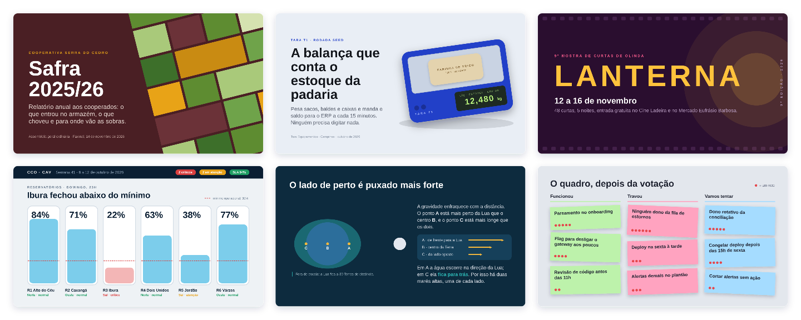
</p>

<p align="center">
  <sub>Um slide de cada deck da <a href="#galeria">galeria</a>. Todas as imagens deste README são PNGs que a própria engine desenhou com o mesmo layout do <code>.pptx</code>, a partir de <a href="examples/gallery/"><code>examples/gallery/</code></a>, <a href="examples/"><code>examples/</code></a> e <a href="docs/readme/decks/"><code>docs/readme/decks/</code></a>.</sub>
</p>

<p align="center">
  <a href="#galeria">Galeria</a> ·
  <a href="#em-30-segundos">Em 30 segundos</a> ·
  <a href="#o-que-você-escreve-é-css">CSS como props</a> ·
  <a href="#como-funciona-por-dentro">Por dentro</a> ·
  <a href="#diagnósticos-que-um-agente-entende">Diagnósticos</a> ·
  <a href="#responsivo-de-verdade">Responsivo</a> ·
  <a href="#gráficos-e-tabelas-nativos">Gráficos e tabelas</a> ·
  <a href="#cli">CLI</a> ·
  <a href="#api-programática">API</a> ·
  <a href="#depara-css--pptx">CSS → PPTX</a> ·
  <a href="#limitações">Limitações</a>
</p>

---

## Galeria

Seis decks em [`examples/gallery/`](examples/gallery/), cada um com paleta, tipografia e um elemento de assinatura próprios; o comentário no topo de cada arquivo diz o que foi escolhido e por quê. A fonte é só Arial: o caráter vem de escala, peso, `letterSpacing`, caixa alta e composição. Todos saem sem `warning` em 16:9 e 4:3, e em cada montagem o slide da direita é o 4:3.

### Safra 2025/26 · relatório anual de uma cooperativa

<p align="center"></p>

O mosaico da capa é um grid com `span` girado −14° atrás do título (`zIndex={-1}`); a chuva é um mapa de calor de 13 colunas de grid; as sobras são uma barra de `Box` com `flex` igual ao percentual. Também tem barras e tabela nativas. [`safra.tsx`](examples/gallery/safra.tsx)

### Tara T1 · pitch de hardware

<p align="center"></p>

O aparelho da capa é um `Box` girado com `boxShadow`; chapa, saco e visor giram junto. O visor LCD volta em todo número do pitch, a comparação é um grid com a coluna do produto em relevo, e em 4:3 a ficha técnica mostra 9 itens em vez de 6 (`ctx.pick`). [`tara.tsx`](examples/gallery/tara.tsx)

### Lanterna · programa de um festival de curtas

<p align="center">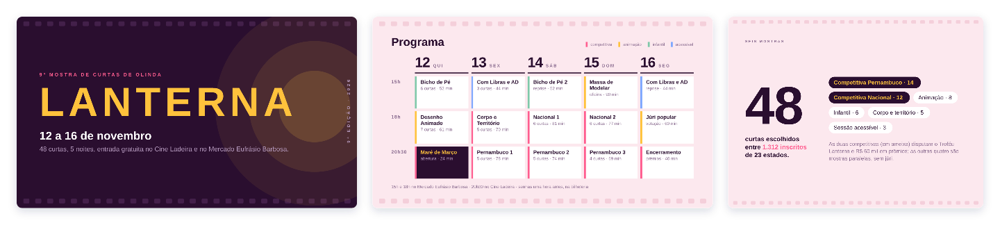</p>

Furos de película em `flex` no topo e na base de todo slide, halo do projetor em elipses com `opacity`, título com `letterSpacing` largo e um selo girado 90°. A grade tem 6 colunas de grid e uma borda esquerda por mostra; as mostras são pílulas com `flexWrap`. [`lanterna.tsx`](examples/gallery/lanterna.tsx)

### Reservatórios · painel semanal de saneamento

<p align="center"></p>

Cada reservatório é um `Box` com o nível em `height` percentual, a linha de mínimo é uma borda tracejada e o número fica por cima com `zIndex`. KPIs com sombra, linha e barras em células de grid, tabela zebrada; em 4:3 o cartão do SLA desce para baixo da tabela. [`reservatorios.tsx`](examples/gallery/reservatorios.tsx)

### Marés · aula de ciências

<p align="center"></p>

Terra, envelope de água e Lua são `Shape`s posicionados numa caixa de tamanho fixo; o envelope gira na direção da Lua. As setas de força são `Box` + "►", com o comprimento como dado. Passos com o número em `opacity`, maré de um dia em gráfico de linha. [`mares.tsx`](examples/gallery/mares.tsx)

### Retro do Q3 · retrospectiva de time

<p align="center">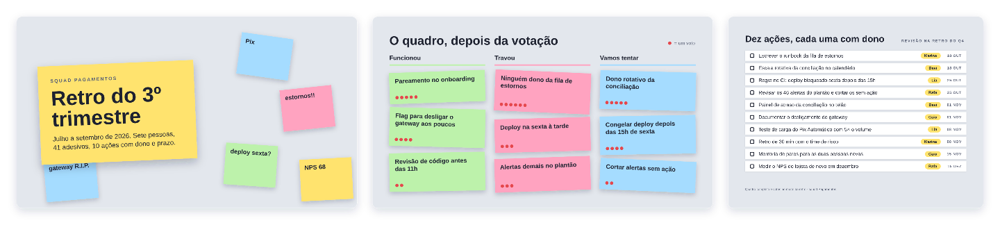</p>

Adesivos são `Box` levemente girados (`rotate`), com sombra; votos são elipses. Linha do tempo em `borderLeft` com pontos absolutos, citações com `<I>` e `<Span>`. As 10 ações usam `paginate`: viram dois slides em 16:9 e cabem num só em 4:3. [`retro.tsx`](examples/gallery/retro.tsx)

### Como um elemento é feito

O reservatório do painel, inteiro. O nível é um `Box` absoluto com `height` em %, a linha de mínimo é um `Box` de altura 0 com `borderTop` tracejada, e o número sobe com `zIndex` (posicionado, ele pinta depois do enchimento):

```tsx
<Box flex={1} border={`2px solid ${C.linha}`} borderRadius={14} backgroundColor={C.branco} padding={10}>
  {/* Enchimento e linha de mínimo são absolutos; o número sobe com zIndex para ficar por cima. */}
  <Box
    position="absolute" left={4} right={4} bottom={4} height={`${level - 2}%`}
    borderRadius={10} backgroundColor={status === 'critico' ? '#F3B6B6' : C.nivel}
  />
  <Box
    position="absolute" left={0} width="100%" bottom={`${MIN_LEVEL}%`} height={0}
    borderTop={`1.5px dashed ${C.critico}`}
  />
  <Text position="relative" zIndex={2} fontSize={{ base: 26, tall: 32 }} fontWeight="bold" nowrap>
    {`${level}%`}
  </Text>
</Box>
```

No `.pptx`, isso são três formas e uma caixa de texto editáveis. Exportado pelo Keynote, o deck mantém rotação, sombra e camadas; à esquerda o preview da engine, à direita o PNG do Keynote:

<p align="center">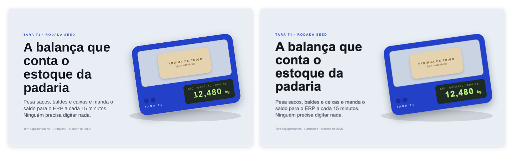</p>

Para construir um deck da galeria: `npx tsx src/cli.ts build examples/gallery/safra.tsx --size 16x9,4x3 --out dist/gallery`.

---

## Em 30 segundos

```sh
mkdir meu-deck && cd meu-deck
npm install pptsx
npx pptsx init                               # deck.tsx, tsconfig.json, pptsx.config.ts, assets/
npx pptsx build deck.tsx --size 16x9,4x3     # .pptx + PNG por slide + overview + diagnósticos
```

Um deck é uma função que devolve `<Deck>` com `<Slide>`s. Contêineres são `Box`, todo texto fica dentro de `Text`, e ninguém informa x/y.

<table>
<tr>
<td width="50%" valign="top">

```tsx
import { Box, Deck, Slide, Text, defineDeck } from 'pptsx';

export default defineDeck(() => (
  <Deck>
    <Slide padding={48} gap={20} color="#1B2A4A">
      <Text fontSize={40} fontWeight="bold">
        Olá, pptsx
      </Text>
      <Box flex={1} justifyContent="center" padding={32}
        backgroundColor="#F4F6FA" borderRadius={12}>
        <Text fontSize={28}>
          Sem coordenadas: o layout é CSS.
        </Text>
        <Text fontSize={16} color="#5B6680" marginTop={8}>
          Este Box ocupa o resto da altura (flex: 1).
        </Text>
      </Box>
    </Slide>
  </Deck>
));
```

</td>
<td width="50%" valign="top">
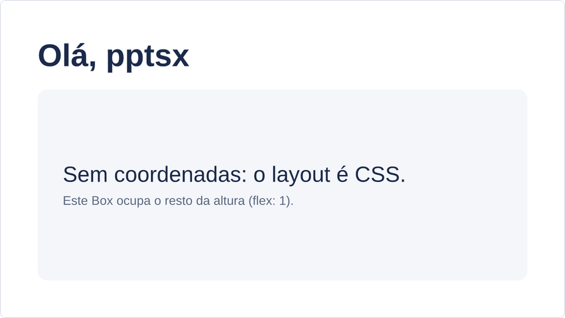
<br><br>
<sub><code>docs/readme/decks/a-minimo.tsx</code> → <code>a-minimo.16x9/slide-01.png</code></sub>
</td>
</tr>
</table>

O `build` grava, para cada tamanho pedido:

```
dist/
├── deck.16x9.pptx               ← formas, textos, gráficos e tabelas nativos (editáveis)
├── deck.16x9.overview.png       ← grade com todos os slides; selo vermelho = error, amarelo = warning
├── deck.16x9/slide-01.png …     ← um PNG por slide, desenhado com o mesmo layout do .pptx
├── deck.4x3.pptx / deck.4x3.overview.png / deck.4x3/…
└── deck.diagnostics.json        ← diagnósticos de todos os tamanhos
```

Requer Node ≥ 20 e um projeto ESM (`"type": "module"`); o `init` cuida disso. Durante a edição, `--watch` refaz tudo a cada arquivo salvo.

---

## O que você escreve é CSS

As props são **CSS em camelCase**. Números são pt (1 pol = 72 pt), `'12px'` também vale, `'50%'` é do pai, e os shorthands funcionam como no browser: `padding="8 16"`, `border="2px solid #ccc"`, `margin="0 auto"`, `flex={1}`. A única diferença intencional: **`Box` sem `display` é uma coluna flex** que estica os filhos (o que um slide quer quase sempre); `display="flex"` é row, como no CSS.

Cada exemplo abaixo é um deck de verdade em [`docs/readme/decks/`](docs/readme/decks/); a imagem é o `slide-01.png` que ele gera. Os trechos omitem os imports e o `defineDeck(() => <Deck>…</Deck>)` em volta.

Os conceitos (b) a (g) e (l) estão logo abaixo. Breakpoints e `paginate` estão em [Responsivo](#responsivo-de-verdade), `Chart` e `Table` em [Gráficos e tabelas](#gráficos-e-tabelas-nativos), e `fit="shrink"` e estouro em [Diagnósticos](#diagnósticos-que-um-agente-entende).

### (b) Grid de cartões

`display="grid"` com `repeat`, `minmax` e `fr`; os cartões esticam na célula. `minmax(0, 1fr)` mantém as colunas iguais mesmo com valores longos. A sombra sai como sombra nativa da forma.

```tsx
const kpis = [
  ['Receita (R$\u00A0mi)', '52,4', '▲ +14,2%'],
  ['Clientes ativos', '1.284', '▲ +86'],
  ['NPS', '62', '▼ −4 pts'],
  ['Churn', '1,8%', '▼ −0,6 pp'],
  ['Disponibilidade', '99,95%', 'meta 99,9%'],
  ['Áreas no catálogo', '11', '▲ +3'],
];

<Slide padding={36} gap={18} backgroundColor="#F4F6FA" color="#1B2A4A">
  <Text fontSize={26} fontWeight="bold">Indicadores</Text>
  <Box display="grid" gap={16} flex={1}
    gridTemplateColumns="repeat(3, minmax(0, 1fr))"
    gridAutoRows="minmax(0, 1fr)">
    {kpis.map(([label, value, delta]) => (
      <Box backgroundColor="#FFFFFF" borderRadius={10}
        padding={18} fontSize={14} color="#5B6680"
        justifyContent="center"
        boxShadow="0 3px 10px rgba(27,42,74,0.18)">
        <Text>{label}</Text>
        <Text fontSize={38} fontWeight="bold" color="#1B2A4A">
          {value}
        </Text>
        <Text fontWeight="bold" color="#2F6FED">{delta}</Text>
      </Box>
    ))}
  </Box>
</Slide>
```

<p align="center">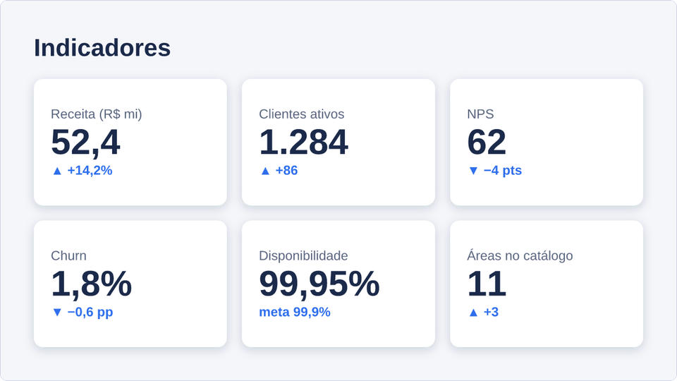</p>

### (c) Tags que quebram em linhas

Um `Text` com `padding`, fundo e `borderRadius` vira uma pílula da largura do conteúdo; numa row com `flexWrap="wrap"`, o que não cabe desce.

```tsx
const tags = ['TypeScript', 'TSX', 'flexbox', 'grid', 'margin: auto',
  'z-index', 'herança', 'bordas por lado', 'box-shadow', 'opacity',
  'rotate', 'breakpoints', 'paginação', 'gráficos nativos', 'tabelas',
  'diagnósticos', 'PPTX editável'];

<Slide padding={44} gap={22} color="#1B2A4A">
  <Text fontSize={28} fontWeight="bold">O que cabe num deck</Text>
  <Box display="flex" flexWrap="wrap" gap={12}>
    {tags.map((tag) => (
      <Text fontSize={20} padding="7 16" borderRadius={16}
        backgroundColor="#E8EEFC" color="#2F6FED">
        {tag}
      </Text>
    ))}
  </Box>
</Slide>
```

<p align="center">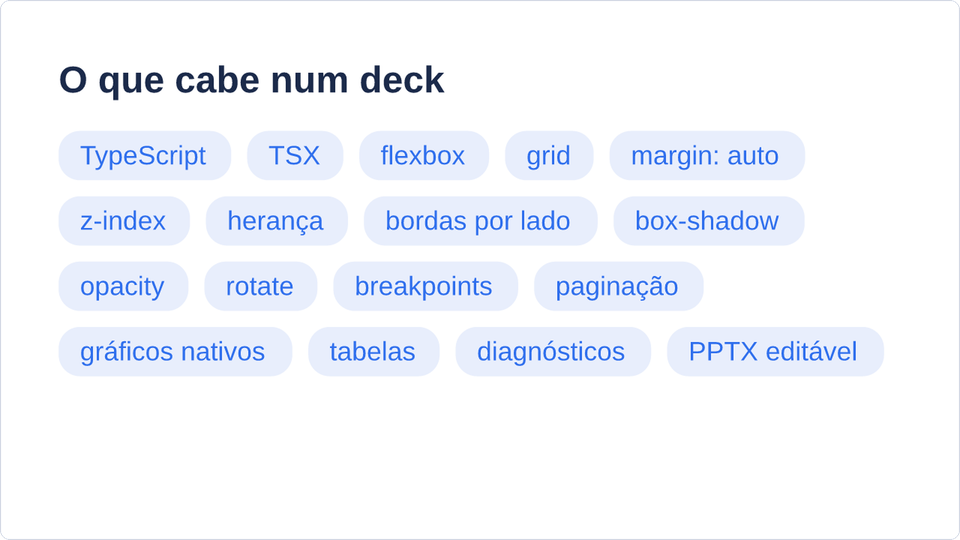</p>

### (d) Rodapé no fim, sem Box para empurrar

`marginTop="auto"` absorve a sobra da coluna: o rodapé vai para o fim do slide em qualquer tamanho.

```tsx
<Slide padding={44} gap={12} color="#1B2A4A">
  <Text fontSize={30} fontWeight="bold">Próximos passos</Text>
  <Text fontSize={20} color="#5B6680">
    Abrir o catálogo de dados para crédito e logística no Q4.
  </Text>
  <Text fontSize={12} color="#5B6680" marginTop="auto"
    paddingTop={10} borderTop="1px solid #CCD3E0">
    Fonte: plataforma de dados, setembro de 2026.
  </Text>
</Slide>
```

<p align="center"></p>

### (e) Herança de texto

`fontFamily`, `fontSize`, `fontWeight`, `fontStyle`, `color`, `lineHeight`, `textAlign`, `letterSpacing` e `textTransform` declarados num `Slide` ou `Box` descem para os `Text` de dentro. O cartão diz a cor e o alinhamento uma vez; cada texto diz só o que muda.

```tsx
<Slide padding={40} gap={20} color="#1B2A4A" fontSize={16}>
  <Text fontSize={28} fontWeight="bold">Herança de texto</Text>
  <Box display="flex" gap={20} flex={1} textAlign="center">
    <Box flex={1} justifyContent="center" borderRadius={12}
      backgroundColor="#1B2A4A" color="#FFFFFF">
      <Text letterSpacing={2} textTransform="uppercase">receita</Text>
      <Text fontSize={56} fontWeight="bold">52,4</Text>
      <Text color="#9DB8F5">R$ mi no Q3</Text>
    </Box>
    <Box flex={1} justifyContent="center" borderRadius={12}
      backgroundColor="#E8EEFC" color="#2F6FED">
      <Text letterSpacing={2} textTransform="uppercase">clientes</Text>
      <Text fontSize={56} fontWeight="bold">1.284</Text>
      <Text color="#5B6680">ativos no mês</Text>
    </Box>
  </Box>
  <Text color="#5B6680">
    Cor, tamanho e alinhamento são declarados uma vez no cartão.
  </Text>
</Slide>
```

<p align="center">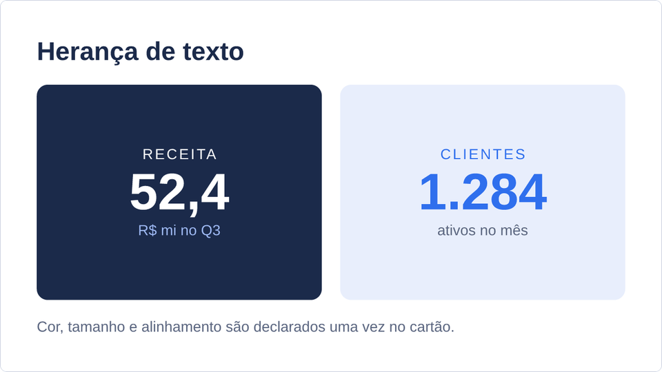</p>

### (f) Camadas: `zIndex`, `rotate`, `opacity`

A ordem de pintura é a do CSS: nós posicionados, com `zIndex`, `opacity` ou `rotate`, sobem de camada. `zIndex={-1}` põe a decoração atrás do conteúdo; sem ele, ela pintaria por cima. Rotação e opacidade valem para o nó e os filhos e saem como atributos nativos das formas.

```tsx
<Slide padding={56} justifyContent="center"
  backgroundColor="#1B2A4A" color="#FFFFFF">
  <Shape kind="ellipse" position="absolute" zIndex={-1}
    right={-110} top={-130} width={400} height={400}
    backgroundColor="#101B33" />
  <Box position="absolute" right={96} top={84}
    width={130} height={130} borderRadius={16}
    backgroundColor="#2F6FED" opacity={0.45} rotate={18} />
  <Box position="absolute" left={0} bottom={0}
    width="100%" height={8} backgroundColor="#2F6FED" />
  <Text fontSize={48} fontWeight="bold">Nova fase</Text>
  <Text fontSize={20} color="#C9D6F5" marginTop={8}>
    Decoração atrás, conteúdo na frente.
  </Text>
</Slide>
```

<p align="center">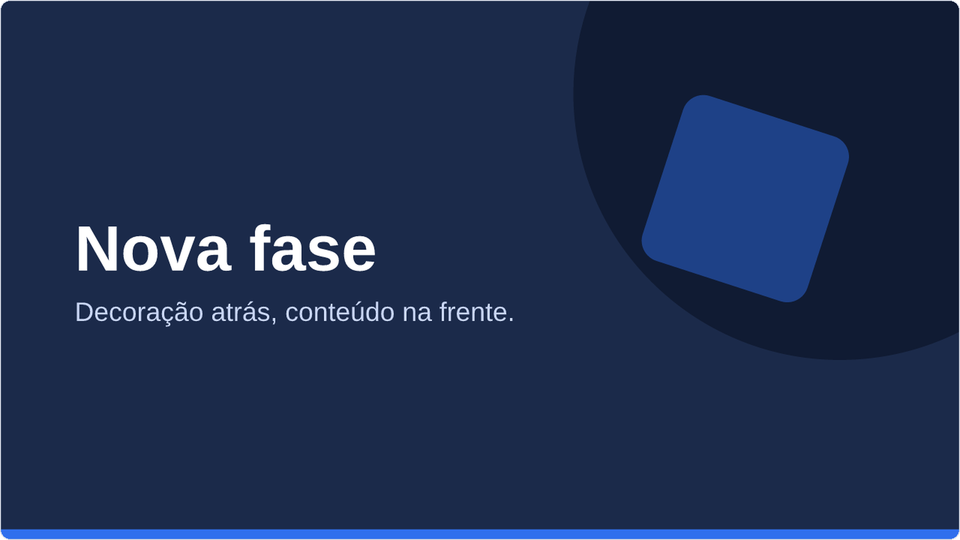</p>

### (g) Bordas por lado

Barra de título, faixa de status e divisória são **bordas**, não nós extras. Sólida, tracejada ou pontilhada; a borda ocupa espaço e o traço fica dentro da caixa, como no CSS.

```tsx
<Slide padding={44} gap={24} color="#1B2A4A" fontSize={20}>
  <Text fontSize={30} fontWeight="bold"
    borderLeft="6px solid #2F6FED" paddingLeft={14}>
    Bordas por lado
  </Text>
  <Text color="#5B6680" paddingBottom={14}
    borderBottom="1px solid #CCD3E0">
    A barra do título é a borda esquerda do próprio Text;
    a divisória abaixo, a borda de baixo deste.
  </Text>
  <Box display="grid" gap={18}
    gridTemplateColumns="repeat(3, minmax(0, 1fr))">
    <Box padding={18} backgroundColor="#F4F6FA"
      borderTop="5px solid #1E9E6A">
      <Text>borderTop como faixa de status</Text>
    </Box>
    <Box padding={18} borderBottom="2px dashed #5B6680">
      <Text>borderBottom tracejada como divisória</Text>
    </Box>
    <Box padding={18} borderRadius={10}
      border="2px dotted #F59E0B">
      <Text>border pontilhada, com raio</Text>
    </Box>
  </Box>
</Slide>
```

<p align="center">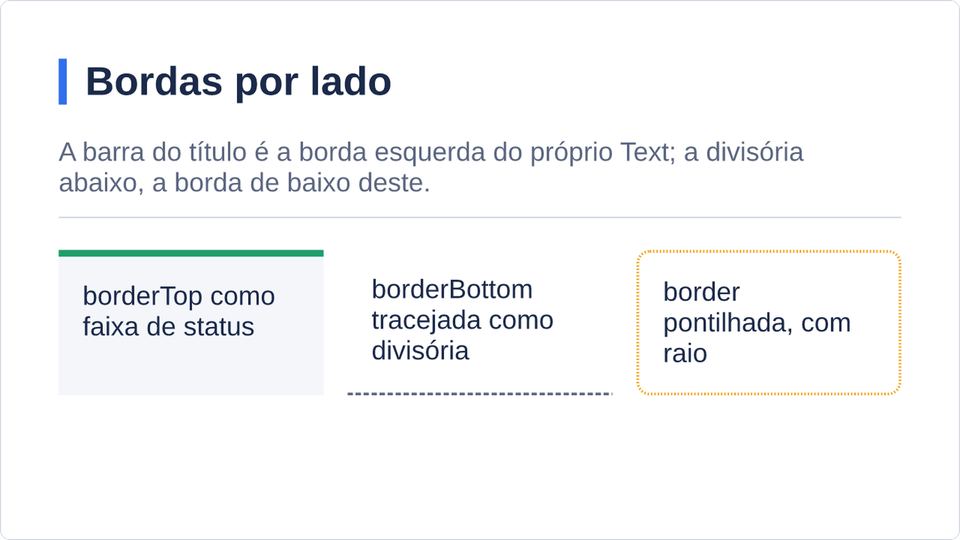</p>

### (l) Rich text

`Span` muda peso, itálico, cor e decoração de um trecho; `B` e `I` são atalhos. A medição soma cada trecho com a face certa (regular, negrito, itálico) e o `.pptx` sai com um run por trecho. `&nbsp;` cola número e unidade.

```tsx
<Slide padding={56} gap={24} justifyContent="center" color="#1B2A4A">
  <Text fontSize={30} lineHeight={1.3}>
    A receita <B>subiu 14%</B> em <Span color="#2F6FED" fontStyle="italic">todas</Span> as
    regiões, <I>exceto</I> no Norte, e fechou o trimestre em
    R$&nbsp;52,4&nbsp;mi (<Span textDecoration="line-through" color="#5B6680">meta antiga</Span>{' '}
    <Span color="#1E9E6A" fontWeight="bold">meta batida</Span>).
  </Text>
  <Text fontSize={14} color="#5B6680">
    Um run por trecho no .pptx; o NBSP mantém “R$ 52,4 mi” numa linha só.
  </Text>
</Slide>
```

<p align="center">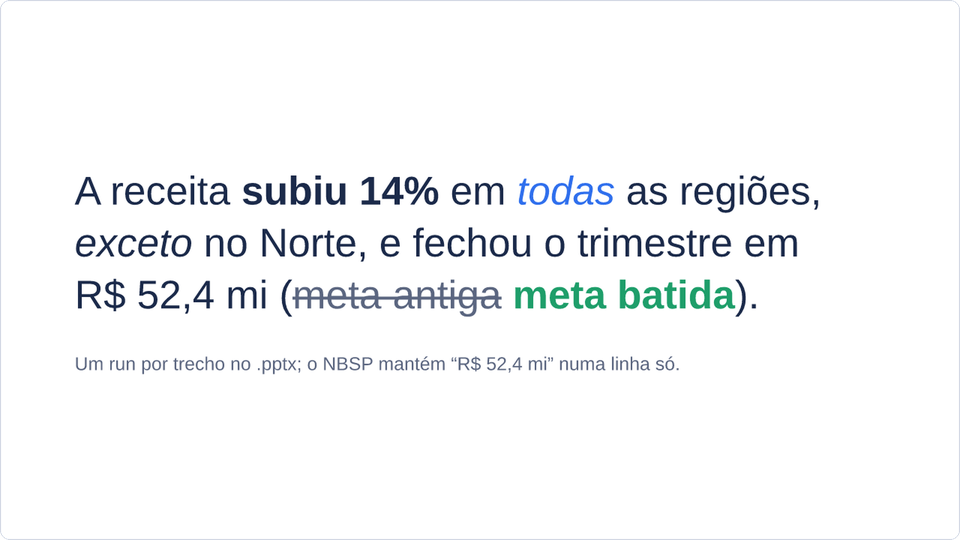</p>

### Resumo das props

| tema | props | nota |
|---|---|---|
| Display | `display="flex" \| "block" \| "grid" \| "none"` | `Box` sem `display` = coluna flex; `none` tira o nó do layout e do PPTX |
| Caixa | `width`, `height`, `min*`/`max*`, `aspectRatio`, `margin` (com `auto`), `padding`, `border`, `borderTop/Right/Bottom/Left`, `borderRadius` | sempre `border-box`; vale também em `Text`, `Image` e `Table` |
| Flex | `flexDirection`, `flexWrap`, `gap`/`rowGap`/`columnGap`, `justifyContent`, `alignItems` (inclusive `baseline`), `alignSelf`, `flex`, `flexGrow`, `flexShrink`, `flexBasis`, `order` | valores do CSS (`'space-between'`, `'flex-end'`…) |
| Grid | `gridTemplateColumns/Rows` (pt, `%`, `fr`, `auto`, `min-content`, `max-content`, `minmax()`, `repeat(n, …)`), `gridAutoRows/Columns`; no item `gridColumn="span 2"`, `"2 / -1"`, `gridRow`, `justifySelf`, `alignSelf` | auto-placement por linhas; itens esticam na célula |
| Posição | `position="relative" \| "absolute"`, `top/right/bottom/left/inset`, `zIndex` | absoluto mede pela borda do pai; é para decoração |
| Texto (herda) | `fontFamily`, `fontSize`, `fontWeight`, `fontStyle`, `color`, `lineHeight`, `textAlign`, `letterSpacing`, `textTransform` | `lineHeight` como no CSS: `'normal'` ou múltiplo do `fontSize` |
| Pintura | `backgroundColor`, `backgroundImage="url(…)"`, `boxShadow` (uma, externa), `opacity`, `rotate` / `transform="rotate() translate()"`, `textDecoration` | o que não tem de/para vira [`css-not-emitted`](#depara-css--pptx) |
| Responsivo | qualquer prop aceita `{ base, tall?, wide?, '4x3'?, … }` | [Responsivo de verdade](#responsivo-de-verdade) |
| Engine | `fit`, `minSize`, `maxLines`, `nowrap` (Text); `paginate` (Box) | não existem no CSS; controlam o ajuste |

A referência completa, com cada prop por primitiva (`Deck`, `Slide`, `Box`, `Text`, `Span`/`B`/`I`, `Image`, `Shape`, `Chart`, `Table`), está no [guia do agente](docs/AGENT_GUIDE.md#3-primitivas-e-props-css).

---

## Como funciona por dentro

<p align="center">
  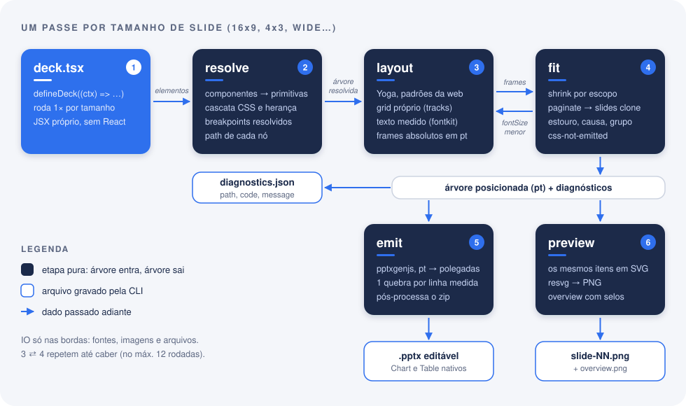
</p>

`render(deck, { sizes })` repete o mesmo caminho para cada tamanho de slide. Cada etapa é uma função pura (árvore entra, árvore sai); ler fontes, imagens e arquivos fica só nas bordas.

1. **TSX.** O runtime JSX é próprio, sem React: `jsx()` só cria objetos congelados. `defineDeck((ctx) => …)` roda uma vez por tamanho e recebe `ctx` com `name`, `width`, `height` (pt), `aspect`, `scale` e `pick`.
2. **resolve.** Chama os componentes até sobrarem primitivas e valida a estrutura (texto só dentro de `Text`, só `Slide` no `Deck`). Escolhe o valor de cada prop responsiva, expande shorthands (`padding="8 16"`, `border="2px solid …"`, `flex={1}`), aplica a cascata (longhand vence shorthand, `style` vence as props) e a herança de texto, e dá a cada nó o seu `path` (`ContentLayout > Box > Bullets > Box[2] > Text`).
3. **layout.** O [Yoga](https://yogalayout.dev) (flexbox em WASM) roda com os padrões da web e `border-box`, em frações de pt sem arredondar para pixel. O `display: grid` é um motor próprio: dimensiona os tracks pelo algoritmo do CSS Grid (`fr`, `minmax`, `min-content`, `span`, linhas negativas) e posiciona cada item na sua célula. O texto entra como folha medida pelo [fontkit](https://github.com/foliojs/fontkit), com as métricas reais da fonte (largura dos glifos, kerning, ascender/descender, `letterSpacing`). Sai uma árvore com o frame absoluto de cada nó, em pt.
4. **fit.** Detecta o que não cabe (texto, caixa, célula de grid, linha de wrap, nó fora do slide) e ajusta: encolhe a fonte por escopo, corta com reticências ou pagina, refazendo o layout a cada tentativa. No fim, gera os diagnósticos, aponta a causa (`causedBy`) e agrupa irmãos com o mesmo problema.
5. **emit.** O [pptxgenjs](https://gitbrent.github.io/PptxGenJS/) converte pt → polegadas e emite formas, textos, imagens, gráficos e tabelas nativos. Depois a engine pós-processa o zip: corrige o XML que o PowerPoint pediria para "reparar", conserta a planilha embutida dos gráficos (sem isso o Keynote descarta o gráfico) e renumera as partes para a saída ser determinística.
6. **preview.** Os mesmos itens posicionados viram SVG, que o [resvg](https://github.com/yisibl/resvg-js) rasteriza com as mesmas fontes da medição. O overview junta as miniaturas e põe um selo em cada slide com `error` ou `warning`.

### O loop de ajuste

Texto que não cabe dispara uma busca **por escopo**: os textos da mesma instância de componente (os itens de um `Bullets`, label e valor de um `KpiCard`) encolhem juntos, para manter a hierarquia tipográfica; uma instância vizinha só encolhe se ela mesma estourar. Cada escopo faz uma busca binária do menor passo de fonte que resolve, e cada tentativa é um layout completo.

<p align="center">
  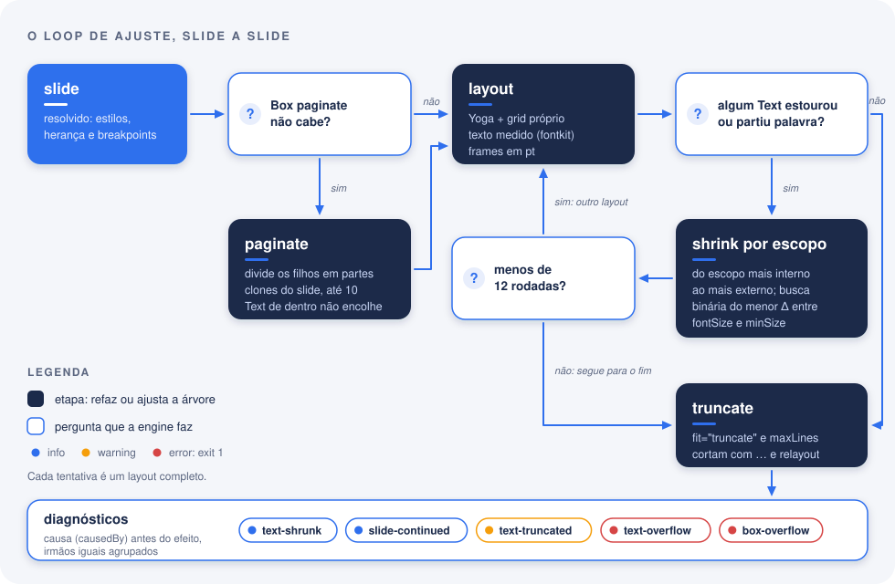
</p>

### Por que as quebras de linha são forçadas

PowerPoint e Keynote quebram linhas cada um do seu jeito. Para o `.pptx` sair igual ao PNG, cada linha que a engine mediu vira uma quebra manual dentro do parágrafo (`lineBreaks: 'forced'`, o padrão). O texto continua nativo e editável; só as quebras ficam fixas. A medição foi calibrada exportando pelo Keynote: **34 de 34** amostras de texto simples e **30 de 30** de rich text com as mesmas linhas da engine. Com `--line-breaks auto` o aplicativo requebra (mais editável), e no Keynote 10 das 34 amostras quebram em outra palavra; nenhuma vaza do frame, porque a engine quebra com 3 % de folga (`textSafety: 0.97`).

### Quanto custou trocar para CSS

A API em CSS nasceu de uma prova de conceito medida contra a engine anterior ([relatório](docs/work/reports/POC-css.md)):

| medida | resultado |
|---|---|
| nós no deck da demo | 92 → 68 (**−26 %**); "Box só para empurrar": 15 → 3 |
| tempo de build da demo (3 tamanhos, com preview) | **1,02×** a engine anterior |
| motor de grid contra o Chrome, 48 casos (grid, flex, block, caixa) | 47/48 em ±1 pt com a métrica da engine; 48/48 com a altura de linha do browser |
| posições e diagnósticos dos exemplos | iguais à engine anterior: frames ±1 pt, mesmos códigos, paths e mensagens (depois, as colunas sem `width` da `Table` passaram a seguir o conteúdo, de propósito) |

---

## Diagnósticos que um agente entende

Todo problema vira um diagnóstico com `path` até o nó e uma `message` que diz **o que fazer**. Com `--debug`, cada Box/Text/Image/Chart/Table ganha um contorno vermelho tracejado (no `.pptx` e no PNG), e o texto que estoura fica vermelho no PNG.

```tsx
<Slide padding={40} gap={16} color="#1B2A4A">
  <Text fontSize={26} fontWeight="bold">Resumo executivo</Text>
  <Box height={110} padding={16} backgroundColor="#F4F6FA">
    <Text fontSize={20} fit="error">
      A plataforma migrou os pipelines legados antes do prazo, reduziu o custo
      por consulta em 22% com o novo cache e abriu o catálogo para três áreas
      novas, mantendo a disponibilidade acima da meta em todos os meses.
    </Text>
  </Box>
</Slide>
```

<p align="center">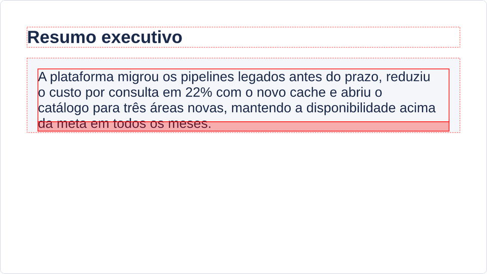</p>

```
$ npx pptsx build n-estouro.tsx --debug

Diagnósticos: 1 error, 0 warning, 0 info
  ✖ [16x9 · slide 1] text-overflow em Slide > Box > Text
    Texto estourou 17.9% (14 pt) da altura disponível em 20 pt (fit="error" não ajusta); reduza o conteúdo, aumente a área ou troque para fit="shrink" ou fit="truncate".
```

O exit code é `1` (há um `error`). Com `--json`, o stdout tem só JSON, pronto para um agente ler:

```json
{
  "files": ["dist/n-estouro.16x9.pptx", "…"],
  "diagnostics": [
    {
      "size": "16x9",
      "slide": 1,
      "severity": "error",
      "code": "text-overflow",
      "path": "Slide > Box > Text",
      "message": "Texto estourou 17.9% (14 pt) da altura disponível em 20 pt (fit=\"error\" não ajusta); reduza o conteúdo, aumente a área ou troque para fit=\"shrink\" ou fit=\"truncate\".",
      "data": { "overflowPt": 14, "overflowPct": 17.9 }
    }
  ]
}
```

### O overview com selos

`<deck>.<tamanho>.overview.png` mostra o deck inteiro numa imagem. Selo vermelho = o slide tem `error`; amarelo = `warning`. Abaixo, o overview de [`examples/overflow.tsx`](examples/overflow.tsx), um deck lotado de propósito:

<p align="center">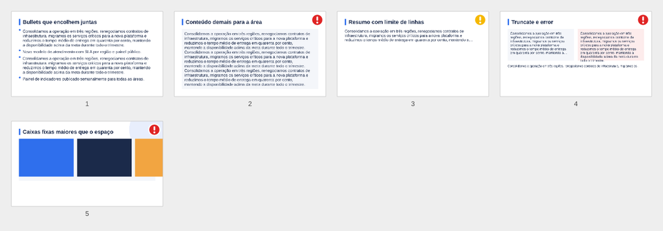</p>

### O texto encolhe só onde precisa

`fit="shrink"` é o padrão: a engine procura o **maior** `fontSize` entre o do autor e `minSize` em que o texto cabe. Abaixo, o mesmo componente em duas larguras: na caixa larga o texto fica em 22 pt; na estreita desce para 17 pt, e só ela recebe o diagnóstico (contornos do `--debug`).

```tsx
// Cada instância de componente é um escopo de shrink: só encolhe quem não coube.
const Quote = ({ width }: { width: number }) => (
  <Box width={width} height={150} padding={16} backgroundColor="#F4F6FA">
    <Text fontSize={22} minSize={12}>
      O catálogo de dados reduziu pela metade o tempo para achar uma tabela confiável.
    </Text>
  </Box>
);

<Slide padding={40} gap={20} color="#1B2A4A">
  <Text fontSize={26} fontWeight="bold">fit="shrink" (padrão)</Text>
  <Box display="flex" gap={24} alignItems="flex-start">
    <Quote width={400} />
    <Quote width={180} />
  </Box>
</Slide>
```

<p align="center">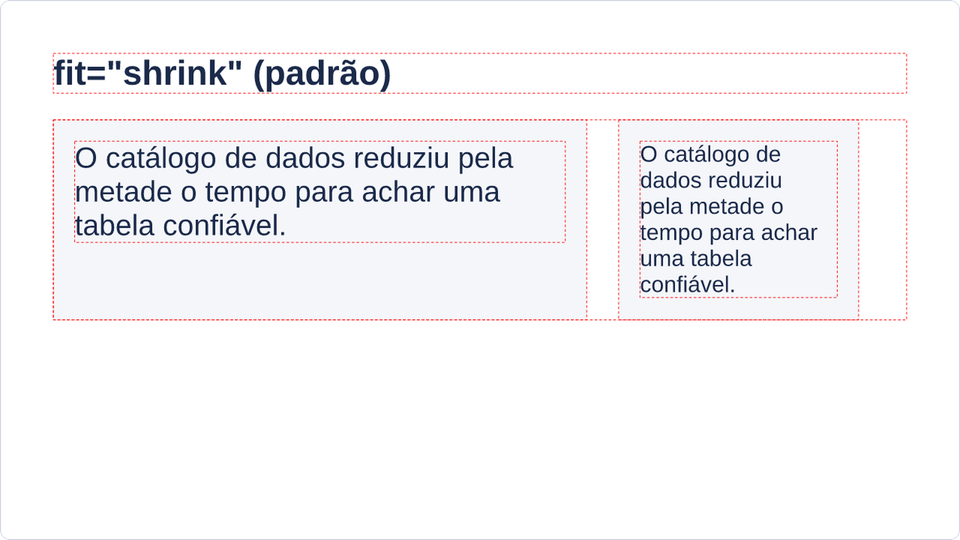</p>

```
  • [16x9 · slide 1] text-shrunk em Slide > Box > Quote[1] > Text
    Texto reduzido de 22 pt para 17 pt para caber na área. Se a redução incomodar, encurte o conteúdo ou aumente a área.
```

### O que vem em cada diagnóstico

- `size`, `slide` (a partir de 1, no arquivo gerado), `severity` (`error` corrige, `warning` é aceitável se intencional, `info` é só aviso), `code`, `path`, `message` e `data` opcional (`overflowPt`, `fromSize`/`toSize`, `axis`…).
- **Causa antes do efeito.** `data.causedBy` marca o estouro que é consequência de outro nó; a mensagem termina com "corrija `<causa>` primeiro", e no terminal os derivados aparecem com `↳` sob a causa.
- **Grupos.** Irmãos com o mesmo problema viram um item só: `Box[0..7]`, com `data.count` e `data.paths`. Corrija uma vez, no `.map` ou no componente.
- **Grid e wrap falam a língua do layout:** "o item ocupa 212 × 98.6 pt, mas a célula do grid tem 212 × 60 pt"; "as linhas do wrap ocupam 64.2 pt na vertical".
- **Nada some em silêncio.** CSS sem equivalente no PPTX vira `css-not-emitted` com a propriedade, o valor e o motivo:

```
  ▲ [16x9 · slide 1] css-not-emitted em Slide > Box
    A propriedade CSS overflow: hidden não sai no PPTX: o PPTX não recorta formas; os filhos saem inteiros. O preview também não a desenha; remova-a ou troque por uma suportada (ver docs/AGENT_GUIDE.md).
```

<details>
<summary><b>Todos os códigos de diagnóstico</b> (13)</summary>

| code | severity | quando |
|---|---|---|
| `text-overflow` | error | o texto não coube nem em `minSize` (ou `fit="error"`, ou área 0 pt) |
| `box-overflow` | error | filhos em fluxo, linhas do wrap ou item de grid maiores que a área |
| `out-of-slide` | error | nó em fluxo fora do slide |
| `table-overflow` | error | a tabela não cabe nem no mínimo; diz quantas linhas cabem |
| `font-missing` | error | família não registrada ou não achada no sistema |
| `text-word-broken` | warning | palavra mais larga que a linha, partida por caractere |
| `text-truncated` | warning | `fit="truncate"`/`maxLines` cortou com `…` |
| `text-illegible` | warning | o shrink desceu abaixo de 10 pt (só com `minSize` explícito) |
| `css-not-emitted` | warning | propriedade CSS sem de/para no PPTX |
| `font-not-embeddable` | warning | com `--embed-fonts`, uma face que não pode ser embutida |
| `text-shrunk` | info | o texto encolheu e coube |
| `slide-continued` | info | um `Box paginate` virou N slides |
| `image-upscaled` | info | imagem ampliada abaixo de 96 dpi |

</details>

Mensagens reais, correções típicas e o checklist de correção estão no [guia, §8](docs/AGENT_GUIDE.md#8-diagnósticos).

---

## Responsivo de verdade

### Breakpoints

16:9 e 4:3 têm a **mesma largura** (720 pt); o 4:3 é mais alto. Qualquer prop aceita um valor por breakpoint, sem `if` sobre o tamanho:

| chave | ativa quando | 16x9 | 16x10 | 4x3 | wide |
|---|---|:-:|:-:|:-:|:-:|
| `tall` | proporção < 1,5 (muda a **estrutura**) | | ✓ | ✓ | |
| `wide` | escala > 1,2 (muda a **tipografia**) | | | | ✓ |
| nome exato (`'4x3'`, `'custom-10x7.5'`) | o tamanho atual tem esse nome | ✓ | ✓ | ✓ | ✓ |

Precedência: nome exato > `wide` > `tall` > `base`. O deck abaixo é **um arquivo só**, construído com `--size 16x9,4x3`:

```tsx
const areas = ['Varejo', 'Crédito', 'Seguros', 'Logística', 'Marketing', 'Jurídico'];

<Slide padding={36} gap={16} backgroundColor="#F4F6FA" color="#1B2A4A">
  <Text fontSize={26} fontWeight="bold">Um arquivo, dois formatos</Text>
  <Box display="grid" gap={16} flex={1}
    gridAutoRows="minmax(0, 1fr)"
    gridTemplateColumns={{
      base: 'repeat(3, minmax(0, 1fr))',
      tall: 'repeat(2, minmax(0, 1fr))',
    }}>
    {areas.map((area) => (
      <Box backgroundColor="#FFFFFF" padding={16}
        justifyContent="center" borderLeft="4px solid #2F6FED">
        <Text fontSize={20} fontWeight="bold">{area}</Text>
      </Box>
    ))}
  </Box>
  <Text fontSize={13} color="#5B6680"
    display={{ base: 'none', tall: 'flex' }}>
    Esta nota só existe em 4:3, onde sobra altura.
  </Text>
</Slide>
```

<p align="center">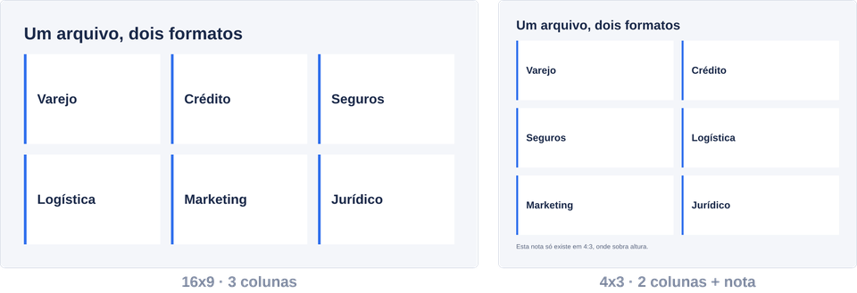</p>

Para o que não é prop de primitiva (quantos itens mostrar, um título mais curto), `ctx.pick` resolve com a mesma regra:

```tsx
items.slice(0, ctx.pick({ base: 4, tall: 6 }))
title={ctx.pick({ base: 'Receita', wide: 'Receita recorrente mensal' })}
```

Na [`examples/demo.tsx`](examples/demo.tsx), o componente `TwoColumn` recebe `stacked={{ base: false, tall: true }}`: lado a lado em 16:9, empilhado em 4:3, com o gráfico ocupando a altura que sobra.

<p align="center"></p>

### Paginação

`<Box paginate>` divide os filhos em fluxo entre slides quando não cabem, em vez de encolher a fonte. O resto continua num **clone do slide** (mesmo título, fundo, decoração, rodapé e notas). Em 4:3, com mais altura, os mesmos 9 itens cabem num slide só:

```tsx
const items = [
  'Migrar os três pipelines legados de faturamento.',
  'Revisar o contrato de armazenamento (+38% de volume).',
  'Treinar crédito e logística no catálogo de dados.',
  'Definir donos para 42 conjuntos sem responsável.',
  'Automatizar o alerta de atraso das cargas noturnas.',
  'Publicar o SLA de disponibilidade por domínio.',
  'Encerrar as planilhas locais dos relatórios oficiais.',
  'Padronizar colunas de data e moeda entre as áreas.',
  'Arquivar painéis que ninguém abre há 90 dias.',
];

<Slide padding={40} gap={18} color="#1B2A4A">
  <Text fontSize={28} fontWeight="bold"
    borderLeft="6px solid #2F6FED" paddingLeft={14}>
    Pontos de atenção para o Q4
  </Text>
  <Box paginate flex={1} gap={14}>
    {items.map((item) => (
      <Box display="flex" gap={12} alignItems="flex-start">
        <Shape kind="ellipse" width={9} height={9} flexShrink={0}
          marginTop={8} backgroundColor="#2F6FED" />
        <Text fontSize={22} flex={1}>{item}</Text>
      </Box>
    ))}
  </Box>
  <Text fontSize={11} color="#5B6680" marginTop="auto">
    Título e rodapé se repetem em cada parte.
  </Text>
</Slide>
```

<p align="center">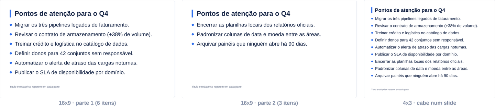</p>

```
  • [16x9 · slide 1] slide-continued em Slide > Box
    Slide 1 do autor virou 2 slides (6 de 9 itens no 1º, 3 no 2º). Para caber em menos slides, reduza o fontSize dos itens ou o conteúdo.
```

Os paths dos itens não mudam entre as partes, e os diagnósticos dos slides seguintes trazem `data.sourceSlide` (o índice no deck do autor).

---

## Gráficos e tabelas nativos

`<Chart>` e `<Table>` saem como objetos nativos do PowerPoint/Keynote: quem recebe o `.pptx` edita os dados, não uma imagem. O gráfico não tem tamanho próprio: estica numa célula de grid, com `flex={1}` ou com `width`/`height`.

```tsx
const quarters = ['Q4', 'Q1', 'Q2', 'Q3'];

<Slide padding={36} gap={16} color="#1B2A4A">
  <Text fontSize={26} fontWeight="bold">Gráficos nativos e editáveis</Text>
  <Box display="grid" gap={16} flex={1}
    gridTemplateColumns="repeat(3, minmax(0, 1fr))">
    <Chart kind="bar" title="Receita (R$ mi)" showValues
      colors={['#2F6FED']}
      data={{ categories: quarters,
        series: [{ name: 'Receita', values: [38.2, 41.5, 45.9, 52.4] }] }} />
    <Chart kind="line" title="Latência p95 (ms)"
      colors={['#2F6FED', '#D64545']}
      data={{ categories: quarters, series: [
        { name: 'Com cache', values: [420, 310, 260, 220] },
        { name: 'Sem cache', values: [610, 600, 650, 630] }] }} />
    <Chart kind="pie" title="Receita nova"
      colors={['#2F6FED', '#1E9E6A', '#F59E0B', '#5B6680']}
      data={{ categories: ['Varejo', 'Crédito', 'Seguros', 'Outros'],
        series: [{ name: 'Q3', values: [4.0, 0.6, 0.7, 1.2] }] }} />
  </Box>
</Slide>
```

<p align="center">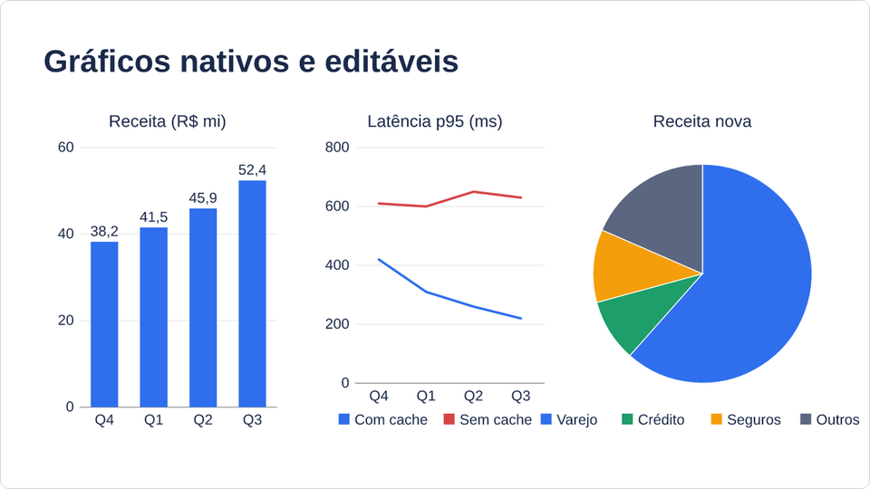</p>

Os três tipos ocupando o corpo inteiro do slide ([`examples/charts.tsx`](examples/charts.tsx)):

<p align="center">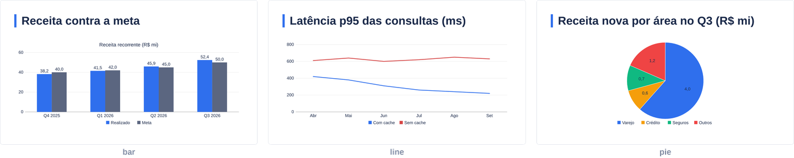</p>

### Tabela

A `Table` é medida pela engine: colunas com `width` ficam fixas e as outras seguem o conteúdo (como `table-layout: auto`); a altura é a soma das linhas. Ela encolhe como uma unidade junto com os textos do slide; se nem assim couber, vem `table-overflow` dizendo quantas linhas cabem.

```tsx
<Slide padding={40} gap={20} color="#1B2A4A">
  <Text fontSize={28} fontWeight="bold">Receita por área</Text>
  <Table
    fontSize={15}
    header={{ fill: '#1B2A4A', color: '#FFFFFF' }}
    stripe="#F4F6FA"
    border="#CCD3E0"
    cellPadding={6}
    columns={[
      { header: 'Área', width: '40%' },
      { header: 'Q2 (R$\u00A0mi)', align: 'right' },
      { header: 'Q3 (R$\u00A0mi)', align: 'right' },
      { header: 'Δ', align: 'right' },
    ]}
    rows={[
      ['Varejo', '18,6', '22,6', '+21,5%'],
      ['Crédito', '9,8', '10,4', '+6,1%'],
      ['Seguros', '6,1', '6,8', '+11,5%'],
      ['Logística', '4,7', '5,0', '+6,4%'],
      ['Marketing', '3,9', '4,2', '+7,7%'],
    ]}
  />
</Slide>
```

<p align="center">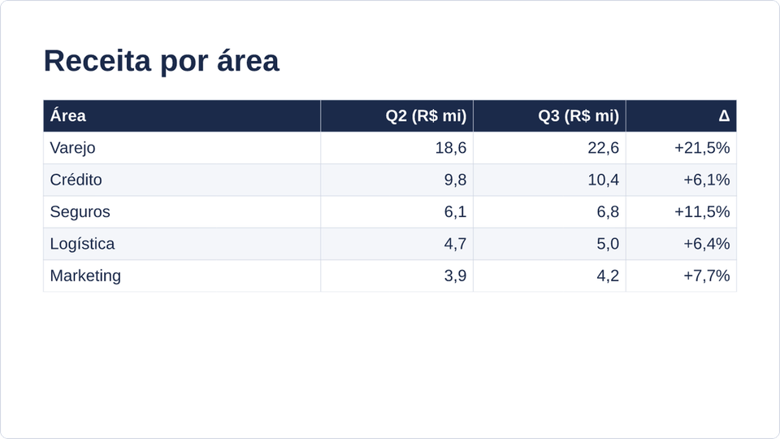</p>

---

## Texto: pesos, notas, links e continuação

- **Pesos de verdade:** `fontWeight={300}`, `600`… escolhem a face registrada mais próxima (regra do CSS); fora de 400/700 o `.pptx` leva o nome da face (`Inter SemiBold`), que o PowerPoint e o Keynote usam quando a fonte está instalada ou embutida. Peso sem face avisa (`font-weight-fallback`).
- **`<Sup>`/`<Sub>`** para m², CO₂ e notas; **`fontSize`/`fontFamily` por `Span`**, com a linha crescendo para caber.
- **`href`** em texto, trecho, imagem e caixa: URL ou `slide:N` (o número do seu slide; a engine corrige depois da paginação).
- **`<Text paginate>`**: texto corrido que não cabe continua no slide seguinte, cortando em fim de parágrafo e sem deixar linhas órfãs.
- **`<Deck footer>` + `<SlideNumber format="n / total">`**: rodapé em todo slide com o número como campo nativo.

```tsx
<Deck footer={<Box display="flex" justifyContent="space-between" padding="0 56 14" fontSize={10}>
  <Text>Cooperativa Safra · Relatório anual 2026</Text>
  <SlideNumber format="n / total" fontWeight={600} />
</Box>}>
  <Slide padding="32 56 36" gap={14} fontFamily="Inter">
    <Text fontSize={24} fontWeight={600}>O ano em resumo</Text>
    <Text paginate flex={1} fontSize={16} lineHeight={1.45}>
      <Span fontWeight={600}>Contexto.</Span> Em 2026 a cooperativa atendeu 4.800 famílias…<Sup href="slide:3">1</Sup>
      …
    </Text>
  </Slide>
</Deck>
```

[`examples/texto/relatorio.tsx`](examples/texto/relatorio.tsx): 3 slides do autor viram 6 (o corpo continua em 4 partes), notas em sobrescrito com link para o slide de notas, Inter 300/600 e "n / 6" em todos:

<p align="center">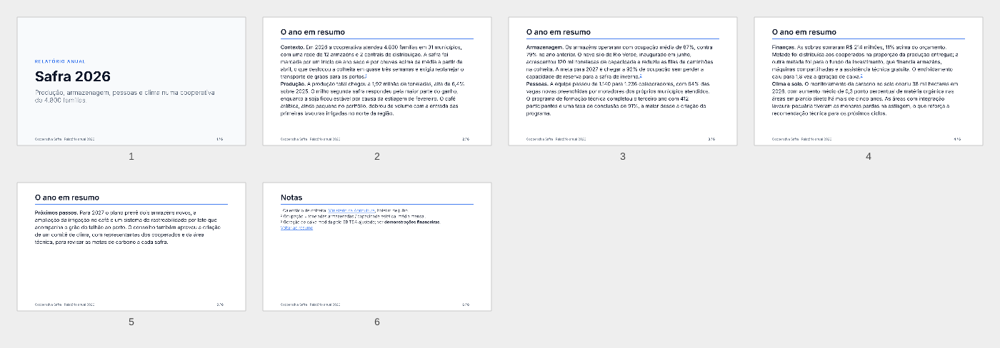</p>

[`examples/texto/pesos.tsx`](examples/texto/pesos.tsx), com a Inter em 300/400/600/700 (OFL, em `fonts/inter/`):

<p align="center">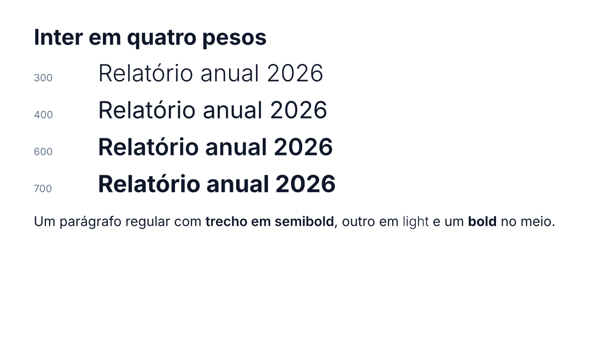</p>

---

## Diagramas

Fluxogramas, arquiteturas e linhas do tempo saem **nativos**: cada nó, seta e ícone é um objeto que dá para mover, recolorir e editar no PowerPoint/Keynote.

- `<Box shape="diamond">` dá à caixa a geometria de uma das 24 formas curadas (losango, hexágono, paralelogramo, pílula, cilindro…); o texto continua dentro do padding e o layout não muda.
- `<Connector from="a" to="b">` liga dois nós pelo `id` **depois** do layout: reta ou em cotovelo (`route="elbow"`), pontas nativas, rótulo com fundo.
- `<Icon src="user.svg">` transforma um SVG simples em formas nativas (com gradiente ou máscara, vira imagem e avisa). `<Path d="…">` desenha qualquer geometria com o `d` do SVG.

```tsx
const Step = ({ id, shape, color, children }) => (
  <Box id={id} shape={shape} width={130} height={46} backgroundColor={color}
    justifyContent="center" alignItems="center" padding="0 20">
    <Text fontSize={12} color="#FFFFFF" textAlign="center">{children}</Text>
  </Box>
);

<Slide padding="24 32" gap={16}>
  <Box display="grid" gridTemplateColumns="repeat(4, 1fr)" gridTemplateRows="1fr 1fr" placeItems="center" flex={1}>
    <Step id="inicio" shape="pill" color="#1B2A4A">Pedido chega</Step>
    <Step id="ok" shape="diamond" color="#F59E0B">Estoque?</Step>
    …
  </Box>
  <Connector from="inicio" to="ok" />
  <Connector from="ok" to="comprar" label="não" labelStyle={{ background: '#FFFFFF' }} />
  <Connector from="comprar" to="enviar" fromSide="right" toSide="bottom" route="elbow" />
</Slide>
```

[`examples/diagrams/fluxo.tsx`](examples/diagrams/fluxo.tsx): 7 nós de 5 formas, 8 conectores (3 em cotovelo) e rótulos, num grid que serve em 16:9 e 4:3.

<p align="center">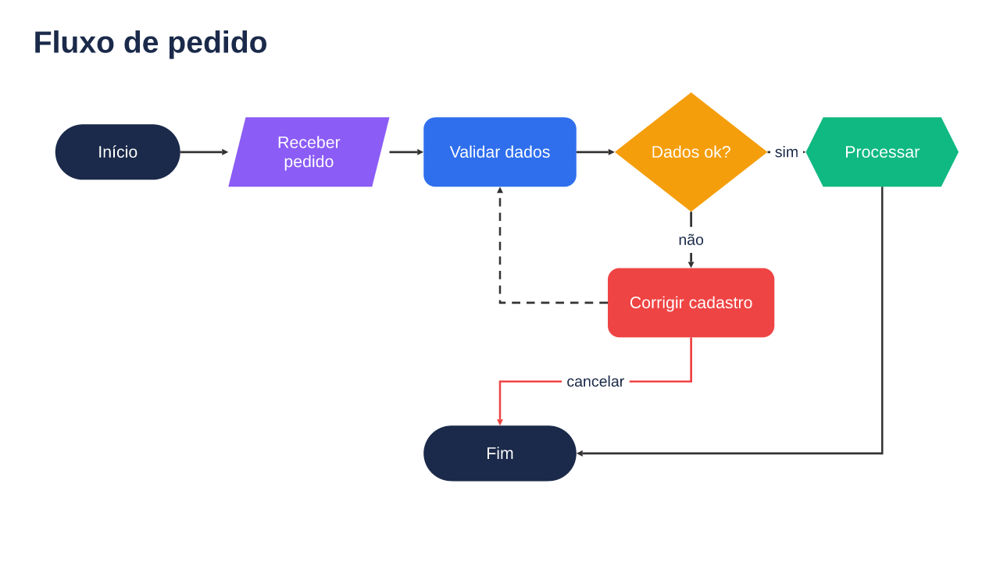</p>

[`examples/diagrams/arquitetura.tsx`](examples/diagrams/arquitetura.tsx): grupos com borda tracejada, cartões com ícones SVG nativos e conectores em cotovelo.

<p align="center">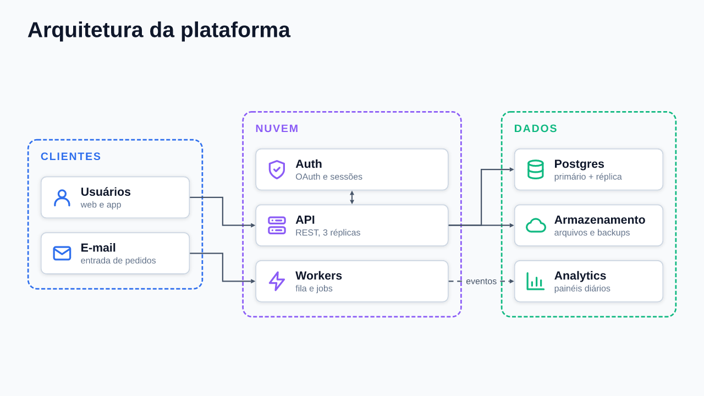</p>

As 24 formas ([`examples/diagrams/formas.tsx`](examples/diagrams/formas.tsx)) e os 12 ícones de exemplo em três cores e tamanhos ([`examples/diagrams/icones.tsx`](examples/diagrams/icones.tsx), MIT em `examples/assets/icons/`):

<p align="center">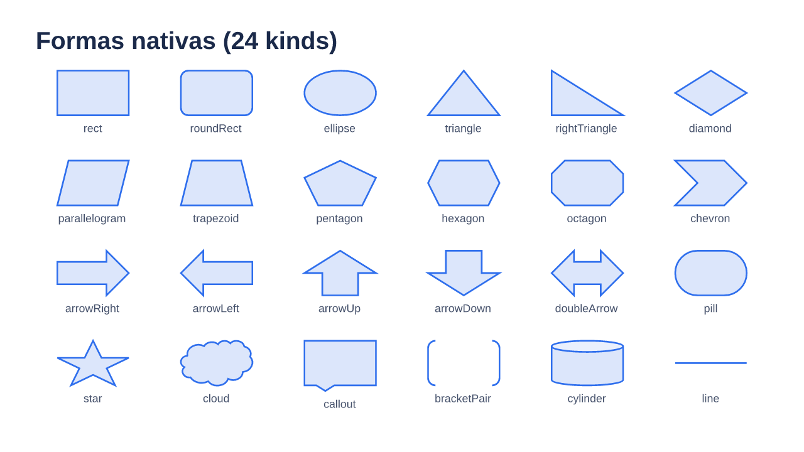 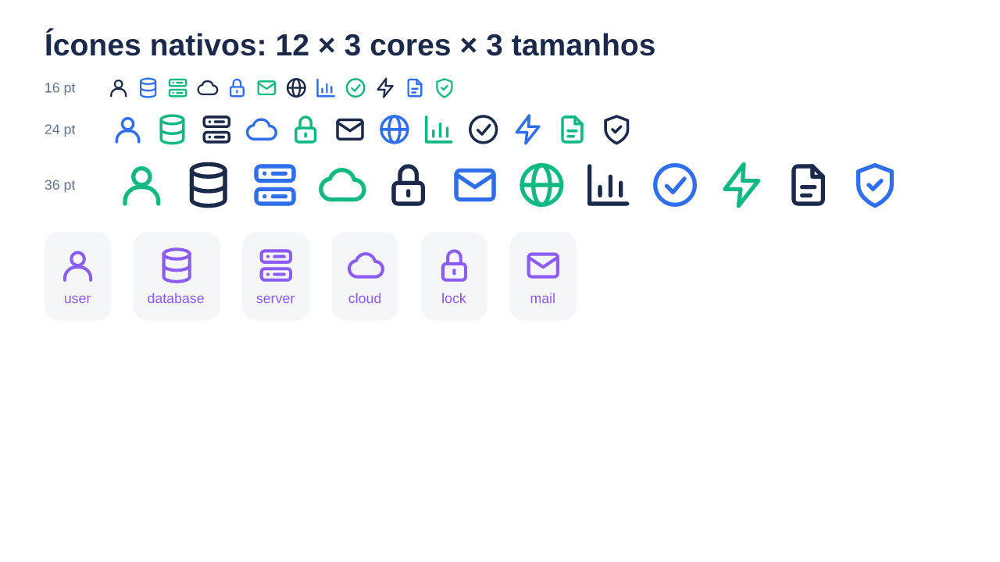</p>

O preview desenha cada forma com as fórmulas do OOXML; no Keynote os nós batem com o PNG em ±1 pt (relatório em [`docs/work/reports/M12.md`](docs/work/reports/M12.md)).

---

## CLI

```
pptsx build <deck.tsx> [flags]
pptsx init [dir] [--force] [--json]
```

| flag | padrão | o que faz |
|---|---|---|
| `--size <lista>` | `16x9` | tamanhos separados por vírgula: `16x9`, `16x10`, `4x3`, `wide` ou custom em polegadas (`10x7.5in`) |
| `--out <dir>` | `dist` | diretório de saída |
| `--debug` | desligado | contorno vermelho tracejado em toda caixa, no `.pptx` e no PNG; texto que estoura em vermelho no PNG |
| `--json` | desligado | stdout só com `{ files, diagnostics }` (ou `{ error }` se o deck nem roda) |
| `--watch` | desligado | rebuild a cada mudança na pasta do deck ou na config; com `--json`, um JSON por linha |
| `--preview native\|none` | `native` | `none` não gera PNGs |
| `--preview-width <px>` | `1280` | largura de cada PNG de slide |
| `--lang <tag>` | `pt-BR` | idioma do texto no `.pptx` (corretor ortográfico) |
| `--line-breaks forced\|auto` | `forced` | [quebras forçadas ou deixadas ao aplicativo](#por-que-as-quebras-de-linha-são-forçadas) |
| `--embed-fonts` | desligado | embute (EOT) as fontes registradas que o deck usa; só o PowerPoint respeita |

**Exit code:** `build` sai com `1` se houver algum diagnóstico `error`, erro de sintaxe/estrutura ou flag inválida; `warning` e `info` não falham. `init` sai com `1` se `deck.tsx` já existe sem `--force`.

<details>
<summary><b>Config: <code>pptsx.config.ts</code></b></summary>

```ts
import { defineConfig } from 'pptsx';

export default defineConfig({
  sizes: ['16x9', '4x3'],
  lang: 'pt-BR',
  textSafety: 0.97,
  lineBreaks: 'forced',
  embedFonts: false,
  fonts: [
    { family: 'Inter', weight: 'regular', file: './fonts/Inter-Regular.ttf' },
    { family: 'Inter', weight: 'bold', file: './fonts/Inter-Bold.ttf' },
    { family: 'Helvetica', weight: 'regular' }, // sem file: fonte instalada no sistema
    { family: 'Helvetica', weight: 'bold' },
  ],
});
```

| campo | o que faz |
|---|---|
| `sizes` | tamanhos usados quando `--size` não é passado |
| `lang`, `lineBreaks`, `embedFonts` | como as flags |
| `textSafety` | fração da largura usada na quebra de linha (padrão `0.97`); a caixa sai com a largura cheia |
| `fonts` | uma entrada por face, `{ family, weight: 'regular' \| 'bold', italic?, file? }`. Sem `file`, a face é procurada nas pastas de fontes do sistema. **Substitui** o padrão: se o deck ainda usa Arial, registre a Arial também |

Precedência: flag > config > padrão. De fábrica só existe Arial, medida com a Liberation Sans incluída no pacote (mesmas métricas) e gravada como `Arial` no arquivo.

</details>

---

## API programática

```ts
import { render } from 'pptsx';
import deck from './deck.tsx';

const results = await render(deck, { sizes: ['16x9', '4x3'], includePositioned: true });

for (const { size, buffer, diagnostics, preview, positioned } of results) {
  // buffer: o .pptx · preview: { slides: Buffer[], overview: Buffer } · positioned: frames em pt
}
```

O `render` não grava arquivos nem imprime; devolve um resultado por tamanho.

<details>
<summary><b><code>RenderOptions</code> e <code>RenderResult</code></b></summary>

| `RenderOptions` | padrão | |
|---|---|---|
| `sizes` | `['16x9']` | presets ou `{ width, height }` em polegadas |
| `fonts` | Liberation Sans como Arial | `FontFace[]`, como na config |
| `preview` | `{ mode: 'native', width: 1280 }` | `false` desliga os PNGs |
| `debug` | `false` | contornos de debug no `.pptx` e no PNG |
| `baseDir` | `process.cwd()` | base dos `src` relativos de imagens (a CLI usa a pasta do deck) |
| `lang` / `textSafety` / `lineBreaks` / `embedFonts` | `'pt-BR'` / `0.97` / `'forced'` / `false` | como na config |
| `includePositioned` | `false` | devolve a árvore posicionada (pós-fit) em `positioned` |

| `RenderResult` | |
|---|---|
| `size` | nome do tamanho (`'16x9'`, `'custom-10x7.5'`) |
| `buffer` | o `.pptx` (`Buffer`) |
| `diagnostics` | `Diagnostic[]` deste tamanho |
| `preview` | `{ slides, overview }` em PNG, se o preview estiver ligado |
| `positioned` | árvore com frames em pt, só com `includePositioned` |
| `fontsMissing` | faces pedidas sem `file` que não foram achadas no sistema |

</details>

---

## De/para CSS → PPTX

O que o `.pptx` consegue representar sai nativo; o resto sai aproximado ou não sai, e **sempre avisa**. O preview desenha só o que o `.pptx` tem, então o PNG nunca promete mais do que o arquivo entrega.

<p align="center">
  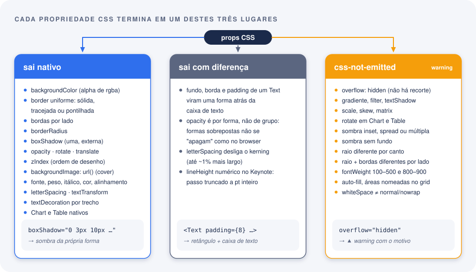
</p>

<details>
<summary><b>A mesma lista em tabela</b></summary>

| sai nativo | sai com diferença | `css-not-emitted` (warning) |
|---|---|---|
| `backgroundColor` (com alpha de `rgba`) | fundo, borda e padding de um `Text` saem como uma forma atrás da caixa de texto | `overflow: hidden` (o PPTX não recorta) |
| `border` uniforme sólida, tracejada ou pontilhada, dentro da caixa | `opacity` é por forma, não de grupo: formas sobrepostas não se "apagam" como no browser | gradiente em `backgroundImage`, `filter`, `textShadow`, propriedade desconhecida |
| bordas por lado (uma linha por lado) | `letterSpacing` desliga o kerning no arquivo (até ~1 % mais largo; a folga de 3 % cobre) | `transform: scale/skew/matrix`; `rotate` em `Chart`/`Table` |
| `borderRadius` | `lineHeight` numérico no Keynote: passo truncado a pt inteiro e 1ª linha até ~2 pt mais baixa | sombra `inset`, `spread` ou múltipla; sombra sem fundo |
| `boxShadow` (uma, externa) | | raio diferente por canto (sai o menor) |
| `opacity`, `rotate`, `translate`, `zIndex` (ordem de desenho) | | `borderRadius` com bordas diferentes por lado (o fundo arredonda, as linhas saem retas) |
| `backgroundImage: url()` (cover), `Image` com `objectFit` | | |
| fonte, tamanho, peso (faces 100–900), itálico, cor, alinhamento, `textTransform`, `textDecoration`, sobrescrito, tamanho/fonte e link por trecho, `letterSpacing`, número de slide (campo) | | `auto-fill`, áreas nomeadas e `[linhas]` no grid; `gridAutoFlow` diferente de `row` |
| `Chart` (bar, line, pie) e `Table` | | `whiteSpace` além de `normal`/`nowrap`; `objectFit` além de `contain`/`cover` |
| 24 formas (`Shape kind`, `Box shape`), `Path` (custGeom), `Icon` vetorial, `Connector` com pontas | `Icon` com gradiente/máscara/`transform` sai como imagem (`icon-rasterized`, info) | borda por lado ou raio num `Box shape` que não é rect; fundo/borda num `Icon` |

</details>

---

## Limitações

- **Fora do escopo do CSS:** `float`, `position: fixed/sticky`, unidades `em`/`rem`/`vw`, áreas nomeadas e `auto-fill` no grid. `position: absolute` é para decoração: mede pela borda do pai e não gera diagnóstico de caixa.
- **Só Arial de fábrica.** Outras famílias entram em `fonts` (por arquivo ou instaladas no sistema); uma família não registrada gera `font-missing`. Pesos fora de 400/700 precisam da face registrada e só aparecem onde ela está instalada (ou embutida, no PowerPoint).
- **Fonte embutida só no PowerPoint.** `--embed-fonts` grava as faces em EOT; o Keynote ignora. Só entram `.ttf` de uma face com licença que permite embed.
- **Quebras forçadas por padrão.** Quem editar o texto no PowerPoint herda as quebras manuais; `lineBreaks: 'auto'` troca isso por possíveis diferenças de quebra (ver [acima](#por-que-as-quebras-de-linha-são-forçadas)).
- **Rich text por trecho** muda peso, itálico, cor, decoração, tamanho, fonte, sobrescrito e link; a entrelinha vale para o `Text` inteiro.
- **Keynote e campos:** o número de slide sai como campo nativo; o Keynote apaga texto no mesmo parágrafo de um campo, por isso `n / total` sai em duas caixas encostadas.
- **`Table` não pagina** e não tem `truncate`: encolhe ou vira `table-overflow`. `Chart` e `Table` não giram.
- **O gráfico do PNG é uma aproximação**: PowerPoint e Keynote redesenham o gráfico nativo dentro do mesmo frame.
- **Conectores não desviam de obstáculos** nem se religam ao mover um nó no PowerPoint: são linhas calculadas no build entre os lados escolhidos.

## Validação

- **Testes:** 1854 com `vitest` (unitários, layout calculado à mão, oráculo do grid contra o Chrome, XML emitido, preview).
- **Keynote:** os exemplos e a vitrine foram exportados pelo Keynote (`scripts/keynote-export.sh`) e conferidos contra o preview: bordas por lado (±0,25 pt), sombra, rotação, opacidade, `zIndex`, grid, wrap, `display` responsivo, gráficos e tabelas nativos. A calibração de texto bate 34/34 e 30/30. Da galeria, `tara` (16:9) e `safra` (4:3) foram exportados e conferidos slide a slide: grupo girado com sombra, grid girado atrás do texto, mapa de calor, tabela e barra proporcional saem como no preview; só os gráficos são redesenhados pelo Keynote, como esperado. Os decks de diagramas (`examples/diagrams/`: formas, Path, ícones, fluxo e arquitetura) batem com o preview em ±1 pt nos nós; o relatório de texto corrido e os pesos da Inter (`examples/texto/`) saem com as mesmas linhas, e a calibração rica (com sobrescrito e corpo por trecho) bate 43/43.
- **PowerPoint e Google Slides:** ainda não validados; a conferência no PowerPoint está com o dono do projeto. O XML é corrigido nos pontos em que o PowerPoint pediria "reparar".

## Para agentes

O [`docs/AGENT_GUIDE.md`](docs/AGENT_GUIDE.md) é o único documento de que um agente precisa: modelo mental, esqueleto, todas as props, receitas, o formato dos diagnósticos, o checklist de correção e as armadilhas comuns. O fluxo é:

1. `npx pptsx build deck.tsx --size 16x9,4x3 --json` e ler o exit code;
2. corrigir primeiro os `error` **sem** `causedBy` (são as causas), seguindo o `path` e a `message`;
3. olhar o overview do tamanho afetado;
4. repetir até exit 0 e, depois, revisar `warning`.

## Desenvolvimento

```sh
npm test               # vitest (1650 testes)
npm run typecheck      # tsc
npm run build          # compila src/ para dist/ (JS + .d.ts)
npm run test:package   # npm pack → projeto vazio → init → build (lento)
node bin/pptsx.mjs build examples/demo.tsx --size 16x9,4x3,wide --out dist/
node bin/pptsx.mjs build examples/gallery/lanterna.tsx --size 16x9,4x3 --out dist/gallery
scripts/keynote-export.sh dist/demo.16x9.pptx dist/keynote/   # exporta os slides pelo Keynote (macOS)
```

Dentro do repo, `bin/pptsx.mjs` roda direto de `src/` (sem build) e os decks importam `pptsx` pelo `paths` do `tsconfig.json`. Os decks deste README ficam fora do `tsconfig` raiz e têm um `tsconfig.json` próprio:

```sh
npx tsx --tsconfig docs/readme/decks/tsconfig.json src/cli.ts build docs/readme/decks/b-grid.tsx --size 16x9,4x3 --out dist/readme
```

<details>
<summary><b>Exemplos em <code>examples/</code></b></summary>

| arquivo | o que mostra |
|---|---|
| `gallery/*.tsx` | seis decks com identidade própria ([Galeria](#galeria)): relatório agrícola, pitch de hardware, festival de cinema, painel operacional, aula de ciências e retrospectiva |
| `demo.tsx` | deck completo com layouts e componentes: grid de KPIs, duas colunas que empilham em 4:3, gráfico e tabela nativos, sem nenhum `if` sobre o tamanho |
| `showcase.tsx` | vitrine do CSS: grid com `span` e `2 / -1`, wrap, `marginTop="auto"`, `zIndex`, herança, bordas por lado, sombra, `rotate`, `opacity`, `display` responsivo |
| `long-list.tsx` | lista de 12 itens paginada (3 slides em 16:9, 2 em 4:3) |
| `charts.tsx` | os três gráficos nativos |
| `hello.tsx`, `layout-test.tsx` | posicionamento absoluto; flex, imagens (`objectFit`) e alinhamentos |
| `overflow.tsx`, `probe/*.tsx` | slides lotados de propósito: cada um termina com o diagnóstico esperado (exit 1) |
| `calibration.tsx`, `calibration-rich.tsx` | grades de calibração da medição de texto |
| `layouts/`, `components/`, `tokens.ts` | `CoverLayout`, `ContentLayout`, `ClosingLayout`; `Bullets`, `KpiCard`, `KpiRow`, `TwoColumn` |

</details>

Spec do produto em [`docs/spec.md`](docs/spec.md); contratos entre módulos em [`docs/work/CONTRACTS.md`](docs/work/CONTRACTS.md).

## Licença

MIT. As fontes Liberation Sans em `fonts/` têm licença própria (`fonts/LICENSE`).
