<p align="center">
  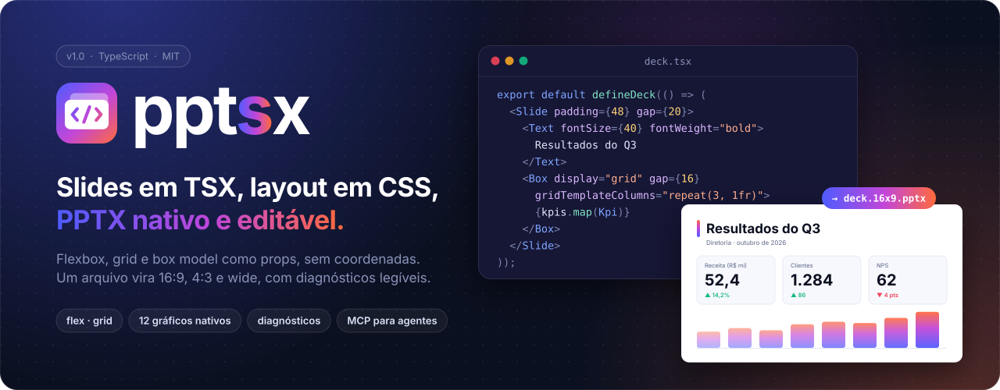
</p>

<p align="center">
  <a href="packages/pptsx/README.md"></a>
  <a href="packages/ds-kit/README.md"></a>
  <a href="packages/ds-base/README.md"></a>
  
  
  
</p>

<p align="center">
  <a href="#por-que-pptsx"><b>Por quê</b></a> ·
  <a href="#em-30-segundos"><b>Começar</b></a> ·
  <a href="#galeria"><b>Galeria</b></a> ·
  <a href="#os-pacotes"><b>Pacotes</b></a> ·
  <a href="#como-funciona"><b>Como funciona</b></a> ·
  <a href="#por-dentro-em-imagens"><b>Por dentro</b></a> ·
  <a href="#estratégias-de-código"><b>Estratégias</b></a> ·
  <a href="#mapa-do-repositório"><b>Repositório</b></a> ·
  <a href="#identidade-visual"><b>Marca</b></a>
</p>

<br>

**pptsx** transforma TSX em apresentações **PowerPoint nativas**. Você descreve o slide com as props do CSS (box model, flexbox, grid, `zIndex`) e a engine calcula o layout, ajusta o texto que não cabe e grava um `.pptx` em que cada forma, texto, gráfico e tabela pode ser editado no PowerPoint e no Keynote. O mesmo arquivo sai em 16:9, 4:3 e wide, e todo problema volta como um diagnóstico com o caminho até o nó e o que fazer.

Este repositório é o monorepo do núcleo e das ferramentas de design system.

## Por que pptsx

<table>
<tr>
<td width="33%" valign="top">
<br>
<b>CSS de verdade</b><br>
<sub>Flex, grid com <code>fr</code> e <code>minmax</code>, <code>margin: auto</code>, bordas por lado, sombra, <code>rotate</code> e <code>zIndex</code>. Ninguém informa x/y.</sub>
</td>
<td width="33%" valign="top">
<br>
<b>Um arquivo, vários formatos</b><br>
<sub>Breakpoints em qualquer prop (<code>{ base, tall, wide }</code>) e paginação automática. 16:9, 4:3 e wide sem <code>if</code>.</sub>
</td>
<td width="33%" valign="top">
<br>
<b>Nativo e editável</b><br>
<sub>Formas, texto rico, 12 tipos de gráfico, tabelas com merges, diagramas e o tema do arquivo. Nada vira imagem.</sub>
</td>
</tr>
<tr>
<td width="33%" valign="top">
<br>
<b>Diagnósticos que explicam</b><br>
<sub>Cada estouro vem com <code>path</code>, causa (<code>causedBy</code>) e a correção. PNG por slide e overview com selos.</sub>
</td>
<td width="33%" valign="top">
<br>
<b>Base de design systems</b><br>
<sub>O núcleo não tem marca. Tokens, variantes tipadas, slots, regras de lint e catálogo visual ficam no seu DS.</sub>
</td>
<td width="33%" valign="top">
<br>
<b>Feito para agentes</b><br>
<sub>Servidor MCP, saída <code>--json</code>, skill para Claude e Copilot e um guia único. O agente constrói, lê e corrige.</sub>
</td>
</tr>
</table>

## Em 30 segundos

Só precisa do Node 20.6+. Baixe o `pptsx.mjs` da [última release](https://github.com/JonathanSantos/pptsx/releases/latest): é o pptsx inteiro num arquivo, sem `node_modules` (detalhes em [Arquivo único](packages/pptsx/README.md#arquivo-único-sem-npm)).

```sh
mkdir meu-deck && cd meu-deck
curl -LO https://github.com/JonathanSantos/pptsx/releases/latest/download/pptsx.mjs
node pptsx.mjs init                              # deck.tsx, tsconfig.json, pptsx.config.ts, assets/
node pptsx.mjs build deck.tsx --size 16x9,4x3    # .pptx + PNG por slide + overview + diagnósticos
```

A release também traz `SHA256SUMS` e as skills para agentes (`pptsx-skill.zip`, `ds-base-skill.zip`). Ainda não há pacote no npm; quando houver, `npm install pptsx` e `npx pptsx …` fazem o mesmo.

<table>
<tr>
<td width="50%" valign="top">

```tsx
import { Box, Deck, Slide, Text, defineDeck } from 'pptsx';

export default defineDeck(() => (
  <Deck>
    <Slide padding={48} gap={20} color="#1B2A4A">
      <Text fontSize={40} fontWeight="bold">
        Olá, pptsx
      </Text>
      <Box flex={1} justifyContent="center" padding={32}
        backgroundColor="#F4F6FA" borderRadius={12}>
        <Text fontSize={28}>
          Sem coordenadas: o layout é CSS.
        </Text>
      </Box>
    </Slide>
  </Deck>
));
```

</td>
<td width="50%" valign="top">

<br><br>
<sub>O PNG que o <code>build</code> grava ao lado do <code>.pptx</code>, desenhado com o mesmo layout do arquivo.</sub>
</td>
</tr>
</table>

> [!TIP]
> Com um design system: `npx pptsx init --ds @marca/ds` gera um deck que já importa os componentes do DS e uma config que registra o DS e o tema.

## Galeria

<p align="center">
  
</p>

Seis design systems criados do zero com o `@pptsx/ds-kit`, cada um com fontes, paleta, componentes e um deck próprios, todos sem nenhum `warning`; o código está em [`examples/gallery/`](examples/gallery/). Cada imagem é o PNG que a engine desenhou com o mesmo layout do `.pptx`.

<table>
<tr>
<td width="33%" valign="top"><a href="packages/pptsx/README.md#nebula--lançamento-de-produto">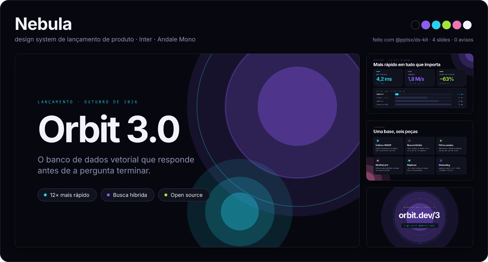</a><br><b>Nebula</b> <sub>· lançamento de produto</sub></td>
<td width="33%" valign="top"><a href="packages/pptsx/README.md#a-gazeta--editorial-de-jornal">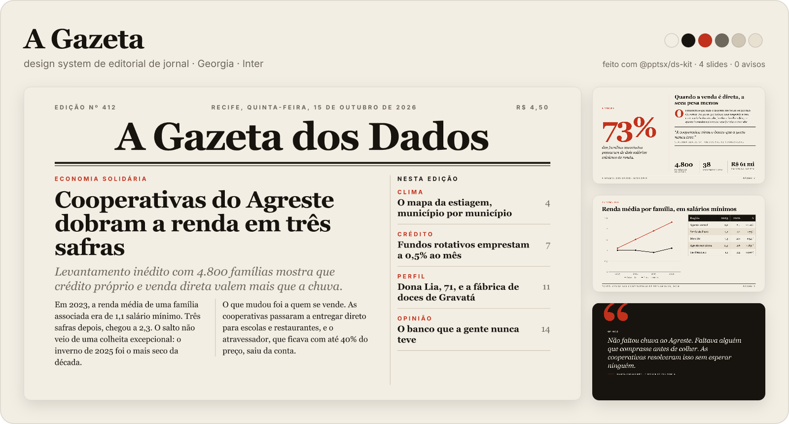</a><br><b>A Gazeta</b> <sub>· editorial de jornal</sub></td>
<td width="33%" valign="top"><a href="packages/pptsx/README.md#forma--congresso-de-design">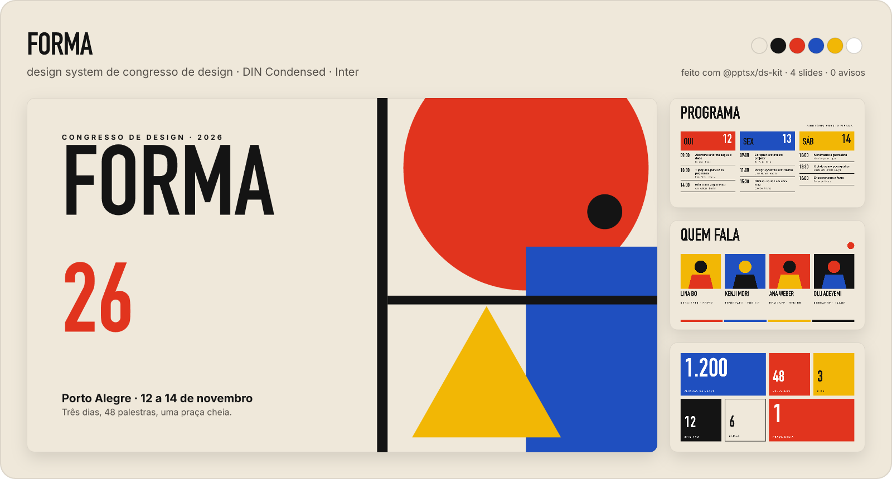</a><br><b>FORMA</b> <sub>· congresso de design</sub></td>
</tr>
<tr>
<td width="33%" valign="top"><a href="packages/pptsx/README.md#brisa--app-de-finanças"></a><br><b>Brisa</b> <sub>· app de finanças</sub></td>
<td width="33%" valign="top"><a href="packages/pptsx/README.md#terminal--pós-mortem-de-incidente">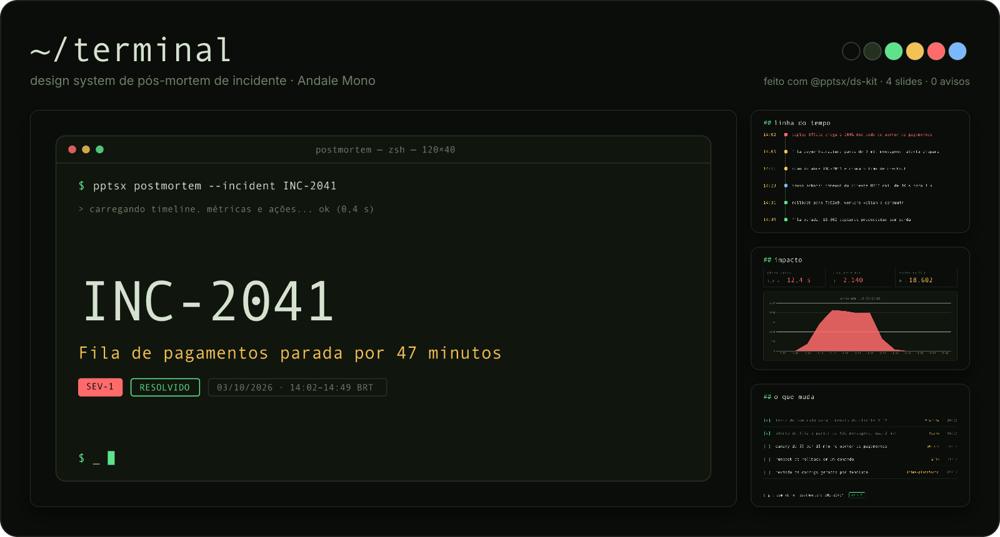</a><br><b>~/terminal</b> <sub>· pós-mortem de incidente</sub></td>
<td width="33%" valign="top"><a href="packages/pptsx/README.md#botânica--relatório-de-impacto">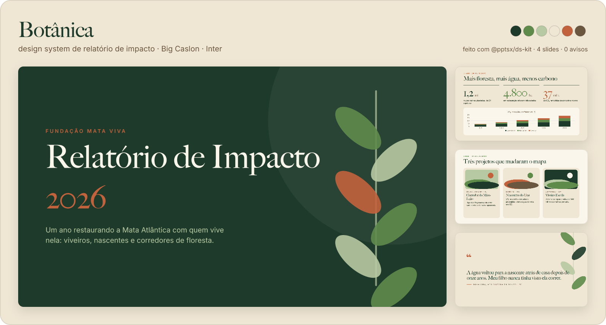</a><br><b>Botânica</b> <sub>· relatório de impacto</sub></td>
</tr>
</table>

<p align="center"><sub><a href="packages/pptsx/README.md#galeria">Como cada um foi feito →</a></sub></p>

## Os pacotes

<p align="center">
  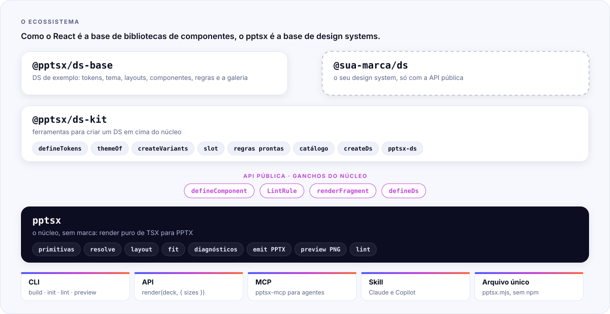
</p>

Como o React é a base de bibliotecas de componentes, o pptsx é a base de design systems: **o núcleo faz render e não tem marca**. Tokens, tema, layouts e componentes vivem num DS, ligado ao núcleo só pela API pública.

<table>
<tr>
<th width="33%" align="left"><a href="packages/pptsx/README.md"><code>pptsx</code></a></th>
<th width="33%" align="left"><a href="packages/ds-kit/README.md"><code>@pptsx/ds-kit</code></a></th>
<th width="33%" align="left"><a href="packages/ds-base/README.md"><code>@pptsx/ds-base</code></a></th>
</tr>
<tr>
<td valign="top">O núcleo: primitivas, layout, ajuste, diagnósticos, emissão PPTX, preview PNG, CLI (<code>build</code>, <code>init</code>, <code>preview --serve</code>, <code>lint</code>), servidor MCP e os ganchos para design systems.</td>
<td valign="top">Ferramentas para criar um DS: <code>defineTokens</code>, <code>themeOf</code>, <code>createVariants</code>, slots, regras de lint prontas, catálogo com fixtures, <code>createDs</code> e a CLI <code>pptsx-ds</code>.</td>
<td valign="top">Um DS completo de exemplo: tokens, tema, layouts de capa, conteúdo e fechamento, <code>KpiRow</code>, <code>Bullets</code>, <code>TwoColumn</code>, regras de marca e a galeria.</td>
</tr>
<tr>
<td><sub><code>npm install pptsx</code></sub></td>
<td><sub><code>npm install @pptsx/ds-kit</code></sub></td>
<td><sub><code>npm install @pptsx/ds-base</code></sub></td>
</tr>
</table>

| gancho no núcleo | para quê |
|---|---|
| `defineComponent(meta, fn, defaults?)` | identidade do componente: o nome no path dos diagnósticos e o `meta` no nó resolvido |
| `LintRule` + `lint.rules` / `ds` na config | regras do DS no `pptsx lint`, com o path e o componente de cada nó |
| `renderFragment(elemento, { size })` | um componente isolado num slide (frames, SVG, PNG): a base do catálogo |
| `defineDs(manifest)` | o guia e o schema de props do DS no MCP e na skill |

## Como funciona

<p align="center">
  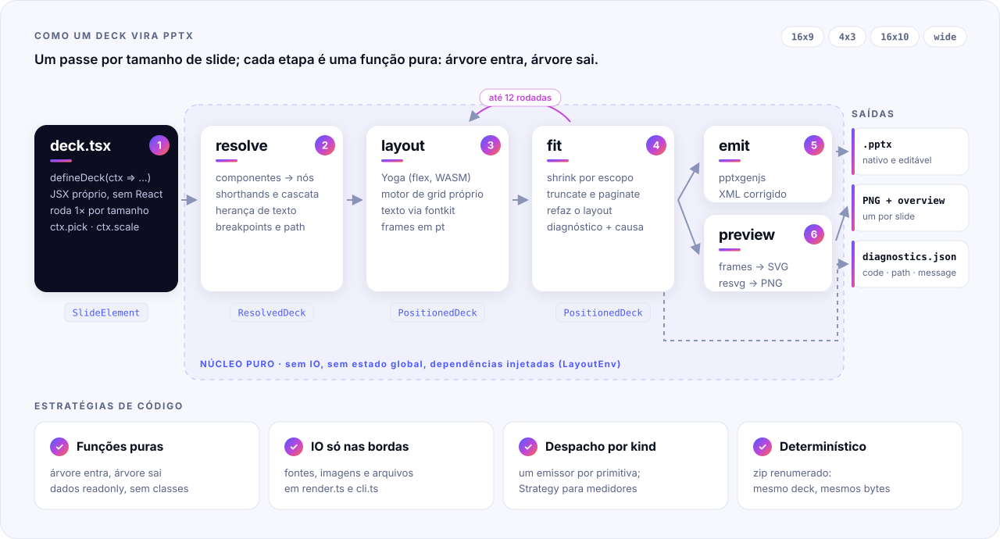
</p>

`render(deck, { sizes })` repete o mesmo caminho para cada tamanho de slide. O deck é uma função que recebe `ctx` (largura, altura, proporção, `pick`) e devolve primitivas; daí em diante cada etapa recebe uma árvore e devolve outra.

| | etapa | entra → sai | o que faz |
|:-:|---|---|---|
| 1 | **TSX** | `defineDeck` → `SlideElement` | runtime JSX próprio, sem React: `jsx()` só cria objetos congelados |
| 2 | **resolve** | `SlideElement` → `ResolvedDeck` | chama componentes, expande shorthands, aplica cascata, herança de texto e breakpoints, dá a cada nó o seu `path` |
| 3 | **layout** | `ResolvedDeck` → `PositionedDeck` | Yoga (flexbox em WASM) com padrões da web, motor de grid próprio, texto medido com as métricas reais da fonte |
| 4 | **fit** | `PositionedDeck` → `PositionedDeck` + `Diagnostic[]` | encolhe por escopo, trunca ou pagina, refaz o layout e explica o que sobrou |
| 5 | **emit** | → `.pptx` | pptxgenjs em polegadas e pós-processo do zip: XML sem "reparar", planilha dos gráficos, partes renumeradas |
| 6 | **preview** | → PNG | os mesmos frames viram SVG e o resvg rasteriza com as fontes da medição |

O mergulho completo, com o loop de ajuste e a calibração no Keynote, está em [**pptsx › Como funciona por dentro**](packages/pptsx/README.md#como-funciona-por-dentro).

## Por dentro, em imagens

Os mecanismos internos desenhados com exemplos de verdade: as contas do grid, as métricas do texto, a busca do shrink, o XML que sai no arquivo. Cada imagem leva à explicação completa no README do núcleo.

<table>
<tr>
<td width="50%" valign="top"><a href="packages/pptsx/README.md#a-árvore-em-três-estados">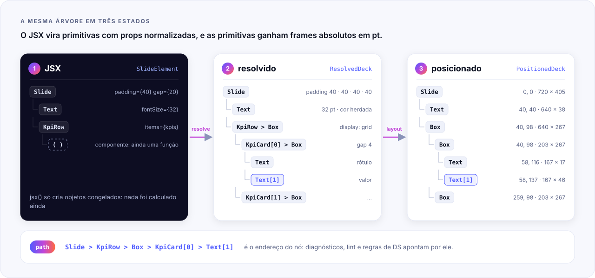</a><br><b>A árvore em três estados</b> <sub>· JSX → resolvido → posicionado</sub></td>
<td width="50%" valign="top"><a href="packages/pptsx/README.md#resolve-shorthands-cascata-e-herança">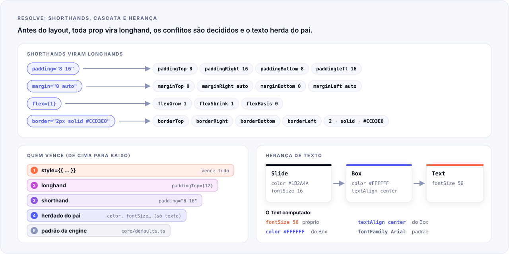</a><br><b>Shorthands, cascata e herança</b> <sub>· o que o resolve decide antes do layout</sub></td>
</tr>
<tr>
<td width="50%" valign="top"><a href="packages/pptsx/README.md#o-motor-de-grid">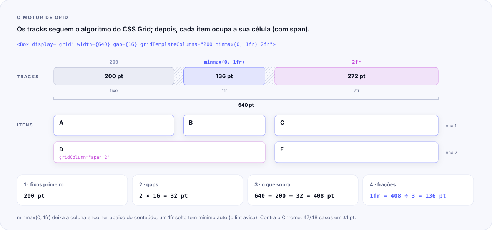</a><br><b>O motor de grid</b> <sub>· tracks, frações e span, conta por conta</sub></td>
<td width="50%" valign="top"><a href="packages/pptsx/README.md#por-que-as-quebras-de-linha-são-forçadas"></a><br><b>Texto medido pela fonte</b> <sub>· glifos, baseline e quebras forçadas</sub></td>
</tr>
<tr>
<td width="50%" valign="top"><a href="packages/pptsx/README.md#o-loop-de-ajuste"></a><br><b>Shrink por escopo</b> <sub>· busca binária do menor passo que cabe</sub></td>
<td width="50%" valign="top"><a href="packages/pptsx/README.md#ordem-de-pintura"></a><br><b>Ordem de pintura</b> <sub>· zIndex, fluxo e camadas como no CSS</sub></td>
</tr>
<tr>
<td width="50%" valign="top"><a href="packages/pptsx/README.md#de-um-box-a-formas-nativas">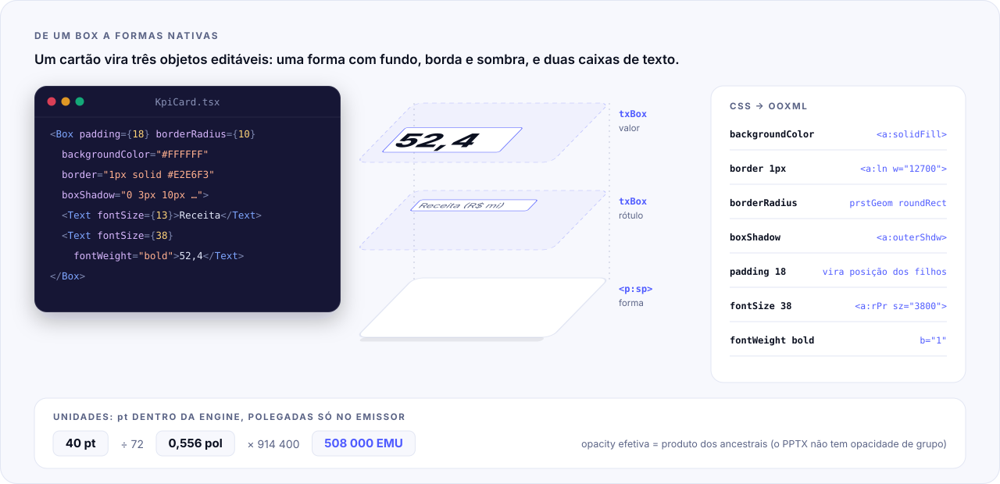</a><br><b>De um Box a formas nativas</b> <sub>· CSS → OOXML, pt → EMU</sub></td>
<td width="50%" valign="top"><a href="packages/pptsx/README.md#por-dentro-do-pptx"></a><br><b>Por dentro do .pptx</b> <sub>· o zip e as correções do pós-processo</sub></td>
</tr>
<tr>
<td width="50%" valign="top"><a href="packages/pptsx/README.md#breakpoints">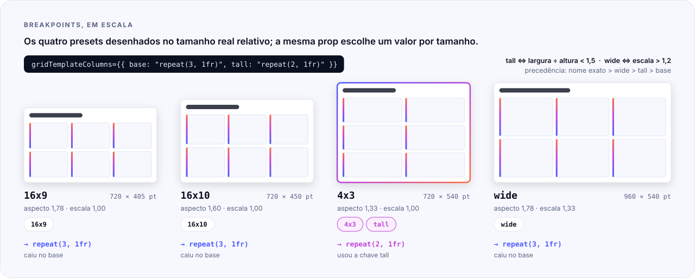</a><br><b>Breakpoints em escala</b> <sub>· quatro presets, uma prop</sub></td>
<td width="50%" valign="top"><a href="packages/pptsx/README.md#paginação"></a><br><b>Paginação</b> <sub>· o que não cabe vira um clone do slide</sub></td>
</tr>
<tr>
<td width="50%" valign="top"><a href="packages/pptsx/README.md#o-que-vem-em-cada-diagnóstico"></a><br><b>Anatomia de um diagnóstico</b> <sub>· cada campo, a causa e os grupos</sub></td>
<td width="50%" valign="top"></td>
</tr>
</table>

## Estratégias de código

| princípio | como aparece | por quê |
|---|---|---|
| **Funções puras** | toda etapa do pipeline: árvore entra, árvore sai; dados `readonly`, sem classes | cada etapa é testável sozinha, e o mesmo deck dá sempre o mesmo resultado |
| **IO só nas bordas** | ler fontes, imagens e arquivos fica em `render.ts`, `cli.ts` e nas fábricas `create*` | o núcleo roda igual na CLI, no MCP, no preview ao vivo e no arquivo único |
| **Dependências injetadas** | o layout recebe um `LayoutEnv` (`measureText`, `imageSize`) | os testes trocam o fontkit por um medidor de estimativa, sem arquivo de fonte |
| **Strategy** | medidores de texto e políticas de estouro (`shrink`, `truncate`, `error`) | o comportamento muda por prop, sem `if` espalhado |
| **Tabela de despacho por `kind`** | `dispatch` em `core/dispatch.ts`: emissores PPTX, desenho do preview, leitura do layout | uma primitiva nova é uma entrada nova, não um `switch` a mais |
| **Factory** | `definePrimitive`, `defineComponent`, `defineLayout`, `createDs` | identidade e metadados presos ao componente desde a criação |
| **Contratos centrais** | tipos em `src/core/types.ts`, padrões numéricos em `src/core/defaults.ts` | nenhum número mágico; módulos conversam por tipos, não por detalhes |
| **Saída determinística** | o zip é renumerado no fim | o mesmo deck gera os mesmos bytes; o XML emitido vira fixture de teste |

## Mapa do repositório

```text
pptsx/
├── packages/
│   ├── pptsx/                 núcleo: src/{jsx,primitives,resolve,layout,text,fit,emit,preview,lint,cli,mcp,skill}
│   │   ├── docs/AGENT_GUIDE.md   o guia único para agentes
│   │   └── docs/readme/          imagens deste README, decks que as geram e a marca (brand/)
│   ├── ds-kit/                tokens, tema, variantes, slots, regras, catálogo, createDs, CLI pptsx-ds
│   └── ds-base/               DS de exemplo: src/, guide/, fixtures/ (contrato visual) e examples/
├── examples/                  gallery/ (os seis DS da galeria) e third-party-ds/ (DS feito só com o guia do kit)
├── docs/                      spec do produto, marcos, contratos entre módulos e relatórios
└── scripts/                   brand.mjs (identidade visual), gallery.mjs (galeria), publish-check, keynote-export
```

## Desenvolvimento

```bash
npm install
```

| comando | o que faz |
|---|---|
| `npm test` | vitest nos três pacotes |
| `npm run typecheck` | `tsc` nos três pacotes |
| `npm run build` | compila `src/` para `dist/` (JS + `.d.ts`) |
| `npm run test:package` | `npm pack` → projeto vazio → `init` → `build` (lento) |
| `npm run publish:check` | confere os `package.json` antes de publicar |
| `node scripts/brand.mjs` | regenera logo, banners, ícones e diagramas em `packages/pptsx/docs/readme/brand/` |
| `node scripts/gallery.mjs` | reconstrói os seis DS de `examples/gallery/` (falha com qualquer `warning`) e remonta a galeria (macOS: usa fontes do sistema) |

Documentos de trabalho (spec, marcos, contratos, relatórios) ficam em [`docs/`](docs/).

## Identidade visual

<p>
  <picture>
    <source media="(prefers-color-scheme: dark)" srcset="packages/pptsx/docs/readme/brand/logo-dark.svg">
    
  </picture>
  &nbsp;&nbsp;&nbsp;
  
</p>

O símbolo é um slide na frente de outro (o deck) com `</>` dentro: código que vira apresentação. No nome, o **s** leva o gradiente: **ppt·s·x** é o PPTX com o TSX encaixado. O gradiente vai do **índigo** (o lado TypeScript) ao **coral** (o lado PowerPoint), passando pelo magenta, e é a transformação que a biblioteca faz.

<p align="center">
  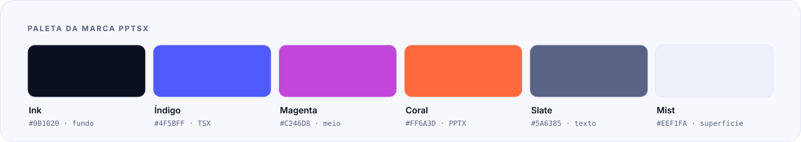
</p>

<details>
<summary><b>Arquivos da marca</b></summary>

| arquivo | uso |
|---|---|
| `logo-light.svg` / `logo-dark.svg` | símbolo + nome, para fundo claro e escuro (use com `<picture>`) |
| `mark.svg` | só o símbolo (avatar, favicon, ícone de pacote) |
| `banner.svg`, `banner-ds-kit.svg`, `banner-ds-base.svg` | cabeçalhos dos READMEs |
| `icon-*.svg` | ícones das funcionalidades |
| `pipeline.svg`, `ecosystem.svg`, `fit-loop.svg`, `css-to-pptx.svg`, `ds-flow.svg` | diagramas |
| `inside-*.svg` | os mecanismos internos (árvore, resolve, grid, texto, shrink, pintura, formas, .pptx, breakpoints, paginação, diagnóstico) |
| `palette.svg`, `palette-ds-base.svg` | paletas (a do ds-base é lida do `tokens.ts`) |

Tudo sai de [`scripts/brand.mjs`](scripts/brand.mjs): cores, medidas e textos ficam no script, e o nome é desenhado em contornos da Inter Bold para sair igual em qualquer máquina.

</details>

## Licença

MIT. As fontes Liberation Sans (núcleo) e Inter (ds-base) têm licença própria, nas pastas `fonts/` de cada pacote.
