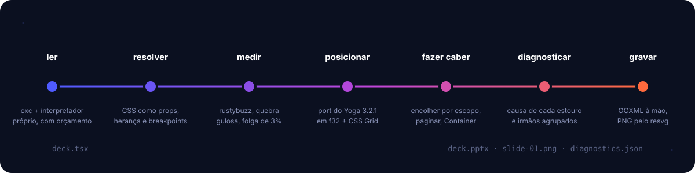

<p align="center">
  <picture>
    <source media="(prefers-color-scheme: dark)" srcset="packages/pptsx/docs/readme/brand/logo-dark.svg">
    
  </picture>
</p>

<p align="center">
  <b>Slides em TSX, layout em CSS, PowerPoint nativo e editável.</b><br>
  Um binário só, em Rust. Sem Node, sem navegador, sem motor JavaScript dentro.
</p>

<p align="center">
  
  
  
  
  
  
</p>

<p align="center">
  <a href="#em-30-segundos"><b>Começar</b></a> ·
  <a href="#com-um-agente-de-ia"><b>Com IA</b></a> ·
  <a href="#design-systems"><b>Design systems</b></a> ·
  <a href="#por-dentro"><b>Por dentro</b></a> ·
  <a href="https://jonathansantos.github.io/pptsx/"><b>A página do motor</b></a> ·
  <a href="packages/pptsx-rs/README.md"><b>Referência</b></a>
</p>

<br>

Você descreve a **estrutura** do slide com as props do CSS (box model, flexbox, grid) e o `pptsx-rs` calcula o layout, mede o texto com a fonte real, ajusta o que não cabe e grava um `.pptx` em que cada forma, tabela e gráfico é nativo. Não existem coordenadas x/y.

<p align="center">
  
</p>

<sub>Os três slides acima saem de <a href="packages/pptsx-rs/docs/exemplo.tsx"><code>exemplo.tsx</code></a>, 34 linhas. O <code>check</code> desse deck leva cerca de 9 ms num Mac arm64; o <code>build</code>, com o <code>.pptx</code> e os PNGs, cerca de 100 ms.</sub>

## Em 30 segundos

Baixe o pacote do seu sistema na [última release](https://github.com/JonathanSantos/pptsx/releases/latest) (macOS, Linux e Windows) ou compile com `cargo build --release`. Depois:

```bash
pptsx-rs init meu-deck
```

```bash
pptsx-rs build meu-deck/deck.tsx --size 16x9,4x3
```

```tsx
import { Box, Deck, Slide, Text, defineDeck } from 'pptsx';

export default defineDeck(() => (
  <Deck>
    <Slide padding={40} gap={20} backgroundColor="#FFFFFF" color="#0B1020">
      <Text fontSize={28} fontWeight="bold">Os três indicadores fecharam acima da meta</Text>
      <Box display="grid" gridTemplateColumns="repeat(3, minmax(0, 1fr))" gap={16} flex={1}>
        {kpis.map((kpi) => (
          <Box backgroundColor="#EEF1FA" borderRadius={12} padding={20} gap={6} justifyContent="center">
            <Text fontSize={14} color="#5A6385">{kpi.label}</Text>
            <Text fontSize={36} fontWeight="bold" nowrap fitGroup="kpi">{kpi.value}</Text>
          </Box>
        ))}
      </Box>
    </Slide>
  </Deck>
));
```

```text
dist/
├── deck.16x9.pptx              editável no PowerPoint e no Keynote
├── deck.16x9.overview.png      todos os slides numa grade, com selo onde há problema
├── deck.16x9/slide-01.png      um PNG por slide, desenhado com o mesmo layout do arquivo
├── deck.4x3.pptx               o mesmo deck no outro formato, sem mudar código
└── deck.diagnostics.json       código, severidade, slide, caminho do nó, mensagem
```

O `init` também grava os tipos para o editor: o VS Code confere e autocompleta as props sem `npm install`.

## O que ele faz

| | |
|---|---|
| **Layout de verdade** | flexbox (um port do Yoga 3.2.1) e CSS Grid, com `position`, `zIndex`, herança de texto e valores por formato (`{ base, tall, wide }`) |
| **Texto que cabe** | medição com shaping e kerning; o que não cabe encolhe por escopo, trunca, pagina em slides clonados ou vira erro com o conserto |
| **Arquivo nativo** | formas, tabelas com mesclagem, 12 tipos de gráfico editáveis, degradê, ícones em vetor, notas, seções, masters e cores do tema |
| **Diagnósticos** | cada problema traz o slide, o caminho do nó, a causa e o que fazer; estouros em cascata apontam para o nó que começou |
| **Feito para agentes** | servidor MCP no próprio binário, lint com regras do seu design system e uma skill gerada com um comando |
| **Um arquivo** | 6 MB com quatro fontes, o guia, o schema e os tipos embutidos; sobe em milissegundos |

## Com um agente de IA

O binário é um servidor MCP. O agente lê o guia, escreve o deck, constrói, lê os diagnósticos e vê o PNG, tudo por ferramentas.

```json
{
  "mcpServers": {
    "pptsx": { "command": ".claude/skills/pptsx/bin/pptsx-rs", "args": ["mcp"] }
  }
}
```

| ferramenta | para quê |
|---|---|
| `guide`, `schema` | aprender as primitivas e as props antes do primeiro slide |
| `diagnose` | iterar sem gravar arquivo |
| `build`, `preview` | gerar o `.pptx` e olhar o resultado |
| `lint` | regras do motor e do design system antes de entregar |

`pptsx-rs skill` gera uma pasta de skill (guia, props, entradas de MCP e o binário) para `.claude/skills/` ou `.github/skills/`. Sem MCP, os mesmos comandos funcionam no shell, com `--json`.

## Design systems

O motor não tem marca. Tokens, tema, layouts de slide e componentes vivem num design system, um módulo TSX que o binário avalia:

```ts
import { createDs, defineComponent, defineTokens, themeOf } from '@pptsx/ds-kit';
```

O `@pptsx/ds-kit` vem embutido no binário, então um design system compila sem `node_modules`. Registrado na config, ele entra em tudo:

- **lint:** regras de marca escritas em JavaScript, por nó (`check`) ou sobre o deck inteiro (`checkDeck`);
- **MCP e skill:** o guia do design system e as props de cada componente, lidas das interfaces TypeScript;
- **arquivo:** as cores do tema aparecem no seletor de cores de quem abre o `.pptx`.

```bash
pptsx-rs skill --ds meu-ds/src/index.ts --name acme-deck --out skills/acme-deck
```

Esse comando empacota o binário, o design system e as referências numa skill autocontida.

## Por dentro

<p align="center">
  
</p>

São 24 mil linhas de Rust e 12 dependências. Algumas escolhas que definem o projeto:

- **Um interpretador próprio.** O `oxc` faz só o parse; quem executa o deck é um interpretador de árvore com orçamento de 50 milhões de passos. `Date` e `Math.random` são erros: um deck dá sempre o mesmo resultado.
- **Flexbox fiel até o float.** O port do Yoga usa `f32` e reproduz até um caso degenerado do original, coberto por um teste.
- **Texto medido, não estimado.** `rustybuzz` para o shaping, quebra gulosa e 3% de folga para o PowerPoint não quebrar a linha de novo.
- **OOXML escrito à mão.** Sem biblioteca de PowerPoint: XML com `format!`, EMU na saída, arcos convertidos em cúbicas e um escritor de EOT para embutir fontes.
- **O PNG é a prévia do arquivo.** O preview desenha os mesmos frames, com os glifos em contorno, e rasteriza com o `resvg`.

A história completa, com desenhos de cada estágio, está na **[página do motor](https://jonathansantos.github.io/pptsx/)** (fonte em [`site/`](site/)). A referência de comandos, flags e primitivas está no [README do crate](packages/pptsx-rs/README.md).

## Desenvolvimento

```bash
cargo build --release
```

```bash
cargo test
```

```bash
cargo clippy --release --all-targets -- -D warnings
```

Os testes rodam sem Node: 67 unitários, 8 do grupo de fit e 7 que comparam decks inteiros com fixtures em `packages/pptsx-rs/fixtures/`.

## Mapa do repositório

```text
pptsx/
├── packages/pptsx-rs/     o motor: src/, assets/ (guia, schema, tipos e ds-kit embutidos), fixtures/, docs/
├── site/                  a página "pptsx-rs por dentro" (GitHub Pages)
├── packages/pptsx/        a implementação original em TypeScript e a marca (docs/readme/brand/); legado
├── packages/ds-kit/       fontes TypeScript do kit de design systems; legado (o binário embute o que usa)
├── packages/ds-base/      design system de exemplo, usado pelos decks de teste
├── docs/                  spec, marcos e relatórios de trabalho
└── scripts/               keynote-export.sh (validação visual) e geradores da marca
```

## Licença

[MIT](LICENSE)
