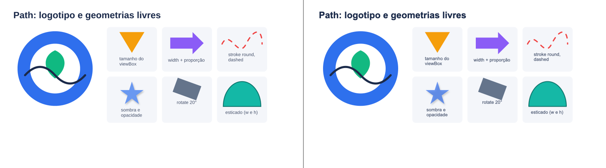
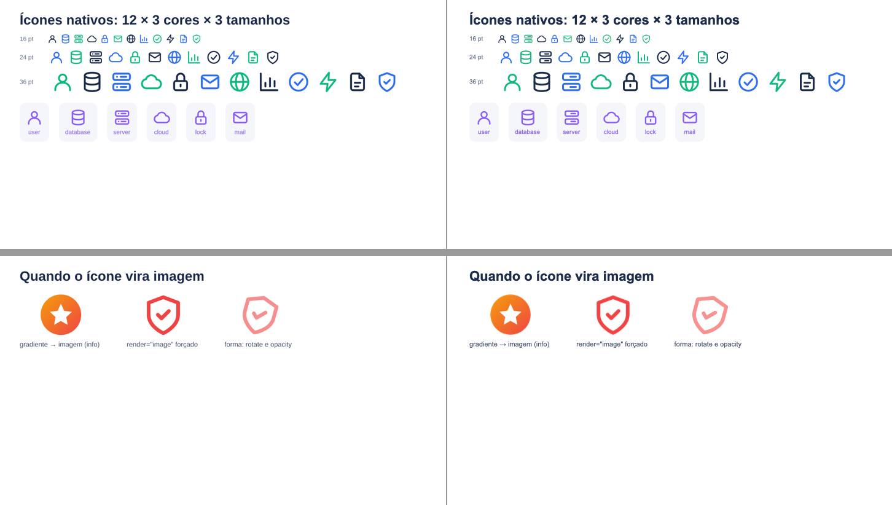
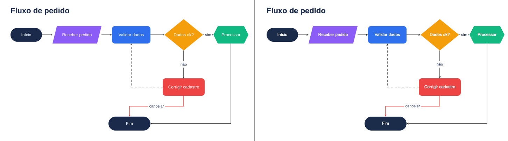

# M12 — formas, conectores e ícones: notas por etapa

## M12-1 — contrato
- `src/core/types.ts`: `ShapeKind` curado (24 kinds), `LineStyle`, `LineCap`, `LineJoin`, `ArrowType`; `ShapeProps` com flip, traço, ponta e setas; `FlexItemProps.id`; `BoxProps.shape`; primitivas `path`, `icon`, `connector` (`PathProps`, `IconProps`, `ConnectorProps`), `PathCommand`, `VectorPath`, `ResolvedPath/Icon/Connector`, `PositionedPath/Icon/Connector`; conectores ficam fora da árvore (`ResolvedSlide.connectors`, `PositionedSlide.connectors`). Diagnósticos `connector-target-missing`, `connector-omitted` (novo em relação ao plano: o "omitido com info" precisava de código próprio), `icon-rasterized`, `path-invalid`.
- `src/core/defaults.ts`: `DEFAULTS.shape.pptx` (prst + adj por kind), `adjScale`, `arrow`; `DEFAULTS.path`, `DEFAULTS.icon`, `DEFAULTS.connector`; `strokeColorOf` dá traço também ao `bracketPair`; `pathPaintOf`, `arrowSizeOf`.
- Diferenças em relação ao plano: `PositionedConnector.label` guarda um `PositionedText` (frame + `TextLayout` + runs) para o emissor e o preview reutilizarem o desenho de texto; `ResolvedIcon` guarda `VectorPath[]` (geometria + pintura) em vez de `ResolvedPath[]` (um traço de ícone não tem css/path próprios), e o raster leva o SVG recolorido e o motivo.
- CONTRACTS §M12 com as regras das etapas 2–5. Stubs nas tabelas de despacho (`<Path>/<Icon>/<Connector>` dão ResolveError até as etapas deles) para cada commit sair com typecheck e testes verdes.

## M12-2 — formas novas
- Resolve: `kind` validado contra as 24 kinds (`DEFAULTS.shape.pptx`), `lineStyle/lineCap/startArrow/endArrow` validados, setas só em `line`, `Box shape` (sem `line`), `id` (string não vazia) em todo nó com props de item.
- Emit: `prstGeom` da tabela; `pill` = roundRect adj 50000; `flipH/flipV`; `prstDash`; `headEnd/tailEnd`; `lineCap` via marca no `objectName` + pós-processamento (`src/emit/line-style.ts`, chamado no `sanitize`), que grava `cap="rnd"` e a junção na ordem do `CT_LineProperties`. `Box shape` usa a geometria no fundo, na borda uniforme (recuada) e no contorno; bordas por lado e raio numa forma viram `css-not-emitted`.
- Preview: `src/preview/shapes.ts` (fórmulas do `presetShapeDefinitions.xml`; `cloud` com os 11 `arcTo` convertidos de ângulo visual para paramétrico), `src/preview/arrows.ts` (pontas como polígonos, recuo da linha na ponta cheia, tracejado em múltiplos da espessura, pontilhado redondo como bolinhas — achado do Keynote), tampa do cilindro clareada (`lighten`).
- Keynote (`examples/diagrams/formas.tsx`, 2 slides): as 24 formas, linhas com setas/tracejado/flip e `Box shape` (hexagon, diamond, pill com borda, parallelogram com sombra, callout girado com borda, cylinder) iguais ao preview. Esquerda = preview, direita = Keynote: 
- Diferença menor aceita: a ponta `arrow` (aberta) sai um pouco maior no Keynote que no preview.
- Testes: `tests/emit/shapes.test.tsx` (XML por kind, pill, flip, setas, tracejado, cap, Box shape com padding, borda recuada, css-not-emitted), `tests/resolve/shape.test.tsx`, `tests/preview/shapes.test.ts` (elemento por kind, vértices de chevron/seta/hexágono/pentágono/estrela/callout, setas sem `<marker>`, flip, tracejado).

## M12-3 — `Path`
- `src/resolve/path-data.ts`: leitor do `d` (M L H V C S Q T A Z, relativos, números colados, flags de arco de um dígito), normalizado para M/L/C/Q/Z absolutos; `A` → até 4 cúbicas (SVG 1.1 F.6.5, raios corrigidos por F.6.6; erro radial < 0,1 %); caixa envolvente exata pelas raízes da derivada. Erro de sintaxe → `problem` → `path-invalid` (error) no fit, sem desenhar.
- Tamanho: sem width/height/flex o Path tem o tamanho do viewBox em pt; com um eixo só (ou um eixo dado por `inset` em absoluto), o outro pela proporção; com os dois, o viewBox estica.
- Emit: `custGeom` (`src/emit/vector.ts`) com pontos em polegadas relativos ao frame; pintura `pathPaintOf` (sem fill nem stroke → fill preto); `lineCap/lineJoin` pela mesma marca do M12-2; `border`/`outline` CSS viram o stroke (como no Shape); Path não pinta caixa (a sombra vai na própria forma).
- Preview: `<path>` com os comandos já no frame (`src/preview/vector.ts`), sombra num `<g filter>`.
- Keynote (`examples/diagrams/path.tsx`): logotipo (anel com furo por sentido oposto, folha em cúbicas, onda em Q/T com ponta redonda) e seis variações (tamanho do viewBox, proporção, tracejado redondo, sombra + opacidade, rotação, esticado) iguais ao preview. Esquerda = preview, direita = Keynote: 
- Nota: subcaminhos no mesmo sentido não abrem furo (preenchimento nonzero, igual no Keynote e no preview); para furo, desenhe o subcaminho interno no sentido oposto.
- Testes: `tests/resolve/path-data.test.ts` (cada comando, relativos, S/T, números colados, erros, arcos com erro ≤ 0,1 %, caixa exata), `tests/emit/path.test.tsx` (custGeom e pontos escalados, tamanho natural, proporção, pintura, cap/join, path-invalid, viewBox inválido, preview).

## M12-4 — `Icon`
- IO na borda: `resolveDeck(root, ctx, env?)` com `ResolveEnv.readAsset` (`createResolveEnv(baseDir)`; o render passa o baseDir). Sem env, relativo ao cwd.
- `src/resolve/svg-icon.ts`: leitor de tags tolerante (comentários, `<?xml?>`, DOCTYPE, CDATA) e classificação conservadora: `svg`/`g` sem transform, `path/rect(rx,ry)/circle/ellipse/line/polygon/polyline`, `title/desc/metadata` ignorados; pintura herdada (fill preto padrão, stroke, stroke-width, linecap butt/round, linejoin) por atributo ou `style`. Raster com motivo para: elemento desconhecido (o elemento decide antes dos atributos), `url(…)`, `transform`, opacidade, `fill-rule evenodd`, `stroke-dasharray`, `linecap square`, cor translúcida, `style` com propriedade desconhecida, texto.
- Cor: `color` do autor ou a cor de texto herdada (currentColor do CSS); `recolor` (padrão) troca também o preto; o raster recebe o SVG já recolorido.
- Layout: altura = `size` (24), largura pela proporção do viewBox; com width e height o desenho fica centrado (`meet`).
- Emit (`src/emit/icon.ts`): um custGeom por traço com o frame do ícone, traço × escala, cap/join pela marca do M12-2; raster = PNG do resvg (largura desenhada × 96/72 × 2) como `data:` na área desenhada. Fundo/borda num Icon viram `css-not-emitted` (o ícone não tem caixa). O agrupamento de diagnósticos passou a separar `icon-rasterized`/`path-invalid`/conectores por mensagem (o motivo só está nela).
- 12 ícones próprios (traço 2 px, grade 24, MIT em `examples/assets/icons/LICENSE`): user, database, server, cloud, lock, mail, globe, chart, check, bolt, file, shield; `examples/assets/badge-gradiente.svg` para o caso raster.
- Keynote (`examples/diagrams/icones.tsx`): 12 ícones × 3 cores × 3 tamanhos, cartões com cor herdada, raster por gradiente e forçado, ícone girado e translúcido — iguais ao preview. Esquerda = preview, direita = Keynote: 
- Testes: `tests/resolve/svg-icon.test.ts` (formas → traços, círculo, preto/recolor, style, g/title, 12 motivos de raster, viewBox, forceImage, recolor do raster), `tests/emit/icon.test.tsx` (custGeom por traço com cor herdada e traço escalado, tamanho e proporção, meet, raster + info, render image/shape, arquivo inexistente, css-not-emitted, env injetado).

## M12-5 — `Connector`
- Resolve (`src/resolve/connector.ts`): o Connector sai da árvore (o path dele conta como irmão, `… > Connector[i]`) e vai para `ResolvedSlide.connectors`; `display: none` num Box leva junto os conectores declarados dentro. Ids únicos por slide (o 2º leva ResolveError citando o 1º); pontas sem nó ficam em `missing`. Props desconhecidas (CSS de caixa, `id`) → ResolveError: o conector não é caixa. O rótulo vira um Text resolvido (`… > Label`, Span/B/I valem, uma linha, centrado, fonte herdada).
- Fit (`src/fit/connectors.ts`, chamado no `fitDeck` depois da paginação): âncora no meio do lado do border-box; `auto` = par de âncoras mais próximo; reta; cotovelo com 3 segmentos (lados no mesmo eixo, dobra no meio; lados iguais, dobra para fora a `DEFAULTS.connector.elbowOffset`) ou L (eixos mistos); colineares fundidos. Rótulo medido numa linha e centrado no segmento mais longo. Diagnósticos: `connector-target-missing` (error, só na 1ª parte, com os ids do slide) e `connector-omitted` (info, na parte que tem `from`, quando as pontas caíram em partes diferentes).
- Emit (`src/emit/connector.ts`): depois de todos os nós; 2 pontos → `line` com `flipH/flipV` pela direção; mais pontos → custGeom aberto sem fill; `headEnd` no início, `tailEnd` no fim (padrão só `triangle` no fim); rótulo = rect de fundo opcional + caixa de texto.
- Preview (`src/preview/connector.ts`): `<polyline>` recuada nas pontas cheias, pontas como polígonos/elipse, rótulo com fundo.
- Correção de carona do M12-2: `Box shape="roundRect"` sem `borderRadius` usa o arredondamento padrão do preset (saía reto).
- Keynote (`examples/diagrams/fluxo.tsx`: 7 nós — pill, parallelogram, roundRect ×2, diamond, hexagon, pill; 8 conectores, 3 em cotovelo, rótulos "sim"/"não"/"cancelar" com fundo, um tracejado e um vermelho): igual ao preview. Caixa envolvente de cada nó colorido, preview × Keynote a 720 px (1 px = 1 pt): diferença máxima de 1 pt (parallelogram), 0 nos demais. Esquerda = preview, direita = Keynote: 
- Testes: `tests/fit/connectors.test.tsx` (âncoras, `auto` nas 4 posições relativas, lado fixo, reta, cotovelo de 4 e de 3 pontos, mesmo lado, colineares, rótulo, resolve com path/label/missing/ids duplicados/props inválidas/display none, XML com flip e tailEnd, custGeom aberto com headEnd/tailEnd/dash, rótulo no XML e no SVG, target-missing, paginação com omitted).
