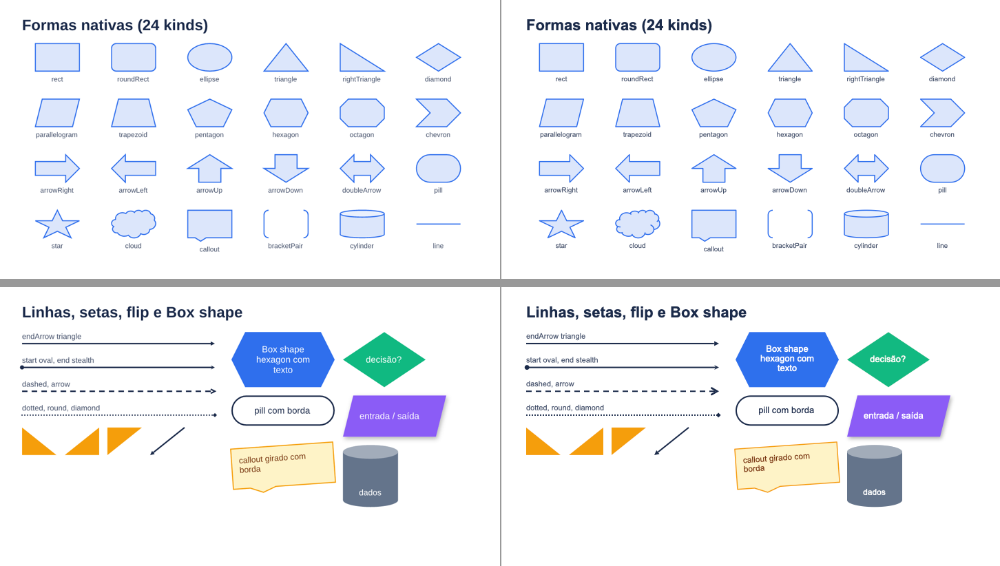

# M12 — formas, conectores e ícones: notas por etapa

## M12-1 — contrato
- `src/core/types.ts`: `ShapeKind` curado (24 kinds), `LineStyle`, `LineCap`, `LineJoin`, `ArrowType`; `ShapeProps` com flip, traço, ponta e setas; `FlexItemProps.id`; `BoxProps.shape`; primitivas `path`, `icon`, `connector` (`PathProps`, `IconProps`, `ConnectorProps`), `PathCommand`, `VectorPath`, `ResolvedPath/Icon/Connector`, `PositionedPath/Icon/Connector`; conectores ficam fora da árvore (`ResolvedSlide.connectors`, `PositionedSlide.connectors`). Diagnósticos `connector-target-missing`, `connector-omitted` (novo em relação ao plano: o "omitido com info" precisava de código próprio), `icon-rasterized`, `path-invalid`.
- `src/core/defaults.ts`: `DEFAULTS.shape.pptx` (prst + adj por kind), `adjScale`, `arrow`; `DEFAULTS.path`, `DEFAULTS.icon`, `DEFAULTS.connector`; `strokeColorOf` dá traço também ao `bracketPair`; `pathPaintOf`, `arrowSizeOf`.
- Diferenças em relação ao plano: `PositionedConnector.label` guarda um `PositionedText` (frame + `TextLayout` + runs) para o emissor e o preview reutilizarem o desenho de texto; `ResolvedIcon` guarda `VectorPath[]` (geometria + pintura) em vez de `ResolvedPath[]` (um traço de ícone não tem css/path próprios), e o raster leva o SVG recolorido e o motivo.
- CONTRACTS §M12 com as regras das etapas 2–5. Stubs nas tabelas de despacho (`<Path>/<Icon>/<Connector>` dão ResolveError até as etapas deles) para cada commit sair com typecheck e testes verdes.

## M12-2 — formas novas
- Resolve: `kind` validado contra as 24 kinds (`DEFAULTS.shape.pptx`), `lineStyle/lineCap/startArrow/endArrow` validados, setas só em `line`, `Box shape` (sem `line`), `id` (string não vazia) em todo nó com props de item.
- Emit: `prstGeom` da tabela; `pill` = roundRect adj 50000; `flipH/flipV`; `prstDash`; `headEnd/tailEnd`; `lineCap` via marca no `objectName` + pós-processamento (`src/emit/line-style.ts`, chamado no `sanitize`), que grava `cap="rnd"` e a junção na ordem do `CT_LineProperties`. `Box shape` usa a geometria no fundo, na borda uniforme (recuada) e no contorno; bordas por lado e raio numa forma viram `css-not-emitted`.
- Preview: `src/preview/shapes.ts` (fórmulas do `presetShapeDefinitions.xml`; `cloud` com os 11 `arcTo` convertidos de ângulo visual para paramétrico), `src/preview/arrows.ts` (pontas como polígonos, recuo da linha na ponta cheia, tracejado em múltiplos da espessura, pontilhado redondo como bolinhas — achado do Keynote), tampa do cilindro clareada (`lighten`).
- Keynote (`examples/diagrams/formas.tsx`, 2 slides): as 24 formas, linhas com setas/tracejado/flip e `Box shape` (hexagon, diamond, pill com borda, parallelogram com sombra, callout girado com borda, cylinder) iguais ao preview. Esquerda = preview, direita = Keynote: 
- Diferença menor aceita: a ponta `arrow` (aberta) sai um pouco maior no Keynote que no preview.
- Testes: `tests/emit/shapes.test.tsx` (XML por kind, pill, flip, setas, tracejado, cap, Box shape com padding, borda recuada, css-not-emitted), `tests/resolve/shape.test.tsx`, `tests/preview/shapes.test.ts` (elemento por kind, vértices de chevron/seta/hexágono/pentágono/estrela/callout, setas sem `<marker>`, flip, tracejado).
