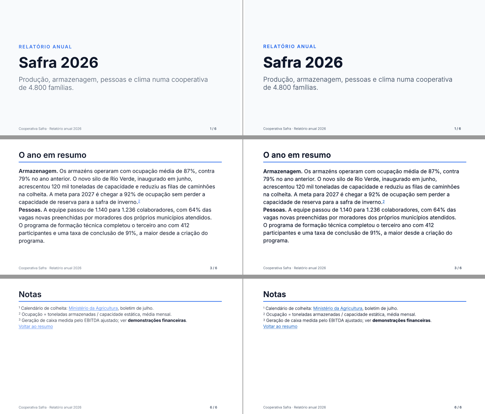

# M13 — texto e tipografia: notas por etapa

## M13-1 — contrato
- Tipos e padrões conforme CONTRACTS §M13. `FontWeight` passa a aceitar número, mas 400/700 continuam `'regular'`/`'bold'` (canônicos): o que já existe não muda.
- Inter 4.1 (OFL, release oficial github.com/rsms/inter) em `fonts/inter/`: Light (300), Regular (400), SemiBold (600), Bold (700) + `OFL.txt`; instalada em `~/Library/Fonts` na máquina de validação (com o ok do dono) para o Keynote mostrar os pesos. O pacote npm passa a levar só a Liberation (`files`), não a Inter.
- Stub: `<SlideNumber>` dá ResolveError até o M13-6.

## M13-2 — pesos numéricos
- Resolve: `fontWeight` 1–1000 (`parseFontWeight` devolve a forma canônica); pesos intermediários deixaram de ser `css-not-emitted`.
- Registro (`src/text/registry.ts`): `match(family, weight, italic)` com a ordem do CSS Fonts §5.2 (`weightPreference`); itálico ausente cai para as retas. **Mudança de contrato:** peso sem face agora usa a mais próxima (antes era `fontMissing`); `fontMissing` só quando a família não tem face nenhuma. 4 testes antigos atualizados para a regra nova.
- Medidor: `TextLayout.faces` (`runFaceOf`): 400/700 → família do autor + flag; outros → `familyName` (name ID 1) da face sem negrito; `previewFamily` = família tipográfica (ID 16). Fit: `font-weight-fallback` (warning) quando |pedido − usado| > 100, um por par no Text (agrupamento separa pares diferentes).
- Emit: `fontFace` por run só quando difere da caixa (o pptxgenjs omite `b` falso; a caixa não é negrito). Preview: `font-weight` numérico e `font-family` da face. Embed: face fora de 400/700 vai como `regular` sob o nome da própria face. Resolução no sistema: peso numérico pega a face com `usWeightClass` a até 50.
- Mapa de famílias do preview: família tipográfica da 1ª face de cada família (antes a última face vencia, e "Inter SemiBold" sequestrava "Inter").
- Calibração: XML dos slides de `calibration.tsx`, `calibration-rich.tsx` e `demo.tsx` idêntico byte a byte ao de antes da etapa (só 400/700), então 34/34 e 30/30 se mantêm.
- Keynote (`examples/texto/pesos.tsx`, config local `examples/texto/pptsx.config.ts` com Inter 300/400/600/700 em `~/Library/Fonts`): os 4 pesos e os Spans semibold/light idênticos ao preview; os dois avisos (Inter 100 → 300, Arial 900 → 700) saem. Achado operacional: o Keynote precisa ser reiniciado depois de instalar a fonte (antes disso substituiu a Inter inteira). Esquerda = preview, direita = Keynote: 
- Testes: `tests/text/weights.test.tsx` (parse, ordem de correspondência, registro com 4 faces, RunFace, largura real, requested, XML com typeface da face, aviso único, embed com o nome da face).

## M13-3 — sobrescrito e subscrito
- Experimento no Keynote (corpo 150 pt, `baseline` 10/30/50 % e −10/−25/−40 %): com `baseline` no run o Keynote **reduz o corpo sozinho para 2/3** (altura de maiúscula 72/108 px em todas as amostras); gravar `sz` menor reduz duas vezes. Decisão: `DEFAULTS.text.superscriptRatio = 2/3` (o plano estimava 0,65) e o emissor grava só `baseline`, sem mexer no `sz`. O deslocamento do Keynote segue o valor com um desvio fixo: sobrescrito sobe (b − 8 %) × corpo, subscrito desce (|b| + 1,3 %) × corpo; o preview usa a semântica do OOXML (b × corpo), então no Keynote um sobrescrito de 30 % fica ~0,08 × corpo mais baixo (1,4 pt a 18 pt). Largura: escala 2/3 conferida. A linha não muda de altura com 30 % (com 50 % o Keynote abre a 1ª linha).
- Resolve: `Span verticalAlign` (e `Sup`/`Sub`), herdado por Spans aninhados, inválido → ResolveError; `href` já entra no run e na fusão de runs (usado no M13-4).
- Medidor (fontkit e estimativa): largura do run com `runSizeOf`. Emit: opção `baseline` do pptxgenjs (30 % → 30000, −25 % → −25000). Preview: `font-size` × 2/3 e `baseline-shift`.
- Calibração (`scripts/calibration/h2.ts`, Keynote → PDF → PDFKit): `calibration-rich.tsx` com R31 (m²), R32 (H₂O, CO₂) e R33 (notas ¹ ²): **33/33** (30 + 3). O leitor de PDF não captura os dígitos deslocados dentro do retângulo da linha, então a ferramenta compara a linha sem os trechos sobrescritos/subscritos (o que importa é onde ela termina). `calibration.tsx`: 33/34 pelo PDFKit com o mesmo artefato conhecido do C05 (M11) — 34/34.
- Testes: `tests/text/vertical-align.test.tsx` (largura de m², altura de linha, resolve com Sup/Sub, erro, XML com baseline e sz intactos, preview).

## M13-4 — hyperlinks
- Resolve (`src/resolve/href.ts`): `href` em Text, Span, Image e Box; URL com esquema (`https:`, `mailto:`…) ou `slide:N` (N ≥ 1); forma inválida → ResolveError. O href do Text desce para os runs; o do Span vence.
- Fit (`src/fit/links.ts`, no fim do `fitDeck`): `slide:N` do autor → 1ª parte do slide N no deck de saída; N fora do deck → `link-target-missing` (error, com o total de slides) e o link sai do nó.
- Emit (`src/emit/link.ts`): `hyperlink` do pptxgenjs em runs (com a cor do próprio texto, `hlinkClr val="tx"` que o pptxgenjs grava), imagem e fundo do Box; Box sem fundo ganha um retângulo 100 % transparente clicável. Preview: `<a href>` em volta de Box/Image/Text com href (`slide:N` → `#slide-N`); links por trecho não aparecem no SVG (o PNG não muda).
- Pendente com o dono: clicar no PowerPoint (externo e interno). O Keynote é conferido com o `relatorio.tsx` no M13-5.
- Testes: `tests/emit/links.test.tsx` (herança de href, formas inválidas, hlinkClick e relacionamento externo, slide:3 → slide4.xml depois de paginar o slide 2, link-target-missing, imagem e Box com/sem fundo, preview).

## M13-5 — continuação de texto (`Text paginate`)
- Fit (`src/fit/paginate.ts` + `src/fit/text-split.ts`): o Text paginate é congelado no size do autor; bisseção do número de linhas que cabem (estouro no Text ou em ancestral); corte no fim de parágrafo se a parte ficar ao menos meio cheia, senão dentro do parágrafo com 2 linhas de cada lado. O resto do texto é remontado dos runs pelo deslocamento no conteúdo original (alinhamento por caracteres visíveis), então negrito, links, sobrescrito e NBSP continuam certos nas partes. Diagnóstico `slide-continued` com `data.kind: 'text'` e contagem de linhas.
- Resolve: um nó paginate por slide (Box ou Text; a mensagem antiga continua quando os dois são Box); Text paginate não aceita `position="absolute"` nem `maxLines`.
- Achado de carona (M13-4): o Keynote **sublinha** os trechos com link (mantendo a cor do texto, `hlinkClr tx`); o preview passou a sublinhar também, para mostrar o que o renderizador desenha (o plano dizia "só se o autor pedir").
- Keynote (`examples/texto/relatorio.tsx`, 3 slides do autor → 6 em 16:9 e 5 em 4:3: 10/10/10/5 e 15/15/5 linhas, cortes em fim de parágrafo, notas em sobrescrito com link para o slide de notas, Inter 300/600): mesmas linhas do preview em todas as partes. Esquerda = preview, direita = Keynote: 
- Testes: `tests/fit/text-paginate.test.tsx` (offsets com espaços repetidos/NBSP/\n, split com estilos, regras de corte e órfãs, partes com título e rodapé repetidos sem encolher, texto inteiro preservado, negrito só na 1ª parte, sem paginate não pagina, validações).

## M13-6 — número de slide e rodapé
- Resolve: `Deck footer` injetado em cada slide pelo componente `Footer` (Box absoluto do tamanho do slide, conteúdo na base), path `Slide > Footer > …` sem mexer nos índices do autor; `SlideNumber` (format `n` | `n / total`) = Text de uma linha medido no pior caso ("88 / 88").
- Fit (`src/fit/slide-number.ts`, depois da paginação e dos links): número e total do deck de saída; texto remedido no frame já calculado.
- Emit (`src/emit/slide-number.ts`): campo `<a:fld type="slidenum">` por run marcado + pós-processamento. **Achado do Keynote:** ele apaga todo texto que divide o parágrafo com o campo (antes ou depois: testados `[campo][ / 6]`, `[Pág. ][campo]`, `[Pág. ][campo][ de 6]`); por isso `n / total` sai em duas caixas (o campo e o ` / total` encostado), com as larguras naturais medidas no fit. Bug corrigido no caminho: o regex do pós-processamento começava num run anterior e engolia o texto até o run marcado (o preview estava certo, o XML não); teste específico.
- Keynote (`relatorio.tsx`, 6 slides de saída): "1 / 6" … "6 / 6" nas mesmas posições do preview, inclusive nas partes paginadas. 
- Pendente com o dono: reordenar slides no PowerPoint e ver o número atualizar.
- Testes: `tests/fit/slide-number.test.tsx` (rodapé em todas as partes com números do deck de saída, índices do autor intactos, XML do campo e das duas caixas, format n, regex do pós-processamento, format inválido).
