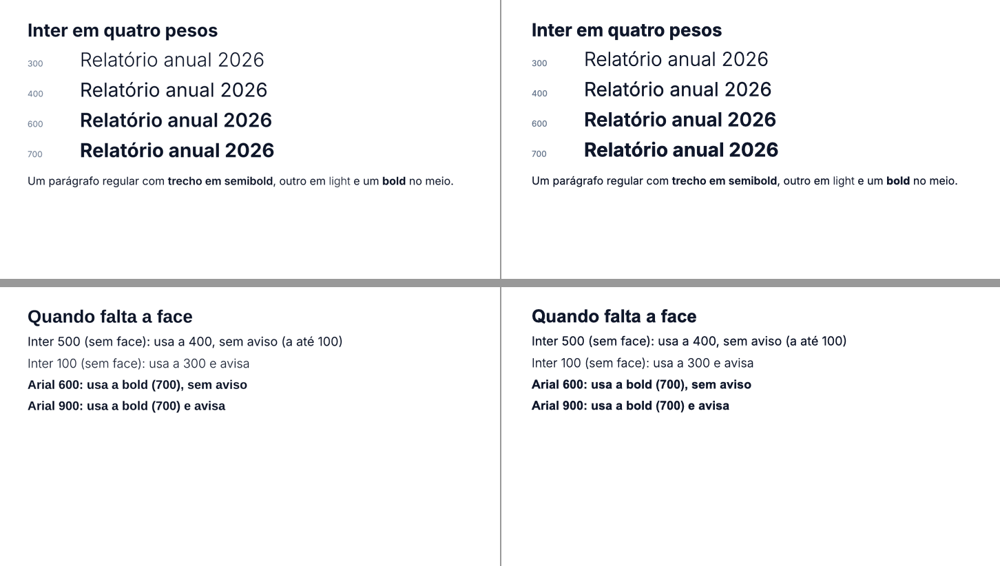

# M13 — texto e tipografia: notas por etapa

## M13-1 — contrato
- Tipos e padrões conforme CONTRACTS §M13. `FontWeight` passa a aceitar número, mas 400/700 continuam `'regular'`/`'bold'` (canônicos): o que já existe não muda.
- Inter 4.1 (OFL, release oficial github.com/rsms/inter) em `fonts/inter/`: Light (300), Regular (400), SemiBold (600), Bold (700) + `OFL.txt`; instalada em `~/Library/Fonts` na máquina de validação (com o ok do dono) para o Keynote mostrar os pesos. O pacote npm passa a levar só a Liberation (`files`), não a Inter.
- Stub: `<SlideNumber>` dá ResolveError até o M13-6.

## M13-2 — pesos numéricos
- Resolve: `fontWeight` 1–1000 (`parseFontWeight` devolve a forma canônica); pesos intermediários deixaram de ser `css-not-emitted`.
- Registro (`src/text/registry.ts`): `match(family, weight, italic)` com a ordem do CSS Fonts §5.2 (`weightPreference`); itálico ausente cai para as retas. **Mudança de contrato:** peso sem face agora usa a mais próxima (antes era `fontMissing`); `fontMissing` só quando a família não tem face nenhuma. 4 testes antigos atualizados para a regra nova.
- Medidor: `TextLayout.faces` (`runFaceOf`): 400/700 → família do autor + flag; outros → `familyName` (name ID 1) da face sem negrito; `previewFamily` = família tipográfica (ID 16). Fit: `font-weight-fallback` (warning) quando |pedido − usado| > 100, um por par no Text (agrupamento separa pares diferentes).
- Emit: `fontFace` por run só quando difere da caixa (o pptxgenjs omite `b` falso; a caixa não é negrito). Preview: `font-weight` numérico e `font-family` da face. Embed: face fora de 400/700 vai como `regular` sob o nome da própria face. Resolução no sistema: peso numérico pega a face com `usWeightClass` a até 50.
- Mapa de famílias do preview: família tipográfica da 1ª face de cada família (antes a última face vencia, e "Inter SemiBold" sequestrava "Inter").
- Calibração: XML dos slides de `calibration.tsx`, `calibration-rich.tsx` e `demo.tsx` idêntico byte a byte ao de antes da etapa (só 400/700), então 34/34 e 30/30 se mantêm.
- Keynote (`examples/texto/pesos.tsx`, config local `examples/texto/pptsx.config.ts` com Inter 300/400/600/700 em `~/Library/Fonts`): os 4 pesos e os Spans semibold/light idênticos ao preview; os dois avisos (Inter 100 → 300, Arial 900 → 700) saem. Achado operacional: o Keynote precisa ser reiniciado depois de instalar a fonte (antes disso substituiu a Inter inteira). Esquerda = preview, direita = Keynote: 
- Testes: `tests/text/weights.test.tsx` (parse, ordem de correspondência, registro com 4 faces, RunFace, largura real, requested, XML com typeface da face, aviso único, embed com o nome da face).
