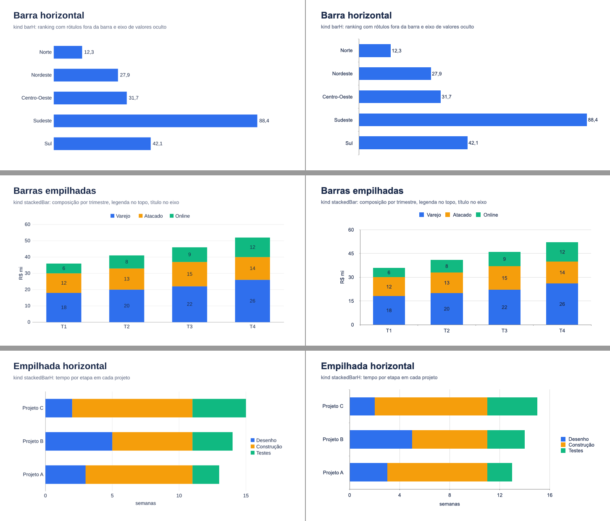
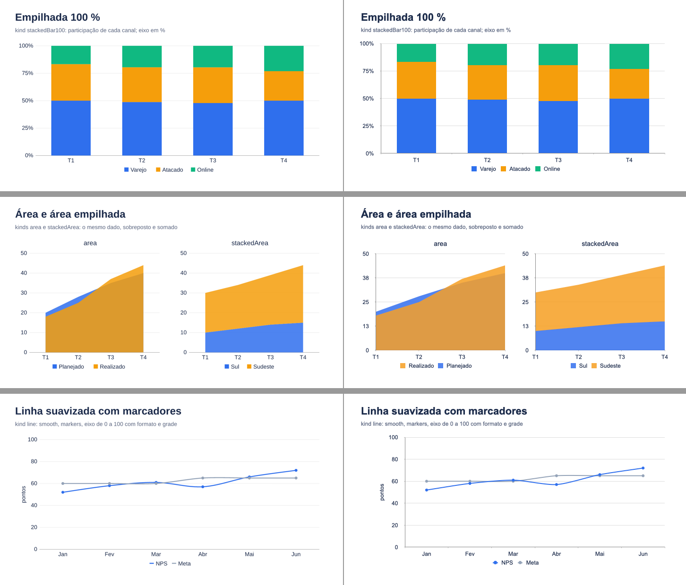
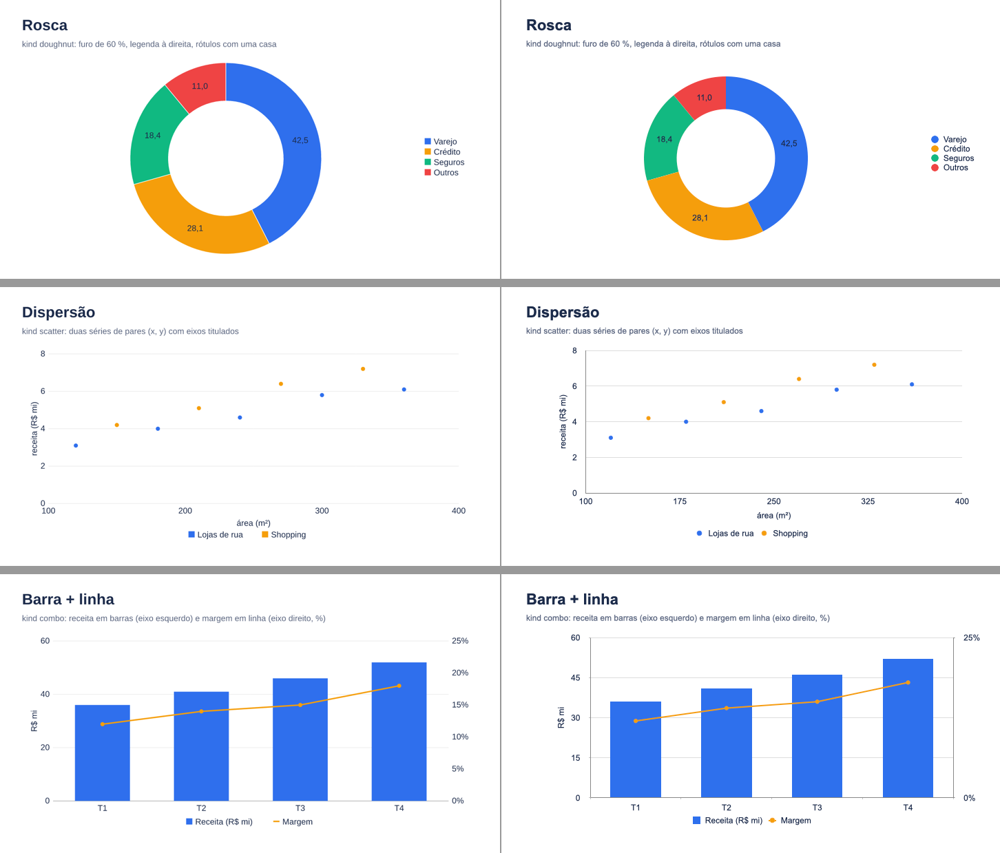
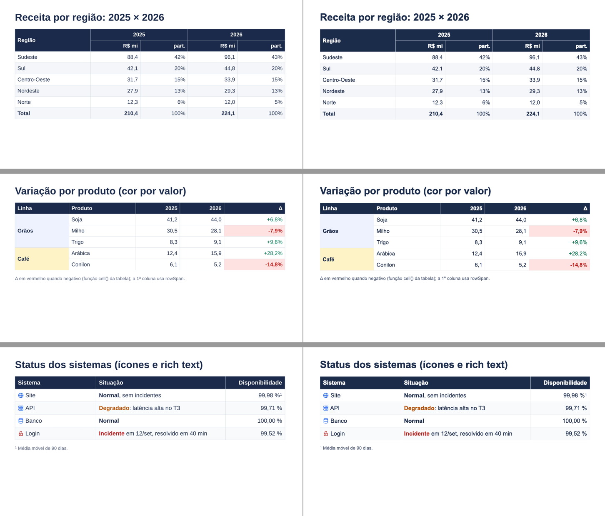
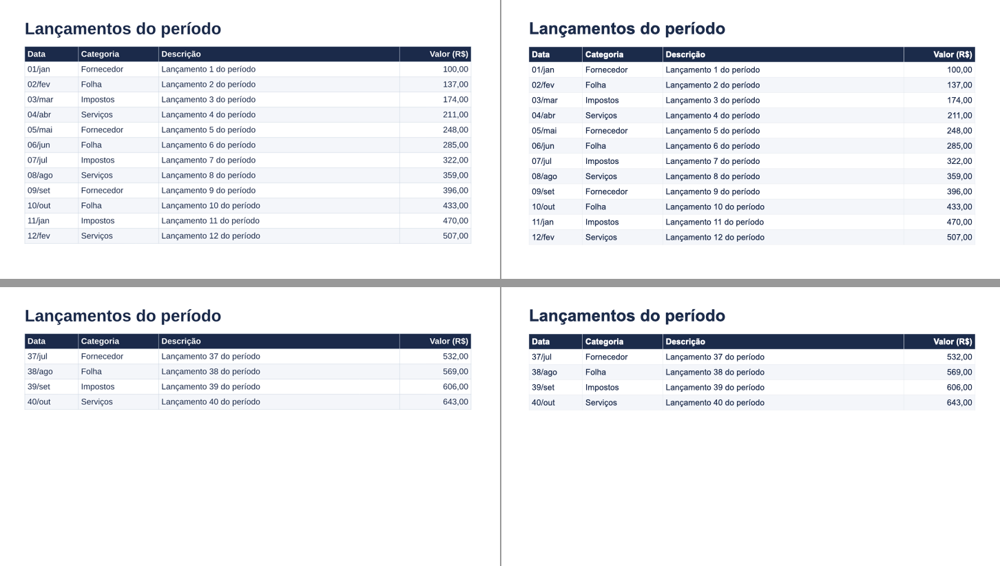

# M14 — gráficos e tabelas 2: notas por etapa

## M14-1 — contrato
- Tipos e padrões conforme CONTRACTS §M14 (diferenças em relação ao plano listadas lá: ResolveError em vez de `chart-data-invalid`/`table-merge-invalid`, `stackedBar100` sem exigir soma, `headerRows`, `icon` de célula, sem `spans`).
- Resolve já valida os 12 kinds (os novos dão "ainda não está disponível" até o M14-2) e monta a grade completa da tabela (`tableGridOf`, merges, `cell()`, estilo, rich text, ícone). Layout/emissão/preview continuam lendo o texto das linhas até o M14-3.
- Testes antigos ajustados: `kind` inválido agora é "radar" (area virou válido); `values`/`categories` opcionais nos tipos.

## M14-2 — gráficos novos
- Emit reescrito para os 12 kinds (CONTRACTS §M14 "Gráficos"). Três achados no caminho: (1) o combo do pptxgenjs é `addChart(camadas, opções)` — com `addChart(camadas, [], opções)` as opções viravam um array e o build quebrava em `plotArea.fill`; (2) no scatter, ponto ausente de uma série sai `<c:v></c:v>` e o Keynote desenha em 0 → o pós-processamento omite o ponto; (3) o eixo secundário herdava o título do primário → `showValAxisTitle: false` quando o autor não dá título.
- Preview reescrito (barras H/V, pilhas, 100 %, áreas, rosca, pontos, combo com 2 eixos, títulos de eixo, legenda em 4 posições).
- Keynote (`examples/dados/graficos.tsx`, 9 slides, um tipo por slide): **10 gráficos nativos** (`count of charts`), dados certos em todos; preview reconhecível (as marcas automáticas dos eixos diferem às vezes: o Keynote escolhe passo 15 onde o preview escolhe 10). No combo o Keynote ignorou o `step` do eixo secundário (mostra só 0 % e 25 %). Esquerda = preview, direita = Keynote:   
- Testes: `tests/emit/charts-m14.test.tsx` (XML por kind, 100 % com eixo em %, área, rosca com holeSize, scatter com ponto omitido, combo com dois valAx, eixos/legenda/rótulos, 6 validações, preview por kind).
- Pendente com o dono: combo com eixo secundário e formatos de eixo no PowerPoint.

## M14-3 — células: merge, estilo e rich text
- Layout, emissão, preview e fit leem a grade (CONTRACTS §M14 "Células"). Ajustes de desenho que o exemplo revelou: a linha de `columns[].header` respeita colunas ocupadas por um `rowSpan` de `headerRows` (o título é da coluna); `cell()` pode devolver `text` (formatar e colorir pelo número, como o Δ do slide 2).
- **Achado do Keynote:** margem por célula (`<a:tcPr marL>`) e recuo de parágrafo (`<a:pPr marL>`) são ignorados (testados os dois, com o XML editado à mão); um espaço inicial com `spc` funciona. Por isso a célula com ícone é de uma linha só (o plano já limitava o ícone a uma linha) e o emissor abre o espaço do ícone com esse espaçador.
- Keynote (`examples/dados/tabelas.tsx`, slides 1–3): cabeçalho de dois níveis mesclado (`headerRows` com rowSpan/colSpan), zebra, linha total em negrito; `rowSpan` na 1ª coluna com fundo próprio e Δ colorido por `cell()`; ícones e rich text (negrito, cor, sobrescrito) — iguais ao preview. 
- Testes: `tests/emit/table-cells.test.tsx` (headerRows e linha de columns, rowSpan, `cell()` com texto e cor, `children` com `<B>`, 5 merges inválidos, rowSpan repartindo altura, XML com gridSpan/rowSpan/hMerge/vMerge, fill e cor, valign, ícone com espaçador e info, grade do preview sem linha interna).

## M14-4 — Table paginate
- Fit (`src/fit/paginate.ts`): mesma estrutura do Text paginate — bisseção por linhas de dados com a tabela congelada, corte só onde nenhum `rowSpan` atravessa (`tableCutsOf`), cabeçalho repetido (ou não, com `repeatHeader={false}`), `slide-continued` com `kind: 'table'` ("12 de 40 linhas da tabela no 1º, …"). Resolve: Table entra na regra de um paginate por slide e rejeita `position="absolute"`.
- Keynote (`examples/dados/tabelas.tsx`, slide 4, 40 lançamentos): 16:9 → 4 partes (12/12/12/4), 4:3 → 3 partes (19/19/2); cabeçalho repetido, zebra contínua, preview e Keynote iguais. Esquerda = preview, direita = Keynote (1ª e última parte): 
- Testes: `tests/fit/table-paginate.test.tsx` (cortes com rowSpan, 40 linhas com cabeçalho repetido e todas as linhas em ordem, `repeatHeader={false}`, rowSpan 3 na fronteira inteiro na parte seguinte, sem paginate → `table-overflow`, dois paginate e absoluto → ResolveError).
