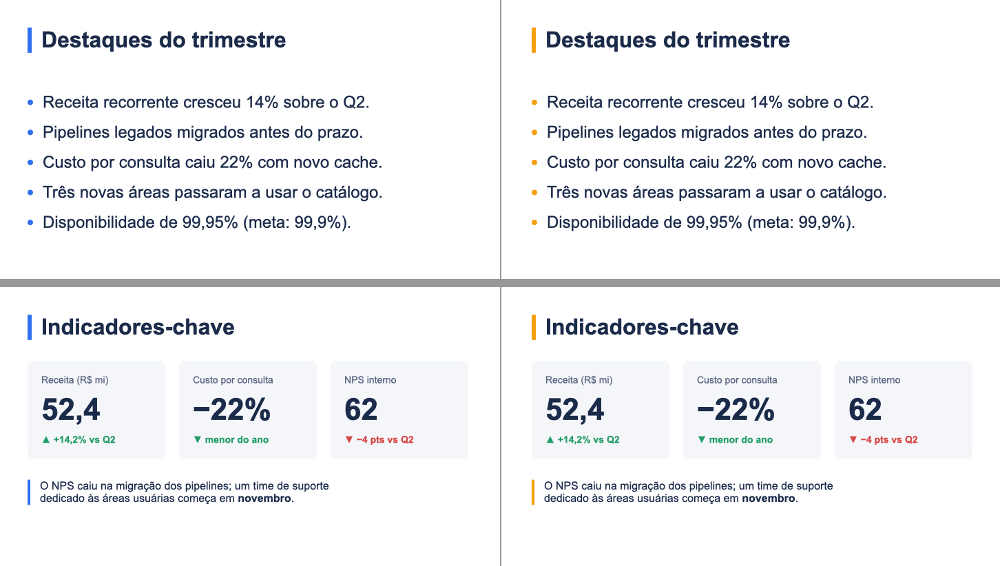
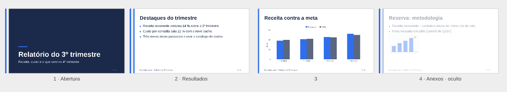
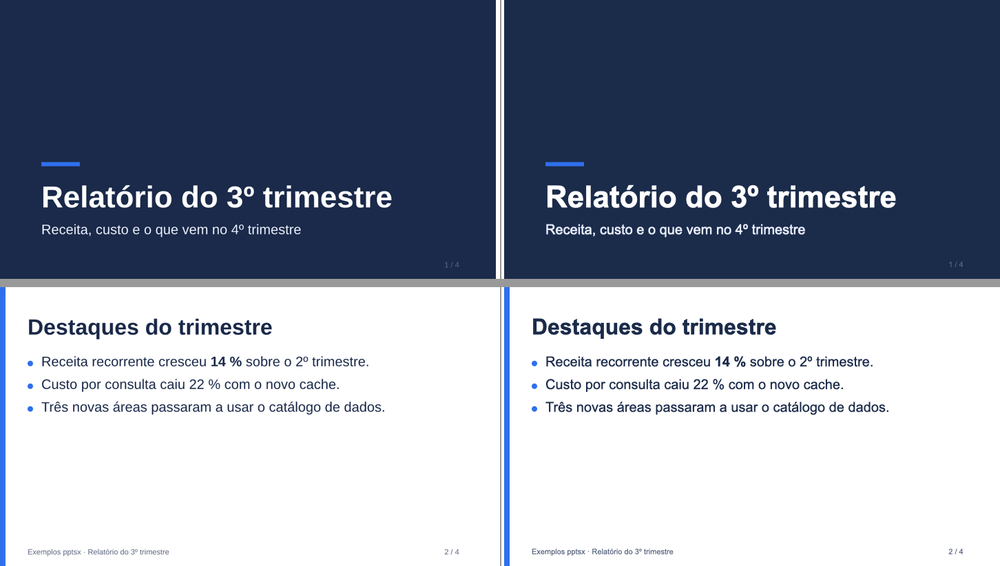
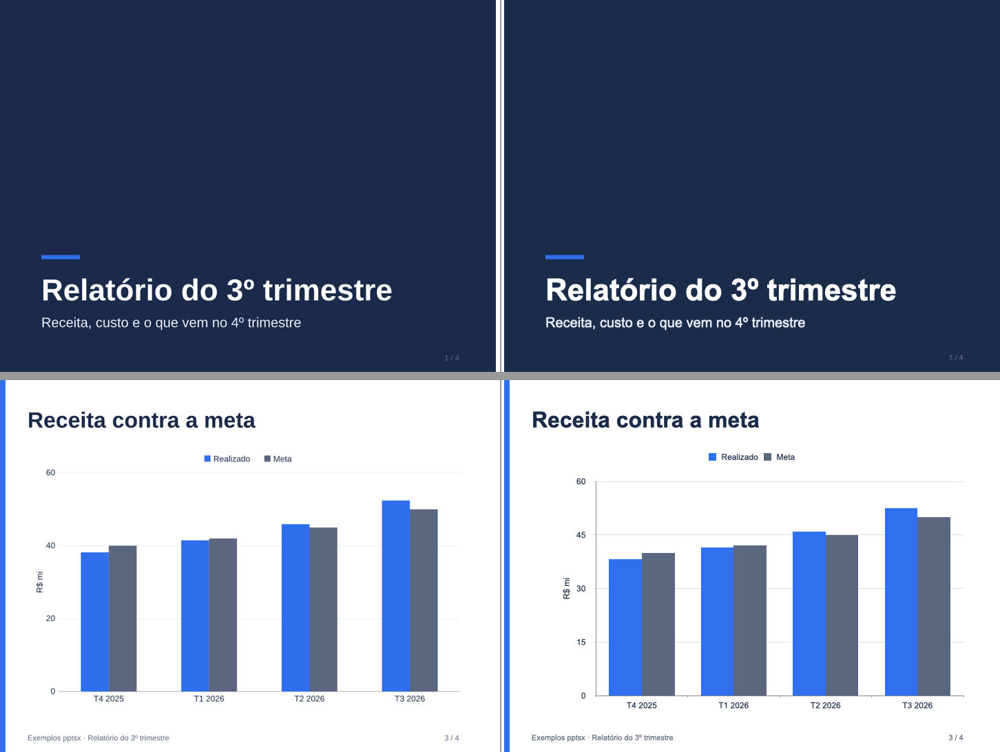

# M15 — arquivo e tema: notas por etapa

## M15-1 — contrato
- Tipos, padrões e resolve conforme CONTRACTS §M15 (diferenças em relação ao plano listadas lá: sem `theme-color-unused`, Box placeholder só reserva a área, seção padrão para slides antes da 1ª seção).
- Spike antes do contrato (o risco do plano): um .pptx com `<a:schemeClr val="accent1">`, `tx2`, `accent2` e fontes `+mj-lt`/`+mn-lt` apontando para Georgia/Courier New no `theme1.xml` abre no Keynote com as cores e as fontes do tema. O caminho do pós-processamento está aberto.
- Spike do pptxgenjs: placeholder pelo próprio pptxgenjs copia posição e estilo do placeholder do layout para o objeto do slide (`Object.assign(itemOpts, placeHold.options)`), o que anularia o frame calculado de cada slide; o vínculo vai ser feito no pós-processamento (nome do shape → `<p:ph>`), mantendo o `xfrm` e o estilo de cada slide. `pic` também não sai com `type` pelo pptxgenjs (`PLACEHOLDER_TYPES['pic']` não existe).
- Resolve já monta layout, notas, seções e valida placeholders; a emissão ainda usa só o texto das notas (rich text no M15-3).
- Testes: `tests/resolve/layout.test.tsx` (layout no slide, fixed, 4 erros de placeholder, 3 de layout, notas rich/string, hidden, 4 erros de seção, `placeholder-unused` no slide de saída); snapshot do resolve com `notes`.

## M15-2 — tema de cores e fontes
- Pós-processamento `src/emit/theme.ts` (CONTRACTS §M15 "Tema"). Decisão: só as cores que o autor **declarou** viram referência ao tema; com todas (as do Office preenchidas), todo preto do deck — sombras inclusive — viraria `tx1`.
- Exemplo: `examples/theme.ts` (`themeOf(tokens)`; `ink` e `brand` têm o mesmo hex, então só `dark1`) e `examples/arquivo/pptsx.config.ts`, que aplica o tema a quem roda o build nessa pasta.
- Keynote (demo, 16:9): com o tema, os 6 slides saem **idênticos pixel a pixel** ao build sem tema (as cores vêm do tema e batem). Com o mesmo arquivo e só o `accent1` trocado para laranja no `theme1.xml`, barras de título, marcadores e a barra da nota mudam de cor; o resto fica. Esquerda = tema dos tokens, direita = `accent1` trocado: 
- Testes: `tests/emit/theme.test.tsx` (resolveTheme e 3 erros, clrScheme na ordem, só declaradas com filhos preservados, empate, fontes do tema, ponta a ponta com slide/tema/gráfico, sem tema igual, preview igual).
- Pendente com o dono: seletor de cores do PowerPoint mostrando a paleta.

## M15-3 — seções, oculto, notas e propriedades
- Conforme CONTRACTS §M15 "Seções, oculto, notas e propriedades". Ajuste: título de seção repetido virou `ResolveError` (o pptxgenjs localiza a seção pelo título).
- Deck de validação `examples/arquivo/arquivo.tsx` (capa + 3 slides de conteúdo, seções Abertura/Resultados/Anexos, slide 4 oculto, notas com negrito/itálico/link, rodapé numerado); o `pptsx.config.ts` da pasta dá tema e propriedades. Overview com as legendas: 
- Keynote (AppleScript): slide 4 `skipped = true`, os outros `false`; notas com os dois parágrafos e o texto certo. O AppleScript só devolve texto puro: a formatação das notas fica coberta pelo XML nos testes e pelo PowerPoint do dono. O Keynote não tem seções (ignora o `sectionLst` sem reclamar).
- Testes: `tests/emit/file.test.tsx` (seções após paginação com a padrão, sem seções, título repetido, `show="0"` em todas as partes, parágrafos e detecção de notas ricas, XML das notas e o rel do link, notas simples intactas, core.xml/app.xml, legenda do overview).

## M15-4 — masters e layouts com placeholders
- Conforme CONTRACTS §M15 "Masters e layouts". O conteúdo fixo é identificado pela **contagem** de elementos emitidos por último no 1º slide do layout, não por nome: o `objectName` já é usado pelo marcador de pontas de linha (M12) e é trocado no `sanitize`.
- **Achado do Keynote:** sem `b` no run, o texto ligado a um placeholder herdava o negrito do estilo de subtítulo do Keynote → negrito/itálico explícitos em todo run de shape ligado. (O subtítulo claro sobre o azul continua parecendo mais encorpado no Keynote, mas igual ao build da demo sem layouts: é a suavização de texto claro em fundo escuro, já presente antes do M15. Conferido com três variantes do arquivo — tipo `body`, sem `<p:ph>`, Arial sem fonte do tema — todas iguais.)
- Keynote (`examples/arquivo/arquivo.tsx`): masters importados **Capa** e **Conteúdo** (além do padrão), cada slide com `base layout` certo e `title showing = true`; faixa azul e assinatura saem do master em todos os slides de conteúdo; slides visíveis iguais ao preview em 16:9 e 4:3 (o oculto não é exportado pelo Keynote, como esperado).  
- Demo sem layouts: todas as partes XML idênticas às do build do M15-2.
- Testes: `tests/emit/layouts.test.tsx` (layout com `<p:ph>` no frame e estilo do 1º uso, subtítulo/body com idx, slides ligados com o próprio xfrm, Box sem vínculo, slide solto, conteúdo fixo só no layout, imagem fixa com o rel copiado, sem layout = só o padrão, `explicitRunStyle`, `takeLastDrawings`).
- Pendente com o dono (PowerPoint): "Redefinir slide" e "Novo slide" com os layouts do deck.
