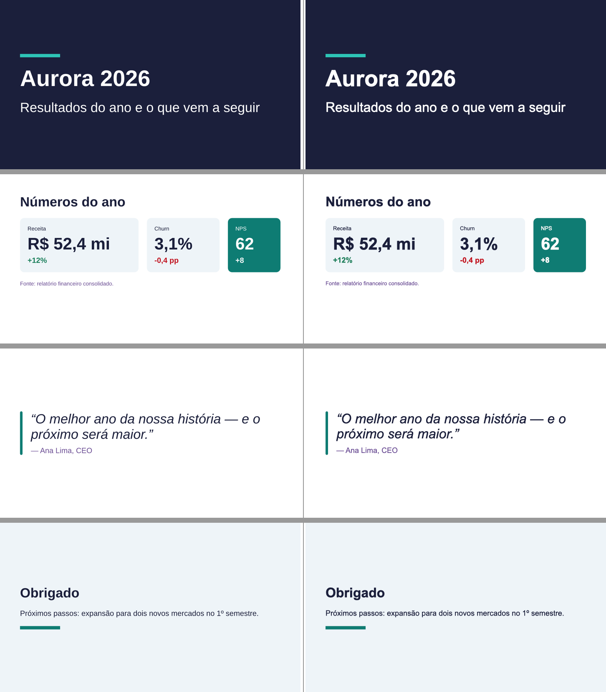

# M17 — extração: núcleo concreto e ganchos para design systems

## M17-1 — ganchos no núcleo
- Conforme CONTRACTS §M17 "Ganchos no núcleo". O `component` só vai no nó que o componente gerou (não nos filhos): uma regra "KpiRow com no máximo 4 filhos" olha o nó do KpiRow e os filhos dele, sem confundir os filhos com o KpiRow.
- `PrimitiveKind` não ganhou nada: componentes continuam expandidos antes do resolve; a identidade viaja no `ExpandedPrimitive` (`component`) junto com o segmento, que sempre veio do componente mais externo.
- Fixtures: nenhuma mudou; o snapshot do resolve ganhou `component` nos nós gerados por componente (`Title`, `CoverLayout`).
- Testes: `tests/extension/hooks.test.tsx` (displayName no path e meta no nó, defaults, função anônima embrulhada, função comum, regra externa com code/path e deduplicada entre tamanhos, `disable`, regra que lança, `renderFragment` com frames/SVG/PNG, `defineDs` inválido, MCP com `source` no guia/schema e fonte desconhecida, `--ds`).

## M17-2 — workspaces e `@pptsx/ds-kit`
- `git mv` do núcleo para `packages/pptsx/` (src, bin, fonts, tests, tools, examples, scripts de calibração, tsconfigs, vitest, README com `docs/readme`, `docs/AGENT_GUIDE.md`, CHANGELOG; LICENSE copiada). Na raiz ficam `docs/spec.md`, `docs/work/`, `scripts/keynote-export.sh`, CI, CLAUDE.md (comandos e caminhos atualizados) e um `package.json` privado com `workspaces`. 1975 testes do núcleo verdes no lugar novo; `test:package` verde; nenhuma referência de código cruzando a fronteira (só logs antigos citam caminhos velhos).
- npm só aplica `overrides` da raiz: o do `image-size` (M16-1) subiu para o `package.json` raiz (com versão explícita). `npm audit`: 0.
- `pptsx` vai a 0.7.0 já nesta etapa (os peers dos pacotes novos pedem `>=0.7.0`; com 0.6.0 o npm ia buscar no registro e dava 404).
- **API pública nova do núcleo** (genérica, sem marca), para o kit não importar caminho interno: `mapResponsive`/`isResponsive`/`pickResponsive`, `toHexColor`, `resolveTheme`, `buildOverview`, `defaultFontFiles`, `lintDeck`, e os tipos da árvore (`ResolvedNode`, `ResolvedSlide`, `PositionedNode`…, `CssStyle`, `Rect`, `Child`, `Component`…).
- `@pptsx/ds-kit` 0.1.0 (`packages/ds-kit`, peer `pptsx >=0.7.0`): `defineTokens` (cores normalizadas e validadas, congela, `tokenAt`, `scale` a 0,5 pt), `themeOf(tokens, mapa)` + `checkTheme` (WCAG AA como aviso: 4,5 texto, 3 acentos), `createVariants` (escolha responsiva vira props responsivas via `mapResponsive`), `slot`/`filledSlots`/`Slots<K>`, `defineRule` e regras prontas (`colorsFromTokens`, `fontsFromTheme`, `maxChildren`, `onlyOnSlide`), `createDs` (núcleo `defineDs` + `implementations` para o catálogo + avisos), `guideOf`, `catalog` (PNG por caso, overview por componente, `fixtures/<Componente>.json`; `check` compara ±1 pt), `schemaOf` (props dos componentes pelos tipos, API do TS 5/6) e o bin `pptsx-ds catalog`.
- Diferença do plano: sem `no-inline-style` — depois do resolve o `style` já foi fundido no `css` e a regra não teria o que olhar (uma regra de DS só vê a árvore resolvida).
- Testes do kit (`packages/ds-kit/tests/kit.test.tsx`, 8): tokens, tema e contraste, variantes (inclusive responsivas e opção inexistente), slots, três regras pelo nome do componente (o teste achou um bug no `onlyOnSlide`, que exigia `parent` ausente), `createDs`, e o catálogo de um componente de teste: grava 5 PNGs e as fixtures, `check` passa e acusa 2 pt de diferença.

## M17-3 — `@pptsx/ds-base` extraído
- **Antes de mover**, gravei os frames de todos os decks que iam sair (demo, showcase, long-list, charts, galeria ×6, texto ×3, dados ×2, diagrams/arquitetura, arquivo; 16x9 e 4x3, cada um com a config da própria pasta) em `ds-base/tests/__fixtures__/decks-positioned.json`. Depois da extração e da reescrita, `tests/parity.test.ts` reconstrói os 17 decks **só pela API pública** e confere mesmos slides, mesmos paths e frames ±1 pt — passa. A parte do `css-positioned.json` do núcleo que era do DS (demo, long-list, charts, showcase, m9; 16x9/4x3/wide, com corpo, linhas e diagnósticos) também veio e passa.
- `git mv` de tokens, tema, layouts, componentes, decks de marca, decks de `agent-test` que usam o DS, a Inter (fonte da marca) e dos testes `components`/`layouts`/`demo` (com o snapshot de paths — inalterado). Os decks importam tudo de `@pptsx/ds-base`. Ícones e `chart.png` foram copiados (o núcleo ainda os usa).
- Reescrita: `defineTokens`/`themeOf` do kit; os 7 componentes com `defineComponent` (mesmos nomes → mesmos paths); `KpiCard` com `createVariants` (as três medidas por tamanho; responsivo igual ao `mapResponsive` antigo); `TwoColumn` com slots; o `responsive.ts` local saiu (o núcleo exporta `mapResponsive`). `meta.catalog` em `Bullets`, `KpiCard`, `KpiRow` e `TwoColumn` (layouts devolvem Slide e não cabem num fragmento).
- **Catálogo:** `pptsx-ds catalog src/ds.ts` → 4 overviews e 18 renderizações; `--check` bate com `fixtures/`. Ajuste que o catálogo pediu ao núcleo: um `KpiCard` (`flex={1}`) esticava até o fim do slide no fragmento → `renderFragment` passou a pôr o elemento num Box do tamanho do conteúdo, sem esse invólucro aparecer nos paths (`fill: true` para quem preenche o corpo, como o `TwoColumn`); e a legenda do overview ganhou `label` (antes usava a de seção, com a barra azul).
- `schemaOf` do kit precisou de dois ajustes para o DS real: seguir `export … from` (alias) e usar o tsconfig mais próximo (sem os `paths` do monorepo o `@pptsx/ds-kit` não resolvia e os componentes viravam `any`).
- **Núcleo:** os testes que usavam o DS passaram a usar cópias congeladas (`tests/examples/legacy/broken-original.tsx` sobre os layouts/componentes legados; `tests/examples/frozen/` com o `KpiRow` para o `word-broken`; a Inter em `tests/fixtures/fonts`); `probe/table.tsx` ganhou o slide de conteúdo e as cores inline (mesmos valores, mesmo nome `ContentLayout` → fixtures de diagnóstico iguais); a config de `texto/` usa `defaultFontFaces()` em vez do caminho das Liberation.
- `pptsx lint` com o DS registrado (config de `ds-base/examples`) acusa o hex fora dos tokens (`ds-base/colors-from-tokens`), conferido pela CLI. Testes do ds-base: 76 (paridade 17 decks, css-parity 15 casos, componentes, layouts, demo, catálogo, regras).

## M17-4 — núcleo sem marca
- `packages/pptsx/examples/` só com primitivas: `hello`, `layout-test`, `overflow` (o `Bullets` dele é local, de primitivas), `calibration*`, `probe/*` (o `table.tsx` com o slide de conteúdo inline), `diagrams/formas|fluxo|icones|path|receitas`, `agent-test/` (os decks de primitivas e os LOGs; os que usam o DS foram para o `ds-base`). Os decks de `docs/readme/decks/` já eram só de primitivas.
- Guia do agente: §5 deixou de documentar componentes e passou a explicar **como um DS se liga** (usar um DS, registrar na config, os ganchos `defineComponent`/`mapResponsive`/`LintRule`/`renderFragment`/`defineDs` e o que o `ds-kit` monta), apontando para o guia do `ds-base` pelo MCP (`guide({ source: '@pptsx/ds-base' })`); `defineLayout` ficou (é recurso do arquivo). §2 importa de `@pptsx/ds-base`; §6 avisa que as receitas usam o DS de exemplo; §7 diz onde um deck do repo que usa o DS fica (`packages/ds-base/examples/agent-test/`) e que um projeto próprio instala um DS ou cria o seu.
- README do núcleo: seção "Design systems em cima do pptsx" (topologia, tabela de ganchos, links para os dois pacotes; a galeria e as imagens vêm do `ds-base`, dito no texto), links dos decks movidos apontando para `../ds-base/examples/`, tabela de exemplos e comandos de desenvolvimento atualizados.
- Conferências do plano: `grep -r "examples/components\|examples/layouts\|tokens.ts" packages/pptsx/src` vazio; `src/index.ts` sem nada de `examples/`; `npm pack --dry-run` do núcleo sem decks, tokens, Inter ou galeria (314 arquivos, 1,2 MB, como antes).

## M17-5 — prova com um DS de terceiro e gate
- `packages/ds-kit/README.md`: o guia de uma página (montagem no repo e fora, tokens e tema, componentes com variantes/slots/catálogo, regras, manifesto, uso/conferência/MCP, armadilhas). Os trechos foram compilados e construídos de uma pasta nova antes de entregar ao agente.
- **Agente virgem** (`examples/third-party-ds/LOG.md`), só com esse guia: criou o **Aurora DS** — `defineTokens` + `themeOf` (o `checkTheme` apontou contraste 2,17:1 e ele trocou a cor), `Hero`, `StatCard`, `Quote` com variantes e catálogo, regras `aurora-ds/cores` (pronta) e `aurora-ds/hero-so-na-capa` (`defineRule`), `createDs`, config e um deck de 4 slides. **2 builds** (o 1º falhou por exportar o `<Deck>` direto; o 2º exit 0 sem diagnóstico), catálogo gravado e `--check` ok, as duas regras dispararam numa cópia errada, `guide({ source: 'aurora-ds' })` pelo MCP com `--ds`. Nada fora da pasta, nenhum import interno.
- **O que ele achou e virou correção:**
  - *Lint da raiz não lia a config da pasta do DS* (as regras sumiam em silêncio): `pptsx build/lint/preview` passaram a usar a config da pasta do deck ou a mais próxima acima (`configDirOf`, o mesmo do MCP), caindo para o cwd. Conferido: da raiz, a cópia errada dispara `aurora-ds/hero-so-na-capa` e `aurora-ds/cores`.
  - *`borderLeftWidth` + `borderLeftColor` não desenhavam nada, sem aviso*: é o CSS (estilo padrão `none` → largura computada 0); agora sai `css-not-emitted` com a troca (`borderLeft="6px solid <cor>"`), e as longhands por lado (`border{Top,Right,Bottom,Left}{Width,Style,Color}`) entraram nos tipos (o resolve já as aceitava).
  - *`StatCard` com `flex={1}` colapsava no catálogo*: o invólucro do `renderFragment` era uma coluna flex de altura pelo conteúdo, onde base 0 colapsa. Virou uma coluna de grid (largura toda, altura do conteúdo, `flex` não vale). **Isso mostrou que as fixtures do `KpiCard` gravadas no M17-3 estavam colapsadas** (textos com altura 0 — o overview parecia certo porque o SVG desenha o texto sem olhar a altura do frame); foram regravadas, e o `--check` passou a defender o tamanho certo.
  - `guide` do MCP para um DS mostrava o título do guia do núcleo → título da fonte; `checkTheme` só olhava `accent1…3` → os seis acentos e `dark2` sobre `light2`.
  - Guia do kit completado: como exportar o deck, onde estão as primitivas/props (guia do núcleo e `schema` do MCP), breakpoints, slots do tema, campos do retorno de uma regra, como ligar o `schemaOf` ao `createDs`, onde a config é procurada.
- **Keynote:** o deck do Aurora (4 slides, 16:9 e 4:3) igual ao preview . O catálogo é PNG do preview (não há .pptx de catálogo); os decks do `ds-base` saem com o XML idêntico ao de antes da extração (só `docProps/core.xml` muda, pela data), então a validação de Keynote dos marcos anteriores continua valendo.
- Pacotes: `npm run build` e `npm pack --dry-run` dos três (núcleo 314 arquivos sem marca; `ds-kit` 23 arquivos, 16 kB; `ds-base` 49 arquivos com guia e Inter). Os dois pacotes novos declaram `@types/node` (sem os `paths` do monorepo o build não achava os tipos do Node).
- Gate: BOARD, ROADMAP, CHANGELOGs (núcleo 0.7.0; `ds-kit` e `ds-base` 0.1.0), política em `docs/work/README.md` (o que entra no núcleo; como um DS evolui: semver das props, fixtures do catálogo como contrato visual).
