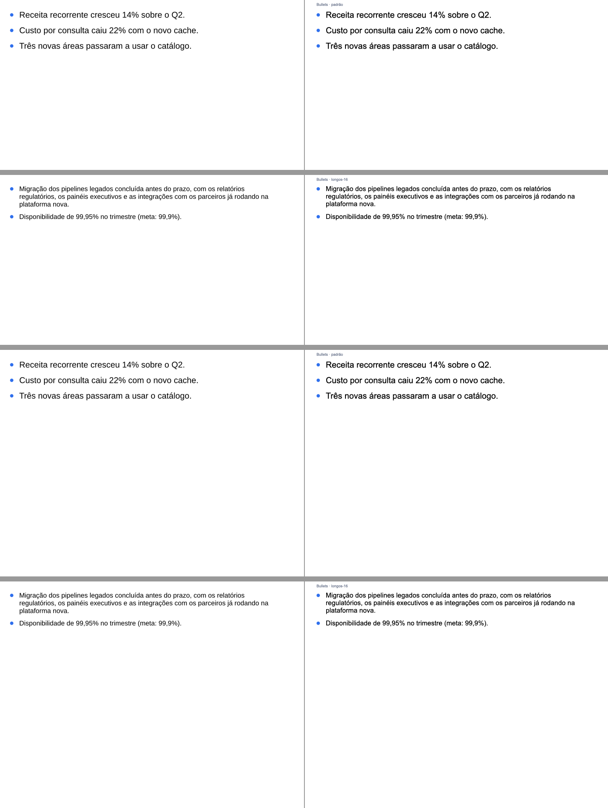
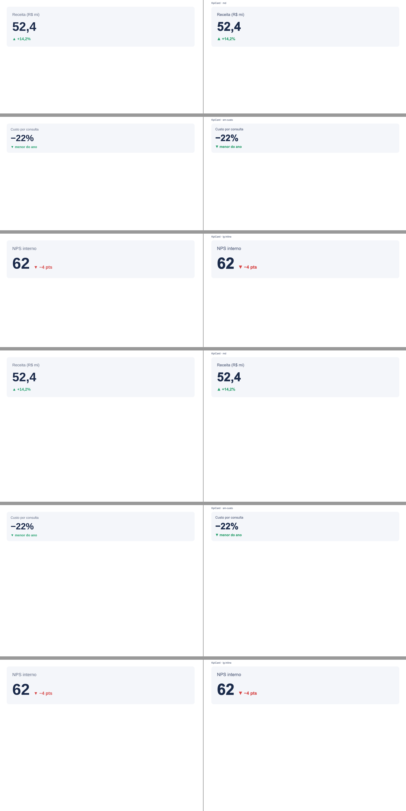
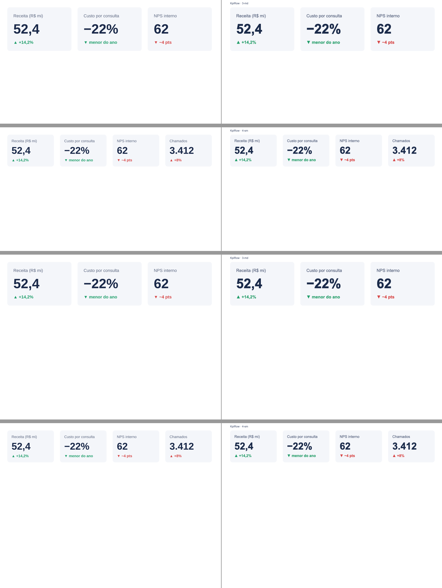
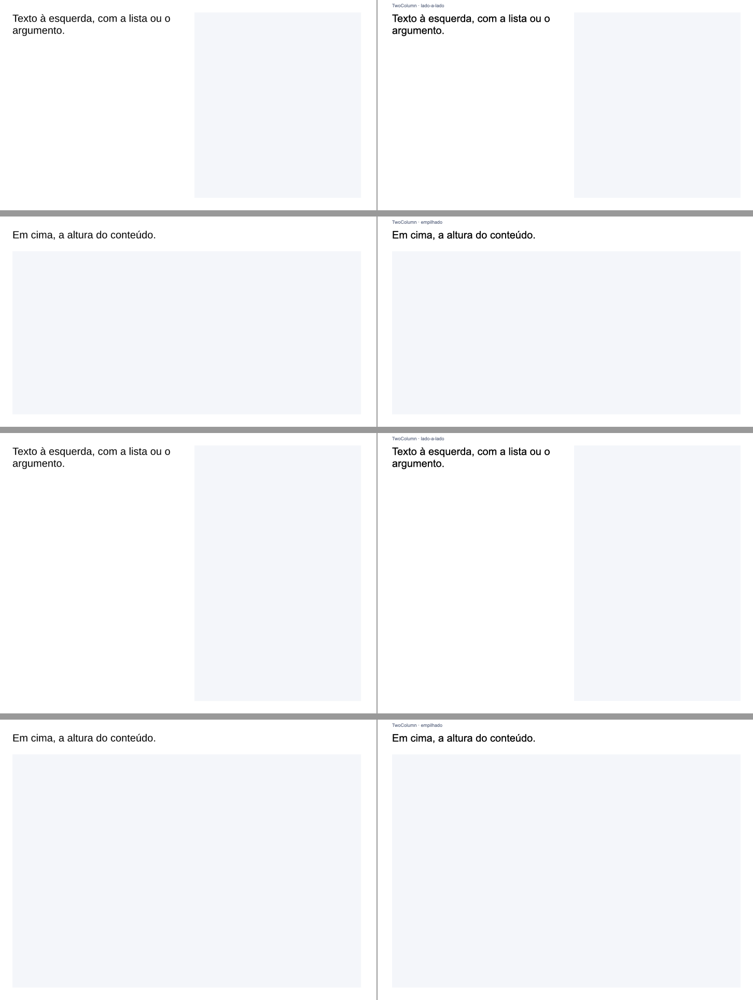

# M18-3 — catálogo do `@pptsx/ds-base` em `.pptx`, conferido no Keynote

`node packages/ds-kit/bin/pptsx-ds.mjs catalog packages/ds-base/src/ds.ts --check --pptx --out dist/catalog --fixtures packages/ds-base/fixtures` → 8 decks (4 componentes × 16x9/4x3, um slide por caso) e as 18 renderizações batendo com as fixtures. `scripts/keynote-export.sh dist/catalog <saída>` exportou os oito numa chamada.

Em cada imagem, à esquerda o PNG do catálogo (preview, `renderFragment`) e à direita o slide exportado pelo Keynote; primeiro os casos em 16:9, depois em 4:3. O rótulo pequeno no canto (`Componente · caso`) só existe no deck — é absoluto, na margem, e não move o componente.

## Bullets

## KpiCard

## KpiRow

## TwoColumn

Resultado: os quatro componentes batem caso a caso nos dois tamanhos (posição, tamanho, quebras de linha, cores). Diferença visível só a de sempre: o Keynote desenha o texto um pouco mais encorpado.
