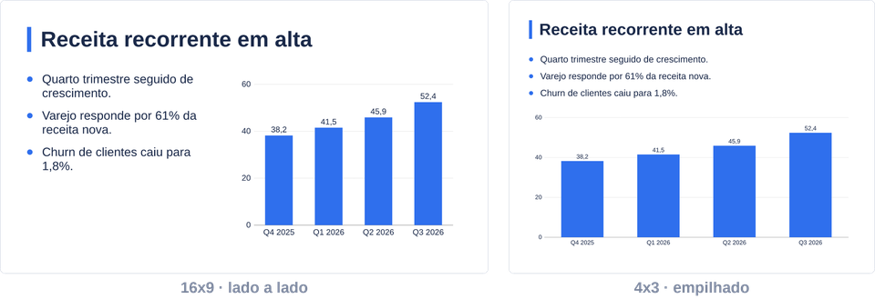
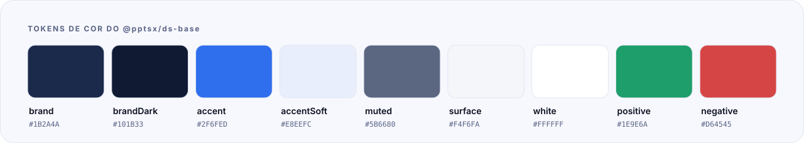
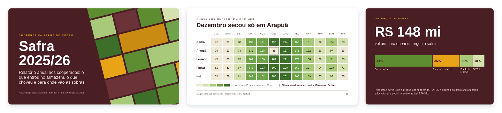
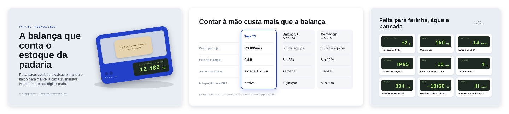
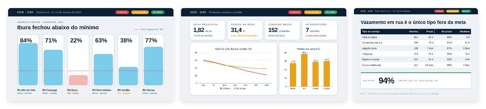
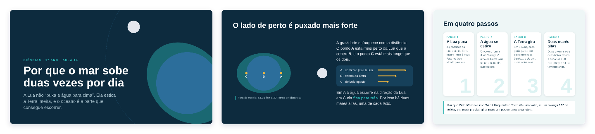

<p align="center">
  
</p>

<p align="center">
  
  
  
  
</p>

<p align="center">
  <a href="#em-uso">Em uso</a> ·
  <a href="#tokens">Tokens</a> ·
  <a href="#o-que-o-pacote-exporta">Exports</a> ·
  <a href="#regras-de-marca">Regras</a> ·
  <a href="#galeria">Galeria</a> ·
  <a href="#exemplos">Exemplos</a> ·
  <a href="#catálogo-e-schema">Catálogo</a>
</p>

<br>

Um design system de exemplo sobre o [pptsx](../pptsx/README.md), feito **só com a API pública** do núcleo e do [`@pptsx/ds-kit`](../ds-kit/README.md). Serve de referência para quem cria o próprio DS: cada decisão aqui (tokens, tema, layouts, variantes, regras, catálogo) é um padrão que dá para copiar.

## Em uso

<table>
<tr>
<td width="55%" valign="top">

```tsx
import { Deck, defineDeck } from 'pptsx';
import { ContentLayout, CoverLayout, KpiRow, tokens } from '@pptsx/ds-base';

export default defineDeck((ctx) => (
  <Deck>
    <CoverLayout ctx={ctx} title="Resultados do trimestre" subtitle="Diretoria · outubro" />
    <ContentLayout title="Indicadores">
      <KpiRow items={[{ label: 'Receita (R$ mi)', value: '52,4', delta: '+14,2%', trend: 'up' }]} />
    </ContentLayout>
  </Deck>
));
```

</td>
<td width="45%" valign="top">

<br><br>
<sub>O <code>TwoColumn</code> da <a href="examples/demo.tsx">demo</a>: lado a lado em 16:9, empilhado em 4:3, com <code>stacked={{ base: false, tall: true }}</code>.</sub>
</td>
</tr>
</table>

> [!TIP]
> Registre na config para o lint e o MCP conhecerem o DS: `defineConfig({ ds: [ds], theme })`. O guia do DS (`guide/*.md`) sai no MCP com `guide({ source: '@pptsx/ds-base' })`.

## Tokens

<p align="center">
  
</p>

| grupo | valores (pt) |
|---|---|
| `tokens.font` | `display` 44 · `h1` 32 · `h2` 24 · `body` 20 · `small` 14 · `caption` 11 |
| `tokens.space` | `page` 40 · `gap` 20 · `tight` 10 |

Tudo validado e congelado por `defineTokens`; o tema do arquivo (`theme`) é montado com `themeOf` a partir desses caminhos, então trocar uma cor no `tokens.ts` repinta componentes, layouts e o seletor de cores do PowerPoint.

## O que o pacote exporta

| exporta | tipo | o que é |
|---|---|---|
| `tokens`, `theme` | fundação | cores, escala tipográfica e espaçamentos (`defineTokens`); o tema do arquivo (`themeOf`) |
| `CoverLayout`, `ContentLayout`, `ClosingLayout` | layouts | componentes que devolvem `<Slide>`: capa, conteúdo com título e fechamento |
| `KpiCard`, `KpiRow` | componentes | um indicador (tamanhos `sm`/`md`/`lg`, tendência e sentimento) e uma linha de até 4 |
| `Bullets` | componente | lista com marcadores e escopo de shrink próprio |
| `TwoColumn` | componente | duas colunas que empilham por breakpoint |
| `rules`, `ds` | manifesto | regras de marca e o manifesto (`createDs`) para o `pptsx lint`, o MCP e a skill |

## Regras de marca

| id | regra pronta do kit | o que pega |
|---|---|---|
| `ds-base/colors-from-tokens` | `colorsFromTokens` | cor pintada fora de `tokens.color` |
| `ds-base/fonts-from-theme` | `fontsFromTheme` | `fontFamily` fora das fontes do tema |
| `ds-base/kpi-row-max-4` | `maxChildren` | `KpiRow` com mais de 4 itens |
| `ds-base/cover-only-first` | `onlyOnSlide` | `CoverLayout` fora do slide 1 |

## Galeria

Seis decks com paleta, tipografia e um elemento de assinatura próprios, só com Arial; todos saem sem `warning` em 16:9 e 4:3. Em cada montagem, o slide da direita é o 4:3.

<table>
<tr>
<td width="50%"><a href="examples/gallery/safra.tsx"></a><br><b>Safra 2025/26</b> <sub>· relatório anual de uma cooperativa</sub></td>
<td width="50%"><a href="examples/gallery/tara.tsx"></a><br><b>Tara T1</b> <sub>· pitch de hardware</sub></td>
</tr>
<tr>
<td width="50%"><a href="examples/gallery/lanterna.tsx"></a><br><b>Lanterna</b> <sub>· programa de um festival de curtas</sub></td>
<td width="50%"><a href="examples/gallery/reservatorios.tsx"></a><br><b>Reservatórios</b> <sub>· painel semanal de saneamento</sub></td>
</tr>
<tr>
<td width="50%"><a href="examples/gallery/mares.tsx"></a><br><b>Marés</b> <sub>· aula de ciências</sub></td>
<td width="50%"><a href="examples/gallery/retro.tsx"></a><br><b>Retro do Q3</b> <sub>· retrospectiva de time</sub></td>
</tr>
</table>

O que há de técnica em cada um (grid girado atrás do título, níveis em `height` percentual, `paginate` que vira dois slides só em 16:9…) está na [galeria do núcleo](../pptsx/README.md#galeria).

## Exemplos

| pasta | o que mostra |
|---|---|
| [`examples/demo.tsx`](examples/demo.tsx) | deck completo com layouts e componentes: grid de KPIs, duas colunas que empilham em 4:3, gráfico e tabela nativos, sem `if` sobre o tamanho |
| [`examples/gallery/`](examples/gallery/) | os seis decks da galeria |
| [`examples/texto/`](examples/texto/) | texto corrido paginado com notas e rodapé, e a Inter em 300/400/600/700 |
| [`examples/dados/`](examples/dados/) | os 12 tipos de gráfico e tabelas com merges, ícones e paginação |
| [`examples/diagrams/arquitetura.tsx`](examples/diagrams/arquitetura.tsx) | grupos tracejados, ícones SVG nativos e conectores em cotovelo |
| [`examples/arquivo/`](examples/arquivo/) | tema e layouts do arquivo (masters, seções, slide oculto) |

Para construir um (na raiz do monorepo):

```bash
node packages/pptsx/bin/pptsx.mjs build packages/ds-base/examples/gallery/safra.tsx --size 16x9,4x3 --out dist/gallery
```

## Catálogo e schema

- **Catálogo:** `node ../ds-kit/bin/pptsx-ds.mjs catalog src/ds.ts --out ../../dist/catalog --fixtures fixtures` grava um overview por componente; `--check` compara com `fixtures/`, que é o contrato visual (±1 pt).
- **Schema das props:** `npm run schema` regenera `src/schema.generated.ts`, que o MCP serve com `schema({ source: '@pptsx/ds-base' })`.
- **Fontes:** a Inter (OFL) fica em `fonts/inter/`.

<p align="center">
  <br>
  <br>
  <sub>Parte do <a href="../../README.md">monorepo pptsx</a> · MIT</sub>
</p>
