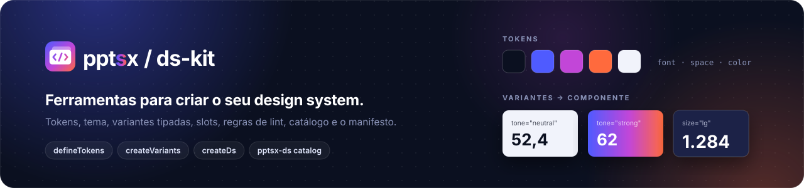
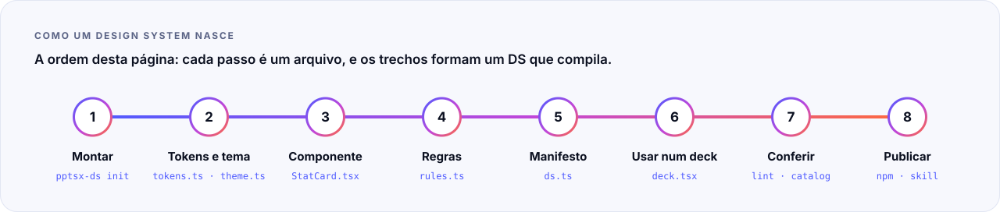

<p align="center">
  
</p>

<p align="center">
  
  
  
  
</p>

<p align="center">
  <a href="#1-montar">Montar</a> ·
  <a href="#2-tokens-e-tema">Tokens e tema</a> ·
  <a href="#3-um-componente">Componente</a> ·
  <a href="#4-regras-de-lint">Regras</a> ·
  <a href="#5-o-manifesto">Manifesto</a> ·
  <a href="#6-usar-num-deck">Deck</a> ·
  <a href="#7-conferir">Conferir</a> ·
  <a href="#8-publicar">Publicar</a> ·
  <a href="#a-api-num-relance">API</a>
</p>

<br>

Ferramentas para criar um **design system (DS)** sobre o [pptsx](../pptsx/README.md): tokens, tema, componentes com variantes tipadas e slots, regras de lint, catálogo visual e o manifesto que liga o DS ao `pptsx lint`, ao MCP e à skill para agentes. Um DS usa **só** `'pptsx'` e `'@pptsx/ds-kit'`. Exemplo completo: [`@pptsx/ds-base`](../ds-base/README.md).

<p align="center">
  
</p>

> [!NOTE]
> Esta página segue a ordem em que um DS nasce. Os trechos marcados com `// arquivo:` formam um DS que compila e roda: um teste do pacote os grava numa pasta, compila, faz o build, passa no lint e renderiza o catálogo. O que está aqui funciona.

## 1. Montar

```sh
npm install pptsx @pptsx/ds-kit
npx pptsx-ds init minha-marca      # tokens, tema, um Card, regras, guia, ds.ts, index, config, package.json, tsconfig
npx pptsx init deck --ds ./minha-marca
npx pptsx build deck/deck.tsx --size 16x9,4x3
```

O `init` cria um DS que já compila e renderiza. O `tsconfig.json` dele só **estende** `@pptsx/ds-kit/tsconfig.base.json` (NodeNext, strict, JSX do pptsx); dentro deste monorepo, estende o `tsconfig.monorepo.json`. Arquivos `.ts`/`.tsx`, imports relativos com extensão (`'./tokens.ts'`). Arquivo existente não é sobrescrito sem `--force`. Os passos abaixo explicam cada arquivo e acrescentam um componente, o `StatCard`.

## 2. Tokens e tema

```ts
// arquivo: tokens.ts
import { defineTokens } from '@pptsx/ds-kit';

export const tokens = defineTokens({
  color: { ink: '#14213D', paper: '#FFFFFF', brand: '#E63946', calm: '#457B9D', mist: '#F1FAEE' },
  font: { title: 30, body: 18, small: 13 },
  space: { page: 40, gap: 16 },
});
```

Cores (grupos `color`/`colors`) são validadas e normalizadas para `#RRGGBB`; tudo congelado. `tokens.tokenAt('font.body')` lê por caminho e `tokens.scale('font.body', 1.25)` multiplica (arredonda a 0,5 pt).

```ts
// arquivo: theme.ts
import { checkTheme, themeOf } from '@pptsx/ds-kit';
import { tokens } from './tokens.ts';

export const theme = themeOf(tokens, {
  name: 'Minha marca',
  colors: { dark1: 'color.ink', light1: 'color.paper', accent1: 'color.brand', accent2: 'color.calm', light2: 'color.mist' },
  fonts: { heading: 'Arial', body: 'Arial' },
});

export const themeWarnings = checkTheme(theme);
```

O tema é o do arquivo PPTX (o seletor de cores do PowerPoint). Slots: `dark1`, `light1`, `dark2`, `light2`, `accent1`…`accent6`, `hyperlink`, `followedHyperlink`; cada um recebe um caminho de token ou uma cor, sem repetir o mesmo hex. `checkTheme` devolve os avisos de contraste abaixo do WCAG AA: texto (`dark1`, `dark2`) sobre fundo (`light1`, `light2`) a 4,5:1 e cada acento sobre `light1` a 3:1. **Num DS escuro**, mantenha o sentido dos slots (a cor escura em `dark1`/`dark2`, a clara em `light1`/`light2`): o fundo escuro do slide vem do `backgroundColor` do Slide ou do layout, não do tema. Os avisos aparecem em `ds.warnings` e o `pptsx-ds catalog` os imprime.

## 3. Um componente

```tsx
// arquivo: components/StatCard.tsx
import { Box, Text, type Responsive } from 'pptsx';
import { createVariants, defineComponent, slot, type Slots } from '@pptsx/ds-kit';
import { tokens } from '../tokens.ts';

const { color, font, space } = tokens;

const card = createVariants({
  base: { borderRadius: 8, gap: 4 },
  variants: {
    tone: { neutral: { backgroundColor: color.mist, color: color.ink }, strong: { backgroundColor: color.brand, color: color.paper } },
    size: { md: { padding: space.gap }, lg: { padding: space.gap * 1.5 } },
  },
  defaults: { tone: 'neutral', size: 'md' },
});

// Variante de texto: `for: 'text'` checa as props contra o Text (fontSize, minSize…).
const value = createVariants({
  for: 'text',
  base: { fontWeight: 'bold' },
  variants: { size: { md: { fontSize: font.title }, lg: { fontSize: font.title * 1.4, minSize: font.title } } },
  defaults: { size: 'md' },
});

export interface StatCardProps extends Slots<'footer'> {
  readonly label: string;
  readonly value: string;
  readonly tone?: 'neutral' | 'strong';
  readonly size?: Responsive<'md' | 'lg'>;
}

export const StatCard = defineComponent(
  {
    name: 'StatCard',
    guide: '`<StatCard label value tone? size? footer? />` — um número com rótulo. `tone`: neutral | strong; `size`: md | lg (responsivo: `{ base: "md", tall: "lg" }`); `footer` é um slot.',
    catalog: [
      { name: 'neutro', props: { label: 'Receita (R$ mi)', value: '52,4' } },
      { name: 'forte-lg', props: { label: 'NPS', value: '62', tone: 'strong', size: 'lg' } },
    ],
  },
  ({ label, value: shown, tone, size, footer }: StatCardProps) => (
    <Box {...card({ tone, size })}>
      <Text fontSize={font.small}>{label}</Text>
      <Text {...value({ size })}>{shown}</Text>
      {slot(footer)}
    </Box>
  ),
);
```

- **`createVariants`**: escolha → props CSS (`base` < variantes; espalhe com `{...card({ tone, size })}` e escreva depois o que muda). As props são checadas contra a primitiva-alvo (`for`: `'box'` por padrão, `'text'`, `'image'`, `'shape'`): um nome CSS errado, um valor do tipo errado, uma opção ou um padrão inexistentes **não compilam**. Escolha responsiva vira prop responsiva. Breakpoints: `base` (sempre), `tall` (4:3; o 16:10, com proporção 1,6, não é tall), `wide` (960×540).
- **`defineComponent(meta, fn, defaults?)`**: `meta.name` vai no path dos diagnósticos (`Slide > StatCard[0] > Text`) e é o que as regras comparam. `catalog` e `defaults` são tipados pelas props do componente. `guide` (markdown) vira a seção do componente no guia do MCP e na skill.
- **Slots**: `Slots<'footer' | 'header'>` declara as áreas; `slot(valor, padrão?)` desenha; `filledSlots(props, nomes)` diz quais vieram.
- **Catálogo**: um caso que preenche o corpo (`flex={1}`) leva `fill: true`. Um layout de slide (componente que devolve `<Slide>`) fica fora do catálogo.

## 4. Regras de lint

```ts
// arquivo: rules.ts
import { colorsFromTokens, defineRule, maxChildren } from '@pptsx/ds-kit';
import { tokens } from './tokens.ts';

export const rules = [
  colorsFromTokens('minha-marca/cores', tokens),
  maxChildren('minha-marca/grade-max-4', 'StatGrid', 4),
  defineRule('minha-marca/statcard-curto', 'warning', (node, ctx) =>
    ctx.component?.name === 'StatCard' && node.kind === 'box' && node.children.length > 3 ? [{ message: 'StatCard tem rótulo, valor e um rodapé; nada mais.' }] : []),
];
```

Prontas (todas com `severity` opcional no fim, padrão `'warning'`): `colorsFromTokens(id, tokens)` (cor pintada fora de `tokens.color`; inclusive o preto padrão do texto, então dê `color` no componente ou no Slide), `fontsFromTheme(id, theme)` (`fontFamily` fora das fontes do tema; o tamanho não conta), `maxChildren(id, componente, máximo)` e `onlyOnSlide(id, componente, slide)`; ex.: `maxChildren('x/max-4', 'MetricRow', 4, 'error')`. Uma regra roda em cada slide e nó resolvido, em cada tamanho: `node` (`css`, `props`, `path`, `children`), `ctx.component` (o meta do componente que gerou o nó), `ctx.slide`, `ctx.parent`, `ctx.theme`. Ela devolve `{ message, severity?, path? }[]`. Prefixe o id com o nome do DS.

## 5. O manifesto

```ts
// arquivo: ds.ts
import { componentGuides, createDs } from '@pptsx/ds-kit';
import { StatCard } from './components/StatCard.tsx';
import { rules } from './rules.ts';
import { theme } from './theme.ts';

const components = [StatCard];

export const ds = createDs({
  name: 'minha-marca',
  version: '0.1.0',
  components,
  theme,
  rules,
  guide: [{ title: 'Visão geral', markdown: 'Números grandes com `StatCard`; cores só dos tokens.' }, ...componentGuides(components)],
});

export default ds;
```

`createDs` liga tudo: as regras entram no `pptsx lint`, o guia no `guide({ source: 'minha-marca' })` do MCP e o schema no `schema({ source })`. Sem `guide`, ele junta os `meta.guide`; sem `schema`, monta um a partir dos casos do catálogo e dos `defaults`. Para os tipos completos, gere uma vez com `schemaOf(caminho, ['StatCard'])` (API do TypeScript 5/6) e passe `schema`. `ds.warnings` traz os avisos de montagem (contraste).

## 6. Usar num deck

```ts
// arquivo: pptsx.config.ts
import { defineConfig } from 'pptsx';
import { ds } from './ds.ts';

export default defineConfig({ ds: [ds], theme: ds.theme });
```

```tsx
// arquivo: deck.tsx
import { Box, Deck, Slide, Text, defineDeck } from 'pptsx';
import { StatCard } from './components/StatCard.tsx';
import { tokens } from './tokens.ts';

const { color, font, space } = tokens;

export default defineDeck(() => (
  <Deck>
    <Slide padding={space.page} gap={space.gap} backgroundColor={color.paper} color={color.ink}>
      <Text fontSize={font.title} fontWeight="bold">Resultados</Text>
      <Box display="grid" gridTemplateColumns={{ base: 'repeat(2, minmax(0, 1fr))', tall: 'minmax(0, 1fr)' }} gap={space.gap}>
        <StatCard label="Receita (R$ mi)" value="52,4" />
        <StatCard label="NPS" value="62" tone="strong" size={{ base: 'md', tall: 'lg' }} footer={<Text fontSize={font.small}>+4 pts</Text>} />
      </Box>
    </Slide>
  </Deck>
));
```

A config vale para os decks da pasta dela e das de baixo (sem nenhuma, a do diretório de onde o comando roda). O deck exporta `export default defineDeck(…)` (`<Deck>` direto não serve). `npx pptsx init deck --ds <pacote|caminho>` gera um deck assim, com um slide por componente.

## 7. Conferir

- **Build:** `npx pptsx build deck.tsx --size 16x9,4x3` (exit 1 só com `error`).
- **Lint:** `npx pptsx lint deck.tsx` — as regras do núcleo e as do DS da config. Sai com 1 se houver `error` ou `warning` (só `info` dá 0).
- **Catálogo:** `npx pptsx-ds catalog ds.ts --out dist/catalog --fixtures fixtures --pptx` grava um PNG por caso, um overview por componente, `fixtures/<Componente>.json` e um `.pptx` por componente e tamanho (um slide por caso, para abrir no PowerPoint/Keynote). Com `--check`, compara com as fixtures (±1 pt): é o contrato visual do DS. O slide do catálogo é branco: um componente feito para fundo escuro declara o próprio `backgroundColor` (ou o caso usa `fill: true` dentro de um componente que o pinte).
- **MCP:** `pptsx-mcp --ds ./ds.ts` (ou o `ds` da config do deck): `guide({ source: 'minha-marca' })`, `schema({ source: 'minha-marca' })` e `lint({ deck })`.

## 8. Publicar

- `package.json` do DS: `peerDependencies` com `pptsx` e `@pptsx/ds-kit`, `exports` para o JS compilado (`tsc` com `rewriteRelativeImportExtensions`), como o `@pptsx/ds-base`.
- **Skill para agentes:** `npx pptsx-ds skill ds.ts --out skill/` gera a skill `pptsx-<pacote>` para Claude e Copilot (SKILL.md, `references/ds.md` com cada componente e regra, a config que registra o DS e o script que roda o pptsx).

> [!WARNING]
> **Armadilhas.** Um `meta.name` diferente do nome usado nas regras faz a regra nunca disparar. Um caso de catálogo sem `fill` mostra o componente na largura toda e na altura do conteúdo. Uma borda por lado precisa de estilo (`borderLeft="6px solid #E63946"`, não só `borderLeftWidth`); o build avisa.

## A API num relance

| export | tipo | o que faz |
|---|---|---|
| `defineTokens(spec)` | tokens | valida e congela cores (normalizadas para `#RRGGBB`), escala e espaços; `tokenAt` e `scale` |
| `themeOf(tokens, mapa)` | tema | monta o tema do arquivo PPTX a partir de caminhos de token |
| `checkTheme(theme)` | tema | avisos de contraste abaixo do WCAG AA |
| `createVariants({ base, variants, defaults, for? })` | componente | escolha → props CSS, checadas contra a primitiva-alvo; escolha responsiva vira prop responsiva |
| `defineComponent(meta, fn, defaults?)` | componente | nome no path, guia, casos de catálogo (vem do núcleo, reexportado) |
| `slot`, `filledSlots`, `Slots<…>` | componente | áreas nomeadas e o que veio preenchido |
| `defineRule(id, severity, fn)` | regras | regra própria, rodada em cada nó resolvido |
| `colorsFromTokens`, `fontsFromTheme`, `maxChildren`, `onlyOnSlide` | regras | regras prontas |
| `createDs({ name, components, theme, rules, guide?, schema? })` | manifesto | liga regras ao lint, guia e schema ao MCP; `ds.warnings` |
| `componentGuides`, `schemaOf` | manifesto | o guia a partir dos `meta.guide`; o schema completo pela API do TypeScript |

| CLI `pptsx-ds` | o que faz |
|---|---|
| `init <pasta>` | cria um DS que compila: tokens, tema, um `Card`, regras, guia, `ds.ts`, config, `package.json`, `tsconfig` |
| `catalog <ds.ts> --out <dir> [--fixtures <dir>] [--check] [--pptx]` | PNG por caso, overview por componente, fixtures (o contrato visual) e `.pptx` por componente |
| `skill <ds.ts> --out <dir>` | a skill `pptsx-<pacote>` para Claude e Copilot |

<p align="center">
  <br>
  <br>
  <sub>Parte do <a href="../../README.md">monorepo pptsx</a> · MIT</sub>
</p>
